# Arsitektur Track Noto + Pente (model C4)

Dokumen ini menjelaskan desain sistem track **noto+pente** dengan model **C4** (Context, Container, Component, Code). Cakupan adalah **apa yang ada di kode saat ini**: smart contract (`contracts/`) dan alur tingkat-skrip (`bond/`, `swap-noto/`) di atas Paladin v1.0.0. Tidak ada layanan, login, gateway, atau backend; lapisan backend/SDK dihapus pada commit `826b393`.

Semua klaim diacu ke berkas repositori (path relatif terhadap `besu/noto+pente/`). Rujukan upstream ditulis `paladin@v1.0.0:<berkas>:<baris>`; salinan verbatim-nya ada di `contracts/vendor/paladin-v1.0.0/` (`VENDOR.md`). Istilah teknis dipertahankan dalam bahasa Inggris.

---

## 1. Ringkasan

- **Apa ini.** Pasar instrumen utang digital di atas Paladin v1.0.0 dengan base ledger Besu. Kas (RD) dan instrumen (DFABI/obligasi) adalah token **Noto** (`notaryMode: hooks`); logika bisnis privat berjalan di **Pente privacy group**; settlement dua leg (DvP) dilakukan atomik oleh **`RestrictedAtom`**.
- **R1 — hanya BI, pengirim, dan penerima melihat transaksi secara utuh.** Terpenuhi untuk data: jumlah ada di state privat Noto (notary, pengirim, penerima) dan di contract privat `BondTracker`; tracker publik `BondTrackerPublic` hanya memuat status. Metadata pseudonim (alamat para pihak, `lockId`, hash) tetap terbaca di base ledger (bagian 7).
- **R2 — alur tetap berjalan saat node BI mati.** **Tidak terpenuhi, by design.** BI adalah notary token kas dan notary + custodian token obligasi; setiap transaksi Noto butuh notary. Pengguna menerima ini sebagai **pengecualian** (bagian 8.4).
- **R3 — DvP atomik.** Terpenuhi: kedua leg di-lock, didelegasikan ke satu `RestrictedAtom`, dan `execute()` menjalankan keduanya dalam satu transaksi (`contracts/src/RestrictedAtom.sol`).
- **Status.** `forge test` **101/101** (5 suite). Uji live E2E di klaster Paladin 4-node: **46 kasus (29 happy, 17 negative), 0 FAIL** (`docs/e2e-report-2026-10-17.md`). Uji BI-offline untuk noto belum dilakukan. Track ini adalah implementasi acuan tingkat-skrip, bukan sistem produksi.

---

## 2. C4 Level 1 — System Context

Siapa yang memakai sistem dan dengan sistem eksternal apa ia berhubungan.

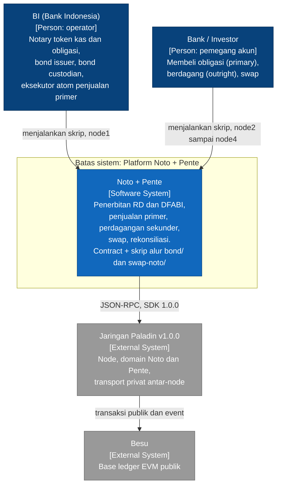

### 2.1 Aktor dan penempatan node

| Aktor | Peran | Identitas Paladin | Node |
|---|---|---|---|
| BI sebagai cash issuer / notary RD | Menerbitkan RD, notary token kas | `cashIssuer@node1` | node1 |
| BI sebagai bond issuer | Men-deploy token dan tracker obligasi, `setActive` | `bondIssuer@node1` | node1 |
| BI sebagai bond custodian / notary obligasi | Notary, `beginDistribution`, whitelist investor, eksekutor atom | `bondCustodian@node1` | node1 |
| Bank / investor (di kode: `investor1..3`) | Membeli, berdagang, swap | `investorN@nodeM` | node2 sampai node4 |

Sumber: `bond/src/index.ts` (investor `i = 1..3` pada `nodeConnections[i]`) dan `swap-noto/src/index.ts` (`investor1` di node3, `investor2` di node4, `cashIssuer` dan `assetIssuer` di node1).

### 2.2 Asumsi kepercayaan

1. **Notary dipercaya.** Notary menerima salinan cleartext state Noto (`distribution = {notary, from, to}`; bukti di `spikes/cash-leg/spike.ts` merujuk `domains/noto/internal/noto/handler_unlock_common.go`). Notary dapat menahan transaksi tetapi tidak dapat memindahkan dana milik lock yang bukan spender-nya.
2. **Satu entitas, tiga peran.** `bondCustodian` adalah notary, custodian, dan eksekutor atom penjualan primer.
3. **Investor tidak saling dipercaya.** Karena itu `cancel()`/`execute()` atom dibatasi dan hook `handleDelegateUnlock` diberi gate (bagian 5.5.1).
4. **Chain publik terbaca.** Apa pun yang dikirim sebagai transaksi publik (atom, `parties`, `lockId`, event) dianggap terbaca oleh peserta jaringan.

---

## 3. C4 Level 2 — Container

Unit yang dapat dijalankan atau di-deploy, dan hubungan antar-unit.

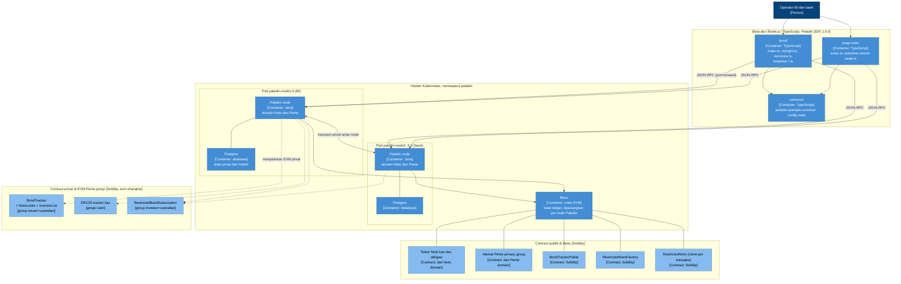

### 3.1 Rincian container

| Container | Teknologi / lokasi | Tanggung jawab |
|---|---|---|
| **Paladin node** (`paladin-node1..4-0`) | Java; pod 2 container (`paladin` + `postgres`); CR hanya mengaktifkan domain `noto` dan `pente` (`ops/resources/README.md`) | Menjalankan domain Noto dan Pente, menyimpan state privat di Postgres, mengirim state antar-node, mengirim transaksi ke Besu |
| **Postgres** (satu per node) | Container pendamping; PVC `paladin-node<N>-pgdata` | State privat, indeks blok, antrean transaksi |
| **Besu** | Node EVM, berpasangan dengan tiap node Paladin | Base ledger publik; `eth_blockNumber` dipakai pembanding sinkronisasi (`ops/resources/README.md`) |
| **Domain Noto** | Plugin di node Paladin | Token privat berbasis notary: `mint`, `lock`, `prepareUnlock`, `delegateLock`, `cancelLock`, transfer; memanggil hook di Pente bila `notaryMode: hooks` |
| **Pente privacy group** | EVM privat di node anggota; alamat publik di Besu; `evm_version = shanghai` (`contracts/foundry.toml`) | Menjalankan contract privat; efek samping publik lewat event `PenteExternalCall` |
| **Contract set** | `contracts/src/` (Solidity ^0.8.20), vendored `contracts/vendor/paladin-v1.0.0/`, OpenZeppelin 5.4.0 | Lihat Level 3 dan 4 |
| **Skrip `bond/`** | TypeScript, `@lfdecentralizedtrust/paladin-sdk` 1.0.0 | Penerbitan RD dan seri, penjualan primer, outright, rekonsiliasi, uji live |
| **Skrip `swap-noto/`** | TypeScript | Swap aset-kas lewat `RestrictedAtom`, uji live cancel |
| **`common/`** | TypeScript (`paladin-example-common`) | Konfigurasi koneksi node (`common/src/config.ts`: `nodeConnections`, timeout polling) |
| **Akses jaringan** | `scripts/port-forward-*.sh` | Port-forward HTTP 31548/31648/31748/31848 dan WS 31549/31649/31749/31849 ke empat pod |

### 3.2 Model data: RD dan DFABI (sebagaimana diimplementasikan)

| Elemen | Representasi | Lokasi kode |
|---|---|---|
| **RD** (kas) | Token Noto `notaryMode: hooks`, notary `cashIssuer@node1`, hook ke Pente group `cash` dengan tracker ERC20 (cermin saldo, tanpa whitelist) | `bond/src/index.ts`, `swap-noto/src/index.ts`, `bond/src/helpers/erc20tracker.ts` |
| **DFABI** (obligasi) | Token Noto `notaryMode: hooks`, notary `bondCustodian@node1`, hook ke `BondTracker` di group issuer+custodian | `bond/src/index.ts`, `contracts/src/BondTracker.sol` |
| Syarat instrumen publik | `issueDate`, `maturityDate`, `faceValue`, `currencyToken` pada `BondTrackerPublic` (konstruktor dan event `BondDetailsChanged`) | `contracts/src/BondTrackerPublic.sol` |
| Data privat | supply, unit belum terjual, harga (`discountPrice`), denominasi, saldo, whitelist | `BondTracker` (+ `InvestorList`) |
| Tranche | `trancheCount`, event `TrancheIssued(trancheNo)` tanpa jumlah; reopening dan burn-on-reopen | `BondTrackerPublic`, `BondTracker` |

Terhadap **ICMA Bond Data Taxonomy v1.2**, yang ada di kode saat ini hanya syarat inti di atas (tanggal terbit, jatuh tempo, nilai nominal, mata uang) sebagai data publik, sedangkan jumlah, harga, dan saldo sengaja privat. Registri metadata berprofil taksonomi yang lebih kaya (`BondSeriesRegistry`: `instrumentType`, `isin`, `seriesCode`, `termsHash`) ikut jalur backend dan **telah dihapus** pada `826b393`; riwayatnya ada di git (`826b393^`). Dokumen ini tidak menyalin teks PDF ICMA.

---

## 4. C4 Level 3 — Component

### 4.1 Komponen on-chain

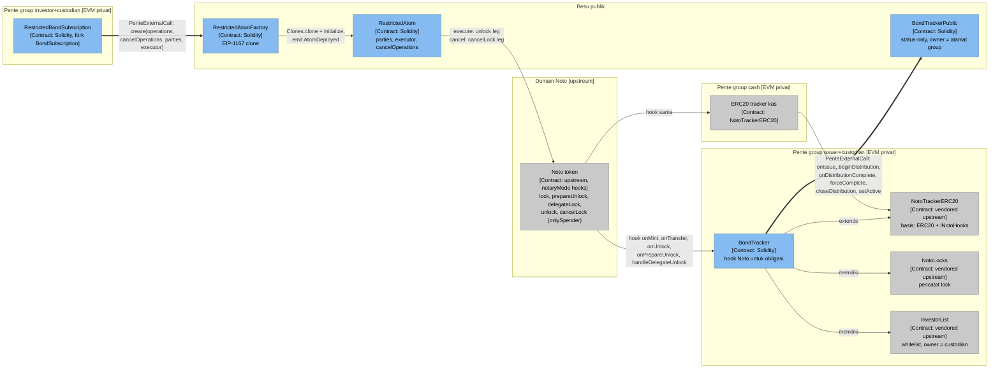

Catatan: garis tebal = `PenteExternalCall`, satu-satunya jalur dari ruang privat ke contract publik. `NotoTrackerERC20._onMint/_onTransfer/_onBurn/_onLock/_onUnlock/_onPrepareUnlock` meneruskan transaksi Noto yang sudah disiapkan lewat event yang sama (`PenteExternalCall(prepared.contractAddress, prepared.encodedCall)`, `NotoTrackerERC20.sol:46,58,69,81,96,107`), sehingga perubahan state privat dan transaksi base ledger terjadi atomik. Pengecualian: `handleDelegateUnlock` dipanggil **setelah** unlock terkonfirmasi (`paladin@v1.0.0:solidity/contracts/domains/interfaces/INotoHooks.sol:126-137`).

### 4.2 Tabel komponen

| Komponen | Berkas | Dasar | Dipanggil oleh | Memanggil / memancarkan |
|---|---|---|---|---|
| `BondTracker` | `contracts/src/BondTracker.sol` | `NotoTrackerERC20` | domain Noto (hook), custodian/issuer (siklus) | `NotoLocks`, `InvestorList`; `PenteExternalCall` ke `BondTrackerPublic` |
| `BondTrackerPublic` | `contracts/src/BondTrackerPublic.sol` | `Ownable` | hanya pemilik (alamat group) via `PenteExternalCall` | event status |
| `RestrictedAtom` | `contracts/src/RestrictedAtom.sol` | `Initializable`, `ReentrancyGuardUpgradeable` | party / executor | `unlock` dan `cancelLock` pada token Noto; `getLock` |
| `RestrictedAtomFactory` | `contracts/src/RestrictedAtomFactory.sol` | — | siapa pun (skrip atau `PenteExternalCall` subscription) | `Clones.clone`, `RestrictedAtom.initialize`, `AtomDeployed` |
| `RestrictedBondSubscription` | `contracts/src/RestrictedBondSubscription.sol` | `Ownable`, `IPenteExternalCall` | investor (`preparePayment`), custodian (`prepareBond`, `distribute`) | `PenteExternalCall` ke `RestrictedAtomFactory` |
| `NotoTrackerERC20`, `NotoLocks`, `InvestorList`, `INotoHooks`, `ILockableCapability`, `IPenteExternalCall` | `contracts/vendor/paladin-v1.0.0/` | salinan verbatim v1.0.0 | — | — |

### 4.3 Komponen skrip

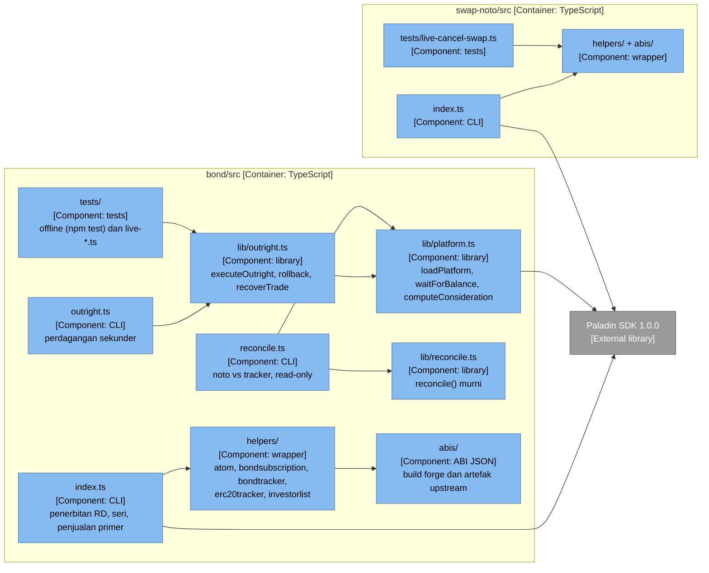

- ABI `RestrictedAtom*.json`, `RestrictedBondSubscription.json`, `BondTracker.json`, `BondTrackerPublic.json` adalah hasil build forge dari `contracts/src`; ABI lain disalin dari asset rilis v1.0.0 (`bond/src/abis/README.md`).
- `bond npm test` menjalankan tiga skrip offline: `tests/consideration.ts`, `tests/restricted-atom.ts`, `tests/reconcile.ts`.

---

## 5. C4 Level 4 — Code: katalog layanan dan logika per smart contract

Konvensi: *Gate* = siapa yang boleh memanggil. *Revert* memakai teks persis dari kode. Bagian 5.0 adalah katalog layanan bisnis dan fungsi di baliknya; bagian 5.1 dan seterusnya adalah logika rinci per contract.

### 5.0 Katalog layanan dan fungsi

Bagian ini adalah daftar layanan bisnis yang **benar-benar diimplementasikan** beserta fungsi di balik tiap layanan. Semua baris diacu ke `berkas:baris` saat ini. Berkas `NotoTrackerERC20.sol`, `NotoLocks.sol`, `InvestorList.sol`, `INotoHooks.sol`, `ILockableCapability.sol` ada di `contracts/vendor/paladin-v1.0.0/` (salinan verbatim upstream v1.0.0, nomor baris sama dengan upstream).

**Jalur pemanggilan (cara membaca kolom "Pemanggil dan jalur"):**

| Jalur | Arti |
|---|---|
| **Noto domain** | Skrip memanggil operasi Noto lewat SDK (`ptx_sendTransaction`, domain `noto`). Domain menyusun transaksi, notary mengesahkan, lalu (bila `notaryMode: hooks`) domain memanggil hook di Pente group token tersebut |
| **Pente pgroup** | Skrip memanggil contract privat di dalam privacy group (`sendTransaction` pada group) atau membaca dengan `pgroup_call` |
| **PenteExternalCall** | Contract privat memancarkan event `PenteExternalCall(address, bytes)`; domain Pente menjalankan panggilan itu ke contract publik atomik dengan transisi privat (`IPenteExternalCall.sol:16`) |
| **Public tx** | Skrip mengirim transaksi publik biasa (`TransactionType.PUBLIC`) ke contract di Besu |

**Daftar layanan.**

| # | Layanan | Status di kode | Bagian |
|---|---|---|---|
| L1 | Penerbitan RD (`mint` kas) | Ada | 5.0.1 |
| L2 | Transfer RD | Hook ada; **tidak ada alur/skrip** yang memanggilnya | 5.0.2 |
| L3 | Burn RD | Hook ada; **tidak ada alur/skrip** | 5.0.2 |
| L4 | Penerbitan seri DFABI | Ada | 5.0.3 |
| L5 | Penjualan primer (subscription) | Ada | 5.0.4 |
| L6 | Perdagangan outright / sekunder | Ada | 5.0.5 |
| L7 | Swap aset-kas | Ada | 5.0.6 |
| L8 | Lock, delegate, unlock (operasi Noto) | Ada (dipakai L5 sampai L7) | 5.0.7 |
| L9 | Cancel atom | Ada | 5.0.8 |
| L10 | Distribusi selesai, tutup, aktivasi, reopening | Tracker ada; `closeDistribution`/`setActive`/`forceComplete` **tidak dipanggil skrip** (hanya uji forge) | 5.0.9 |
| L11 | Rekonsiliasi | Ada | 5.0.10 |
| — | Kupon, pelunasan/redemption saat jatuh tempo, amandemen syarat, lelang/order book | **Tidak ada** | 5.0.11 |

#### 5.0.1 L1 — Penerbitan RD

| Contract | Fungsi | Pemanggil dan jalur | Langkah | Event | Revert |
|---|---|---|---|---|---|
| Noto token kas (upstream) | `mint(from, {to, amount, data})` (SDK `NotoInstance.mint`) | `cashIssuer` lewat **Noto domain**: `bond/src/index.ts:149-151`, `swap-noto/src/index.ts:152` | 1) Notary `cashIssuer` mengesahkan. 2) State koin baru untuk `to`, didistribusikan ke notary dan penerima. 3) Domain memanggil hook `onMint`. 4) Transaksi base ledger dikirim lewat `PenteExternalCall(prepared)` | `PenteExternalCall` (hook), event Noto di Besu | di tingkat domain Noto |
| `NotoTrackerERC20` (tracker kas) | `onMint(sender, to, amount, data, prepared)` `NotoTrackerERC20.sol:110` | Noto domain (hook) | 1) `onlyNotary(sender)`. 2) `_onMint` (:38): `_mint(to, amount)`. 3) `emit PenteExternalCall(prepared.contractAddress, prepared.encodedCall)` (:46) | `PenteExternalCall`, `Transfer` (ERC20) | `"Sender is not the notary"` (:17) |

Perubahan state: saldo ERC20 privat `to` bertambah (cermin saldo kas). Catatan: tracker kas tidak punya whitelist.

#### 5.0.2 L2 dan L3 — Transfer dan burn RD (hook ada, alur tidak ada)

| Contract | Fungsi | Pemanggil dan jalur | Langkah | Event | Revert |
|---|---|---|---|---|---|
| `NotoTrackerERC20` | `onTransfer` `:120` | Noto domain (hook) bila ada yang memanggil `transfer` | `onlySelf(sender, from)` → `_onTransfer` (:49): `_transfer(from, to, amount)` → `PenteExternalCall(prepared)` | `PenteExternalCall` | `"Sender is not the from address"` (:22) |
| `NotoTrackerERC20` | `onBurn` `:131` | Noto domain (hook) | `onlySelf` → `_onBurn` (:61): `_burn(from, amount)` → `PenteExternalCall(prepared)` | `PenteExternalCall` | idem |

Tidak ada skrip di `bond/src` atau `swap-noto/src` yang memanggil `transfer` atau `burn` (pencarian `.transfer(`/`.burn(` kosong). Perdagangan memakai `lock` → `prepareUnlock` → `delegateLock` → atom, bukan `transfer`.

#### 5.0.3 L4 — Penerbitan seri DFABI

Urutan di `bond/src/index.ts`.

| Langkah (baris) | Contract | Fungsi | Pemanggil dan jalur | Apa yang terjadi | Event | Revert |
|---|---|---|---|---|---|---|
| 1 (:157-163) | Pente domain | `newPrivacyGroup({members: [bondIssuer, bondCustodian], evmVersion: "shanghai", externalCallsEnabled: true})` | Skrip, Pente domain | Group privat dibuat; alamat publik di Besu | event Pente | — |
| 2 (:169-188) | `BondTrackerPublic` | konstruktor `(owner, issueDate_, maturityDate_, currencyToken_, faceValue_)` `BondTrackerPublic.sol:63` | Skrip, **Public tx** dari `bondIssuer`, `owner = alamat group` | 1) `maturityDate_ > issueDate_`. 2) simpan terms. 3) `_status = INITIALIZED` | `StatusChanged`, `BondDetailsChanged` | `"Maturity date must be after issue date"` |
| 3 (:192-198) | `BondTracker` | konstruktor `(name, symbol, custodian, publicTracker)` `BondTracker.sol:109` | Skrip, **Pente pgroup** (deploy dari `bondIssuer`) | `_status = INITIALIZED`, `_publicTracker`, `_issuer = msg.sender`, `_custodian`, `investorList = new InvestorList(custodian)`; basis menetapkan `_notary = msg.sender` | — | — |
| 4 (:201-216) | Noto bond | `newNoto({notary: bondCustodian, notaryMode: "hooks", hooks: {privateGroup, publicAddress, privateAddress}})` | Skrip, **Noto domain** | Token Noto obligasi; hook diarahkan ke `BondTracker` | event factory Noto | — |
| 5 (:219) | `RestrictedAtomFactory` | konstruktor (`:29`) | Skrip, **Public tx** (`helpers/atom.ts:37`) | `logic = new RestrictedAtom()` | — | — |
| 6 (:228-229) | `BondTracker` | `onMint` `BondTracker.sol:239` (dipicu `mint(bondIssuer, {to: bondCustodian, amount})`) | **Noto domain** → hook | 1) `onlyIssuer(sender)`. 2) `to == _custodian`. 3) status INITIALIZED atau ACTIVE. 4) `amount > 0`. 5) `_onMint`: mint ERC20 privat + `PenteExternalCall(prepared)`. 6) `_status = ISSUED`. 7) `PenteExternalCall(_publicTracker, onIssue(to))`. 8) `_pendingTrancheAmount = amount` | `PenteExternalCall` ×2 | `"Sender is not bond issuer"`, `"Bond must be issued to custodian"`, `"Bond must be either unissued or fully active to mint more supply"`, `"Mint amount must be greater than zero"` |
| 6b | `BondTrackerPublic` | `onIssue(to)` `:91` | **PenteExternalCall** dari group (`onlyOwner`) | status ∈ {INITIALIZED, COMPLETE, ACTIVE} → `custodian = to`, `trancheCount++`, `ISSUED` | `StatusChanged`, `CustodianChanged`, `TrancheIssued` | `OwnableUnauthorizedAccount`, `"Bond must either be unissued, fully sold out, or fully active to issue more supply"` |
| 7 (:234-235) | `BondTracker` | `beginDistribution(discountPrice, minimumDenomination)` `:122` (`helpers/bondtracker.ts:50`) | `bondCustodian`, **Pente pgroup** | 1) `onlyCustodian(msg.sender)`. 2) `_status == ISSUED`. 3) `_roundSeq++`, `DISTRIBUTION_STARTED`. 4) simpan harga dan denominasi privat. 5) `_availableUnitsPrivate = _pendingTrancheAmount`. 6) `PenteExternalCall(_publicTracker, beginDistribution())` | `PenteExternalCall` | `"Sender is not bond custodian"`, `"Bond has not been issued"` |
| 7b | `BondTrackerPublic` | `beginDistribution()` `:112` | **PenteExternalCall** | status ≠ STARTED → `DISTRIBUTION_STARTED` | `StatusChanged` | `"Previous distribution round not finished"` |
| 8 (:239-246) | `InvestorList` | `addInvestor(addr)` `InvestorList.sol:20` (`helpers/investorlist.ts:24`) | `bondCustodian`, **Pente pgroup** | `onlyOwner` (owner = custodian); `addr` belum terdaftar → simpan | `InvestorAdded` | `OwnableUnauthorizedAccount`, `"Investor already added"` |

State yang berubah: `BondTracker` (`_status`, `_pendingTrancheAmount`, `_roundSeq`, `_discountPrice`, `_minimumDenomination`, `_availableUnitsPrivate`, saldo ERC20, `investorList`), `BondTrackerPublic` (`_status`, `custodian`, `trancheCount`).

#### 5.0.4 L5 — Penjualan primer (subscription)

Urutan di `bond/src/index.ts` (loop pembelian, :250-436).

| Langkah (baris) | Contract | Fungsi | Pemanggil dan jalur | Apa yang terjadi | Event | Revert |
|---|---|---|---|---|---|---|
| 1 (:256-264) | Pente domain | `newPrivacyGroup({members: [investor, bondCustodian], externalCallsEnabled})` | investor, Pente domain | Group per investor | event Pente | — |
| 2 (:267-273) | `RestrictedBondSubscription` | konstruktor `(bondAddress_, units_, custodian_, atomFactory_)` `:49` | investor, **Pente pgroup** (deploy) | `Ownable(_msgSender())` → owner = investor; simpan field | — | — |
| 3 (:276-299) | Noto kas | `lock` lalu `prepareUnlock(lockId → custodian)` | investor, **Noto domain** | Hook `onLock` (tracker kas), `onPrepareUnlock`; receipt memuat `lockId`, `unlockCall`, `cancelCall` | event Noto | — |
| 4 (:309-337) | Noto bond / `BondTracker` | `lock` lalu `prepareUnlock(lockId → investor)`; hook `onPrepareUnlock` `BondTracker.sol:387` | `bondCustodian`, **Noto domain** → hook | 1) `onlyLockOwner`. 2) `_checkTransfers` (penerima harus terdaftar). 3) bila `STARTED && lockFrom == custodian`: `_checkSaleAllowed(quantity)` dan cap `_lockRound[lockId] = _roundSeq`. 4) `_onPrepareUnlock` | `PenteExternalCall` | `"Sender is not the lock owner"`, `"Investor is not registered"`, `"Sale would exceed this round's available units"`, `"Sale amount is not a valid denomination multiple"` |
| 5 (:340-349) | `RestrictedBondSubscription` | `preparePayment(to, encodedCall, lockId, cancelCall)` `:61` | investor, **Pente pgroup** | `onlyOwner`; simpan leg pembayaran | — | `OwnableUnauthorizedAccount` |
| 6 (:352-361) | `RestrictedBondSubscription` | `prepareBond(to, encodedCall, lockId, cancelCall)` `:73` | `bondCustodian`, **Pente pgroup** | `onlyCustodian`; simpan leg obligasi | — | `"Sender is not custodian"` |
| 7 (:364-368) | `RestrictedBondSubscription` | `distribute()` `:85` | `bondCustodian`, **Pente pgroup** | 1) `onlyCustodian`. 2) empat `require` (leg terisi dan cancel tercatat). 3) bangun `operations = [bond, payment]`, `cancelOperations = [bond, payment]`, `parties = [owner(), custodian]`. 4) `emit PenteExternalCall(atomFactory, create(...custodian))` | `PenteExternalCall` | `"Bond transfer has not been prepared"`, `"Payment transfer has not been prepared"`, `"Bond cancel call has not been prepared"`, `"Payment cancel call has not been prepared"` |
| 7b | `RestrictedAtomFactory` | `create(operations, cancelOperations, parties, executor)` `:33` | **PenteExternalCall** dari group | `Clones.clone(logic)` → `initialize` → emit | `AtomDeployed(addr)`, `AtomStatusChanged(Pending)` | — |
| 7c | `RestrictedAtom` | `initialize(...)` `:119` | factory | salin array, `executor`, `status = Pending` | `AtomStatusChanged(Pending)` | `InvalidInitialization` bila diulang |
| 8 (:384-395) | Noto cash dan bond | `delegateLock(lockId, delegate = atom)` | investor (kas), `bondCustodian` (bond), **Noto domain** | Spender lock menjadi atom; hook `onDelegateLock` (`NotoTrackerERC20.sol:230`) hanya meneruskan `PenteExternalCall(prepared)` | `PenteExternalCall` | — |
| 9 (:397-407) | `RestrictedAtom` | `execute()` `:150` | `bondCustodian`, **Public tx** | lihat 5.1 | `AtomStatusChanged(Executed)` | `AtomNotPending`, `NotExecutor`, `OperationReturnedFalse` |
| 10 | `BondTracker` | `handleDelegateUnlock` `:500` | Noto domain (hook, sesudah konfirmasi) | cabang cocok: `_transfer`, `_recordSale` (5.5.1) | `StaleLockSettled` bila lock basi | `"Caller is not the deployer or the custodian"` |
| 10b | `BondTrackerPublic` | `onDistributionComplete()` `:124` | **PenteExternalCall** saat unit habis | `STARTED → DISTRIBUTION_COMPLETE` | `StatusChanged` | `"No distribution round in progress"` |

State yang berubah: lock Noto (spender atom → terpakai), saldo bond dan kas, `BondTracker._availableUnitsPrivate`, status atom, status publik (bila sold-out).

#### 5.0.5 L6 — Perdagangan outright (sekunder)

Urutan di `bond/src/lib/outright.ts`.

| Langkah (baris) | Contract | Fungsi | Pemanggil dan jalur | Apa yang terjadi | Event | Revert |
|---|---|---|---|---|---|---|
| 0 (:99-160) | `InvestorList` | `isRegistered(addr)` `InvestorList.sol:41` | skrip, **Pente pgroup** (`pgroup_call`) | Skrip menolak awal bila pembeli tidak terdaftar, saldo kurang, atau `tradeId` sudah ada | — | `TradeRejected` (skrip) |
| 1 (:171-190) | Noto bond | `lock`, `prepareUnlock(→ pembeli)` | penjual, **Noto domain** → hook `BondTracker.onPrepareUnlock` (:387) | sama dengan 5.0.4 langkah 4 (`lockFrom` = penjual, bukan custodian, jadi tanpa cek kuota/cap round) | `PenteExternalCall` | `"Investor is not registered"` |
| 2 | Noto kas | `lock`, `prepareUnlock(→ penjual)` | pembeli, **Noto domain** | hook tracker kas | — | — |
| 3 (:214-222) | `RestrictedAtomFactory` | `create(ops, cancelOps, [penjual, pembeli], custodian)` `:33` | `bondCustodian`, **Public tx** (`helpers/atom.ts:67`) | atom `Pending` | `AtomDeployed` | — |
| 4 (:195) | Noto | `delegateLock(→ atom)` ×2 | penjual dan pembeli, **Noto domain** | spender menjadi atom | — | — |
| 5 (:236-238) | `RestrictedAtom` | `execute()` `:150` | `bondCustodian`, **Public tx** | dua `unlock` atomik | `AtomStatusChanged(Executed)` | `NotExecutor`, `AtomNotPending`, ... |
| 6 | `BondTracker` | `handleDelegateUnlock` `:500` | hook | `_transfer(penjual → pembeli)`; bukan lock custodian jadi tanpa hitungan penjualan | — | — |
| rollback (:296-340) | `RestrictedAtom` | `create` + `execute` sebagai "cancel atom" | `bondCustodian` | melepas lock yang belum didelegasikan ke atom perdagangan; **ditolak** bila sudah didelegasikan (lalu pakai `cancel()` atom, 5.0.8) | — | — |

#### 5.0.6 L7 — Swap aset-kas

Urutan di `swap-noto/src/index.ts`. Dua token Noto (aset dan kas) dengan tracker ERC20 sendiri (`NotoTrackerERC20`).

| Langkah (baris) | Contract | Fungsi | Pemanggil dan jalur | Apa yang terjadi | Event | Revert |
|---|---|---|---|---|---|---|
| 1 (:66) | `RestrictedAtomFactory` | deploy | `cashIssuer`, Public tx | — | — | — |
| 2 (:146-155) | Noto aset dan kas | `mint` | `assetIssuer`, `cashIssuer`, Noto domain | hook `NotoTrackerERC20.onMint` (`:110`) | `PenteExternalCall` | `"Sender is not the notary"` |
| 3 (:159-233) | Noto aset dan kas | `lock` + `prepareUnlock` | investor1 (aset), investor2 (kas), Noto domain | hook `onLock` (`:141`), `onPrepareUnlock` (`:184`) | — | — |
| 4 (:238-250) | `RestrictedAtomFactory` | `create(ops, cancelOps, [investor1, investor2], investor2)` | `cashIssuer`, Public tx | atom `Pending`; **executor = investor2** | `AtomDeployed` | — |
| 5 (:256-266) | Noto | `delegateLock(→ atom)` ×2 | investor1, investor2, Noto domain | — | — | — |
| 6 (:272) | `RestrictedAtom` | `execute()` | investor2, Public tx | dua `unlock` atomik | `AtomStatusChanged(Executed)` | `NotExecutor` untuk selain investor2 |

#### 5.0.7 L8 — Operasi lock, delegate, unlock (Noto) dan hook yang dipanggil

Operasi di sisi SDK (`NotoInstance`) dan hook yang diimplementasikan. Kolom "implementasi" menunjuk hook yang berlaku untuk tracker kas (`NotoTrackerERC20`) dan obligasi (`BondTracker`).

| Operasi Noto (SDK) | Hook (`INotoHooks`) | Implementasi kas | Implementasi `BondTracker` | Dipanggil skrip? |
|---|---|---|---|---|
| `mint` | `onMint` `:25` | `NotoTrackerERC20.sol:110` (`onlyNotary`) | `BondTracker.sol:239` (`onlyIssuer`, custodian-only, status, `amount>0`, ext `onIssue`) | Ya (L1, L4) |
| `transfer` | `onTransfer` `:33` | `:120` (`onlySelf`) | `:312` (`onlySelf`, whitelist, hitung penjualan) | Tidak |
| `burn` | `onBurn` `:42` | `:131` (`onlySelf`) | `:287` (`onlySelf`, `amount <= unsold` saat round) | Tidak |
| `lock` | `onLock` `:50` | `:141` (`onlySelf`) → `_locks.onLock` | diwarisi (`NotoTrackerERC20.sol:141`) | Ya (L5 sampai L7) |
| `prepareUnlock` | `onPrepareUnlock` `:111` | `:184` (`onlyLockOwner`) → `_locks.onPrepareUnlock` | `:387` (`onlyLockOwner`, whitelist, kuota, cap round) | Ya |
| `delegateLock` | `onDelegateLock` `:119` | `:230` (tanpa gate, hanya `PenteExternalCall`) | diwarisi | Ya |
| `unlock` (oleh pemilik, tanpa delegasi) | `onUnlock` `:76` | `:174` (`onlyLockOwner`) | `:335` (`onlyLockOwner`, whitelist, hitung penjualan/`StaleLockSettled`) | Tidak (alur memakai atom) |
| unlock oleh delegate (atom) | `handleDelegateUnlock` `:132` (dipanggil **sesudah** konfirmasi) | `:239` (tanpa gate, `_locks.handleDelegateUnlock` + `_transfer`) | `:500` (gate D21 + bentuk cancel; 5.5.1) | Tidak langsung; dipicu `atom.execute` |
| `cancelLock` (oleh spender) | tidak ada pre-hook; hasil diterima via `handleDelegateUnlock` bentuk cancel | — | `:500` cabang cancel | Tidak langsung; dipicu `atom.cancel` |
| `createTransferLock` | `onCreateTransferLock` `:84` | `:194` (`onlySelf`) | `:422` (`onlySelf`, whitelist, kuota) | Tidak |
| `createMintLock` / `prepareMintUnlock` | `onCreateMintLock` `:94`, `onPrepareMintUnlock` `:59` | `:207`, `:152` (`onlyNotary`) | `:460`, `:473` (`onlyNotary`, penerima harus custodian) | Tidak (tercatat di `BACKLOG.md`) |
| `prepareBurnUnlock`, `createBurnLock` | `onPrepareBurnUnlock` `:67`, `onCreateBurnLock` `:102` | `:162`, `:217` (`onlySelf`) | diwarisi | Tidak |

Modul bantu di `NotoLocks.sol`: `onLock:33` (catat `from`, `amount`, tambah `lockedBalance`), `onPrepareUnlock:56` (catat penerima, tambah `pendingBalance`), `onUnlock:40` (kurangi `amount` dan `lockedBalance`, hapus lock bila habis), `handleDelegateUnlock:69` (kurangi `pendingBalance` penerima yang diprepare lalu `onUnlock`), `ownerOf:29`, `getLock:25`.

#### 5.0.8 L9 — Cancel atom

| Contract | Fungsi | Pemanggil dan jalur | Langkah | Event | Revert |
|---|---|---|---|---|---|
| `RestrictedAtom` | `cancel()` `:219` | party atau executor, **Public tx** (`helpers/atom.ts:112`; uji `live-cancel-*.ts`) | 1) `nonReentrant`. 2) `status == Pending`. 3) `msg.sender == executor` atau party. 4) `status = Cancelled`, emit. 5) untuk tiap `cancelOperation`: `_attemptRelease(i)` | `AtomStatusChanged(Cancelled)`, `LegReleased`/`LegReleaseFailed` per leg | `AtomNotPending`, `NotAParty(msg.sender)` |
| `RestrictedAtom` | `_attemptRelease(index)` `:250` | internal | 1) `try getLock(lockId)`; lewati bila revert atau spender ≠ atom. 2) `call(callData)` (`cancelLock`). 3) nilai sukses efektif → event | `LegReleased`, `LegReleaseFailed` | tidak pernah revert karena leg |
| Noto token (upstream) | `cancelLock(lockId, cancelArgs, data)` (`ILockableCapability.sol:276`; `Noto.sol:633-646`) | atom (spender), dipanggil dari `_attemptRelease` | modifier `lockActive` dan `onlySpender`; mengembalikan koin ke pemilik lock | `LockCancelled`, `NotoLockCancelled` | revert bila bukan spender atau lock tidak aktif |
| `BondTracker` | `handleDelegateUnlock` `:500` | Noto domain (hook, sesudah konfirmasi) | cabang bentuk cancel (5.5.1): lepas lock tanpa `_transfer` dan tanpa hitungan penjualan | — | `"Recipients do not match the prepared unlock"` |
| `RestrictedAtom` | `retryRelease(index)` `:240` | party atau executor | hanya saat `Cancelled`; ulangi `_attemptRelease(index)` | `LegReleased`/`LegReleaseFailed` | `AtomNotPending`, `NotAParty` |
| `RestrictedAtom` | `simulate()` `:187` | party atau executor | jalankan semua operasi lalu selalu revert `ExecutionResult(results)` (untuk eth_call/estimasi) | — | `ExecutionResult`, `AtomNotPending`, `NotAParty` |

Siapa boleh memanggil (menurut kode): hanya alamat di `_parties` atau `executor` (`RestrictedAtom.sol:138` `_isParty`). Pada penjualan primer `parties = [investor, custodian]`; pada outright `[penjual, pembeli]` dengan executor custodian; pada swap `[investor1, investor2]` dengan executor investor2.

#### 5.0.9 L10 — Distribusi selesai, tutup, aktivasi, reopening

| Contract | Fungsi | Pemanggil dan jalur | Langkah | Event | Revert |
|---|---|---|---|---|---|
| `BondTracker` | `_recordSale(total)` `:75` | internal (hook `onTransfer`, `onUnlock`, `handleDelegateUnlock`) | `_availableUnitsPrivate -= total`; bila `total > 0` dan hasil 0 → `PenteExternalCall(_publicTracker, onDistributionComplete())` sekali | `PenteExternalCall` | underflow Solidity 0.8 |
| `BondTrackerPublic` | `onDistributionComplete()` `:124` | **PenteExternalCall** | `STARTED → DISTRIBUTION_COMPLETE` | `StatusChanged` | `"No distribution round in progress"` |
| `BondTracker` | `forceCompleteDistribution()` `:148` | `bondCustodian`, Pente pgroup (**tidak ada skrip**) | `STARTED` → privat `DISTRIBUTION_CLOSED`; ext `forceCompleteDistribution()` | `PenteExternalCall` | `"No distribution round in progress"` |
| `BondTrackerPublic` | `forceCompleteDistribution()` `:136` | PenteExternalCall | `STARTED → COMPLETE` | `StatusChanged` | `"No distribution round in progress"` |
| `BondTracker` | `closeDistribution()` `:166` | `bondCustodian` (**tidak ada skrip**) | privat `DISTRIBUTION_CLOSED`; ext `closeDistribution()` | `PenteExternalCall` | `"Sender is not bond custodian"` |
| `BondTrackerPublic` | `closeDistribution()` `:145` | PenteExternalCall | `COMPLETE → CLOSED` | `StatusChanged` | `"Distribution is not complete"` |
| `BondTracker` | `setActive()` `:174` | `bondIssuer` (**tidak ada skrip**) | `CLOSED → ACTIVE`; ext `setActive()` | `PenteExternalCall` | `"Sender is not bond issuer"`, `"Bond is not ready to be activated"` |
| `BondTrackerPublic` | `setActive()` `:154` | PenteExternalCall | `CLOSED → ACTIVE` | `StatusChanged` | `"Bond is not ready to be activated"` |
| `BondTracker` + publik | reopening | `onMint` (:239) saat status `ACTIVE` | mint tranche berikut → `ISSUED`; ext `onIssue` (`BondTrackerPublic.sol:91`, status ACTIVE/COMPLETE) lalu `beginDistribution` lagi | `TrancheIssued` | lihat 5.0.3 |

Semua fungsi pada tabel ini diuji di forge (`BondTracker.t.sol`, `BondTrackerPair.t.sol`) tetapi tidak dipanggil oleh skrip `bond/src` atau `swap-noto/src`; satu-satunya yang dipicu alur nyata adalah `onDistributionComplete` (saat sold-out).

#### 5.0.10 L11 — Rekonsiliasi

| Komponen | Fungsi | Pemanggil dan jalur | Langkah | Hasil |
|---|---|---|---|---|
| `bond/src/reconcile.ts` | `main` | operator, SDK (read-only) | 1) `loadPlatform` (`lib/platform.ts`). 2) untuk custodian dan tiap investor: Noto `balanceOf` (SDK) dan `BondTracker.balanceOf` serta `lockedBalanceOf` lewat **Pente pgroup** `call`. 3) `reconcile(rows)` | `OK` / `MISMATCH` / `UNVERIFIABLE`; exit 1 bila ada selisih |
| `bond/src/lib/reconcile.ts` | `reconcile(rows)` | internal | `expectedNoto = tracker − (locked ?? 0)`, `delta = noto − expectedNoto`; `UNVERIFIABLE` bila `locked` tak ada dan `delta < 0` | `Finding[]` |
| `BondTracker` | `lockedBalanceOf(account)` `:69` | `pgroup_call` | `return _locks.lockedBalance(account)` | view |

Tidak mengirim transaksi.

#### 5.0.11 Yang tidak ada

| Kemampuan | Kondisi di kode |
|---|---|
| Kupon (pembayaran bunga) | **Tidak ada** (tidak ada fungsi atau skrip; `grep` coupon/kupon kosong) |
| Pelunasan / redemption saat jatuh tempo | **Tidak ada** alur. Hook `onBurn` (`BondTracker.sol:287`) ada dan komentar menyebut burn saat jatuh tempo, tetapi tidak ada skrip dan tidak ada logika jatuh tempo; `maturityDate` hanya data publik |
| Transfer dan burn RD sebagai alur | Hook ada (5.0.2), tidak ada skrip |
| Amandemen syarat instrumen | **Tidak ada** (syarat tetap sejak konstruktor `BondTrackerPublic`) |
| Pencabutan whitelist sebagai alur | Fungsi `InvestorList.removeInvestor` (`:33`) ada, tidak ada skrip |
| `createTransferLock`, `createMintLock`, burn-lock | Hook ada, tidak dipakai alur mana pun (`BACKLOG.md`) |
| Lelang / order book / fee | **Tidak ada** |
| Penutupan dan aktivasi seri lewat skrip | Fungsi ada di contract, tidak ada skrip (5.0.9) |

### 5.1 `RestrictedAtom` (`contracts/src/RestrictedAtom.sol`)

**Tujuan.** Menjalankan serangkaian panggilan (biasanya `unlock` pada dua token Noto) secara atomik, dengan akses terbatas, dan melepas lock leg yang sudah didelegasikan bila dibatalkan. Fork `Atom.sol` upstream (`paladin@v1.0.0:solidity/contracts/shared/Atom.sol`), yang `cancel()` dan `execute()`-nya tidak punya kontrol akses.

**Pewarisan.** `Initializable`, `ReentrancyGuardUpgradeable`; `using Address for address`. Dipakai sebagai logic contract yang di-clone (konstruktor memanggil `_disableInitializers()`).

**Tipe.** `enum Status { Pending, Executed, Cancelled }`; `Operation { contractAddress, callData }`; `CancelOperation { contractAddress, lockId, callData }`; `OperationResult { success, returnData }`.

**State.**

| Variabel | Visibilitas | Isi |
|---|---|---|
| `status` | public | `Pending` / `Executed` / `Cancelled` |
| `executor` | public | satu-satunya alamat yang boleh `execute()` (custodian, atau investor2 pada swap) |
| `_parties` | private | alamat yang boleh `cancel()`/`simulate()` (pemilik leg) |
| `_operations` | private | panggilan `unlock` tiap leg, urutan = urutan eksekusi |
| `_cancelOperations` | private | per leg: kontrak token, `lockId`, panggilan `cancelLock` |

**Event dan error.** `AtomStatusChanged(Status)`, `LegReleased(index, contractAddress, lockId)`, `LegReleaseFailed(index, contractAddress, lockId, reason)`; error `AtomNotPending()`, `NotAParty(caller)`, `NotExecutor(caller)`, `OperationReturnedFalse(index)`, `ExecutionResult(OperationResult[])`.

**Fungsi eksternal.**

| Fungsi | Gate | Prasyarat | Perubahan state | Event | Revert |
|---|---|---|---|---|---|
| `initialize(operations, cancelOperations, parties, executor_)` | `initializer` (sekali; dipanggil factory dalam transaksi yang sama dengan clone) | belum diinisialisasi | salin array, `executor`, `status = Pending` | `AtomStatusChanged(Pending)` | `InvalidInitialization` bila diulang |
| `execute()` | `nonReentrant`; `msg.sender == executor` | `status == Pending` | `status = Executed` **sebelum** panggilan; tiap op: `functionCall`; bila return 32 byte bernilai 0 → revert | `AtomStatusChanged(Executed)` di akhir | `AtomNotPending`, `NotExecutor`, error bawaan target (bubble), `AddressEmptyCode` (target tanpa kode), `OperationReturnedFalse(i)` |
| `simulate()` | `nonReentrant`; executor atau party | `Pending` | tidak ada (selalu revert di akhir) | — | selalu `ExecutionResult(results)`; `AtomNotPending`, `NotAParty` |
| `cancel()` | `nonReentrant`; executor atau party | `Pending` | `status = Cancelled`, lalu `_attemptRelease(i)` untuk tiap `cancelOperation` | `AtomStatusChanged(Cancelled)`, per leg `LegReleased` atau `LegReleaseFailed` | `AtomNotPending`, `NotAParty(msg.sender)` |
| `retryRelease(index)` | `nonReentrant`; executor atau party | `status == Cancelled` | `_attemptRelease(index)` | `LegReleased` / `LegReleaseFailed` | `AtomNotPending` (bila belum Cancelled), `NotAParty` |
| `getOperationCount`, `getOperation(n)`, `getOperations`, `getCancelOperations`, `getParties` | view | — | — | — | — |

**`_attemptRelease(index)`** (internal; kegagalan leg tidak pernah me-revert pemanggil):

1. `try getLock(lockId)` pada token (`ILockableCapability.getLock`): bila revert (lock tidak aktif) atau `info.spender != address(this)` → **lewati diam-diam** (tanpa event).
2. Selain itu panggil `op.callData` (`cancelLock`) dengan low-level `call`.
3. `effectiveSuccess = ok && target.code.length > 0 && (ret.length != 32 || uint256(bytes32(ret)) != 0)`. Sukses → `LegReleased`, gagal → `LegReleaseFailed(index, contract, lockId, ret)`.

Pembacaan nilai kembali memakai `uint256(bytes32(ret)) != 0`, bukan `abi.decode(bool)`, karena yang terakhir revert pada word selain 0/1 dan dapat menggagalkan seluruh `cancel()`.

**Invarian.**

1. `status` hanya bergerak `Pending → Executed` atau `Pending → Cancelled`; `retryRelease` hanya valid saat `Cancelled`.
2. `Executed` hanya dicapai oleh `executor`, dan hanya bila **semua** operasi sukses dalam satu transaksi (revert membatalkan status juga).
3. `operations`, `cancelOperations`, `parties`, `executor` tidak punya setter; tetap sejak `initialize`.
4. `cancel()` hanya dapat mengembalikan dana lewat `cancelCall` yang didaftarkan saat pembuatan (Noto `cancelLock` mengembalikan ke pemilik lock) dan hanya untuk lock yang spender-nya atom ini.
5. Kegagalan satu leg tidak menghalangi leg lain dan tidak membatalkan status `Cancelled`.

**Catatan jujur.** `initialize` tidak memvalidasi isi array: `executor == address(0)` membuat atom tidak dapat dieksekusi, dan `parties` kosong membatasi `cancel` ke executor. Skrip dan `RestrictedBondSubscription` selalu mengisi 2 operasi, 2 cancelOperation, 2 party.

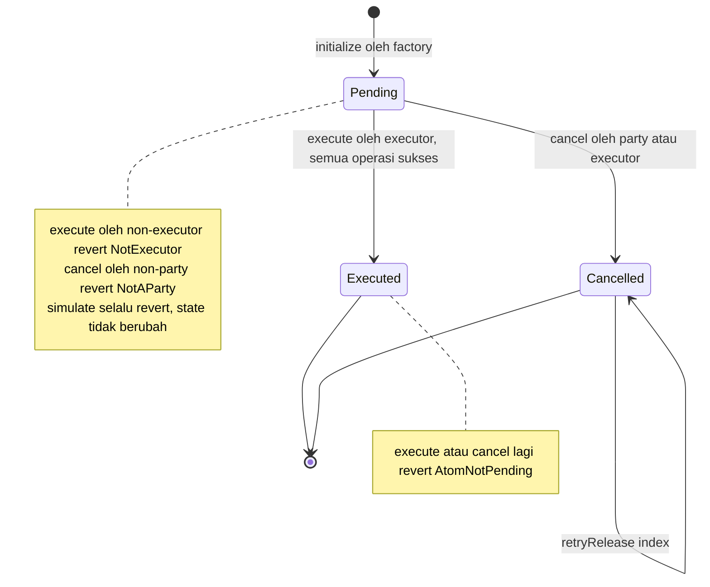

### 5.2 `RestrictedAtomFactory` (`contracts/src/RestrictedAtomFactory.sol`)

**Tujuan.** Membuat atom murah lewat EIP-1167 minimal proxy. **Pewarisan:** tidak ada. **State:** `address public immutable logic` (dibuat di konstruktor: `new RestrictedAtom()`). **Event:** `AtomDeployed(address addr)` (signature identik dengan upstream sehingga pendengar event lama tetap bekerja).

| Fungsi | Gate | Efek |
|---|---|---|
| `create(operations, cancelOperations, parties, executor)` | tanpa gate | `Clones.clone(logic)` → `RestrictedAtom(instance).initialize(...)` → `emit AtomDeployed(instance)` → mengembalikan alamat |

Invarian: atom yang dibuat siapa pun tidak punya kuasa apa pun sampai ada lock yang didelegasikan kepadanya oleh pemilik lock; karena itu `create` sengaja tanpa gate. `cancelOperations` tidak harus sama panjang dengan `operations`.

### 5.3 `RestrictedBondSubscription` (`contracts/src/RestrictedBondSubscription.sol`)

**Tujuan.** Contract privat di group investor+custodian yang mengumpulkan dua leg penjualan primer lalu memicu pembuatan `RestrictedAtom`. Fork `BondSubscription@v1.0.0` dengan 4 perubahan (tercantum di header berkas): impor `Restricted*`; `preparePayment`/`prepareBond` menerima `lockId` dan `cancelCall`; `distribute()` mewajibkan catatan cancel dan memanggil `RestrictedAtomFactory.create` dengan `parties` dan `executor`; path impor `IPenteExternalCall`.

**Pewarisan.** `Ownable`, `IPenteExternalCall`. **State:** `bondAddress`, `custodian`, `requestedUnits`, `atomFactory` (public); `distributeBondAddress/Call/LockId/CancelCall` dan `distributePaymentAddress/Call/LockId/CancelCall` (internal).

| Fungsi | Gate | Prasyarat | Efek | Revert |
|---|---|---|---|---|
| konstruktor `(bondAddress_, units_, custodian_, atomFactory_)` | — | — | `Ownable(_msgSender())` → **owner = deployer = investor**; set field | — |
| `preparePayment(to, encodedCall, lockId, cancelCall)` | `onlyOwner` (investor) | — | simpan leg pembayaran | `OwnableUnauthorizedAccount` |
| `prepareBond(to, encodedCall, lockId, cancelCall)` | `onlyCustodian` (`_msgSender() == custodian`) | — | simpan leg obligasi | `"Sender is not custodian"` |
| `distribute()` | `onlyCustodian` | kedua `encodedCall` terisi; kedua `cancelCall` terisi dan `lockId != 0` | menyusun `operations = [bond, payment]`, `cancelOperations = [bond, payment]`, `parties = [owner(), custodian]`; `emit PenteExternalCall(atomFactory, abi.encodeCall(create, (ops, cancelOps, parties, custodian)))` | `"Bond transfer has not been prepared"`, `"Payment transfer has not been prepared"`, `"Bond cancel call has not been prepared"`, `"Payment cancel call has not been prepared"` |

**Invarian.** Urutan operasi selalu bond lalu payment; `executor` selalu custodian; `parties` selalu persis `[investor, custodian]`. Tes: `RestrictedBondSubscription.t.sol` (`testAtomIsRestrictedToInvestorCustodianAndExecutor`, `testNonPartyCancelRevertsAndLegsStayLocked`, `testInvestorCancelReleasesBothDelegatedLegs`, `testCustodianCancelWorks`, `testOnlyCustodianExecutesAndInvestorCannot`, `testDistributeRequiresCancelRecordsForBothLegs`, `testUpstreamGatesAreKept`).

**Catatan jujur.** `bondAddress` dan `requestedUnits` disimpan tetapi tidak dipakai oleh `distribute()`; batas jumlah ditegakkan oleh `BondTracker` saat `prepareUnlock`, bukan di sini. `distribute()` tidak punya guard satu-kali, dan tiap pemanggilan memancarkan `create` baru.

### 5.4 `BondTrackerPublic` (`contracts/src/BondTrackerPublic.sol`)

**Tujuan.** Setengah publik dari seri: hanya **status siklus** dan syarat instrumen; tanpa jumlah, harga, atau supply. Turunan `BondTrackerPublic@v1.0.0` upstream yang sengaja menyimpang (komentar kepala berkas).

**Pewarisan.** `Ownable` (owner = alamat Pente group, sehingga hanya panggilan dari dalam group via `PenteExternalCall` yang lolos `onlyOwner`).

**State.** public: `custodian`, `currencyToken`, `trancheCount`; internal: `_status`, `_issueDate`, `_maturityDate`, `_faceValue` (syarat instrumen dipublikasikan lewat event `BondDetailsChanged`, bukan getter). **Event:** `StatusChanged(Status)`, `CustodianChanged(address indexed)`, `BondDetailsChanged(issueDate, maturityDate, faceValue, currencyToken)`, `TrancheIssued(trancheNo)`.

| Fungsi | Gate | Prasyarat (`require`) | Efek |
|---|---|---|---|
| konstruktor | — | `"Maturity date must be after issue date"` | `INITIALIZED`; emit `StatusChanged`, `BondDetailsChanged` |
| `onIssue(to)` | `onlyOwner` | status ∈ {INITIALIZED, DISTRIBUTION_COMPLETE, ACTIVE}; `"Bond must either be unissued, fully sold out, or fully active to issue more supply"` | `custodian = to`, `trancheCount++`, `ISSUED`; emit `StatusChanged`, `CustodianChanged`, `TrancheIssued` |
| `beginDistribution()` | `onlyOwner` | status ≠ DISTRIBUTION_STARTED; `"Previous distribution round not finished"` | `DISTRIBUTION_STARTED` |
| `onDistributionComplete()` | `onlyOwner` | status == STARTED; `"No distribution round in progress"` | `DISTRIBUTION_COMPLETE` |
| `forceCompleteDistribution()` | `onlyOwner` | status == STARTED; `"No distribution round in progress"` | `DISTRIBUTION_COMPLETE` |
| `closeDistribution()` | `onlyOwner` | status == COMPLETE; `"Distribution is not complete"` | `DISTRIBUTION_CLOSED` |
| `setActive()` | `onlyOwner` | status == CLOSED; `"Bond is not ready to be activated"` | `ACTIVE` |
| `schema()` | view pure | — | `"status-only-v1"` (penanda bagi klien: tracker lama tidak punya fungsi ini) |
| `status()` | view | — | `Status` |

Error dari `onlyOwner`: `OwnableUnauthorizedAccount(account)` (OpenZeppelin 5.4.0).

**Invarian.** (1) Tidak ada field, argumen, atau event bernuansa jumlah; dijaga `testPublicTrackerAbiCarriesNoAmounts` yang menelusuri ABI (konstruktor, input, output, event) dengan allowlist tertutup, plus tes yang membuktikan pagar itu sendiri bekerja. (2) Status hanya berubah oleh pemilik (group). (3) `ISSUED` ditolak sebagai titik awal `onIssue` (mint kedua sebelum round berjalan).

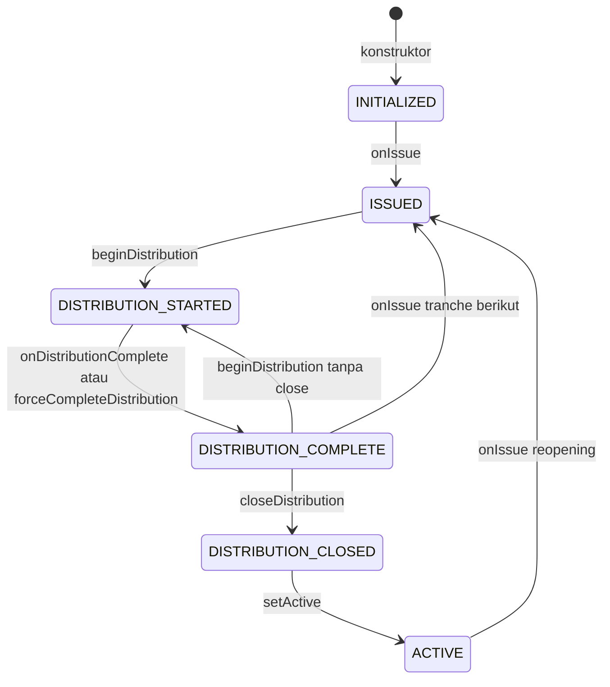

### 5.5 `BondTracker` (`contracts/src/BondTracker.sol`)

**Tujuan.** Hook privat untuk token Noto obligasi: menjaga saldo privat, whitelist investor, aturan round penjualan, dan memberi tahu tracker publik hanya perubahan **status**. Fork `BondTracker@v1.0.0` (reopening, whitelist custodian, kuota prepare-time, status-only, cancel outcome).

**Pewarisan.** `BondTracker → NotoTrackerERC20 → (INotoHooks → IPenteExternalCall, ERC20)`.

**State.**

| Variabel | Isi |
|---|---|
| `_status` (internal enum, 5 nilai) | `INITIALIZED, ISSUED, DISTRIBUTION_STARTED, DISTRIBUTION_CLOSED, ACTIVE` (tidak ada COMPLETE privat) |
| `_publicTracker` | alamat `BondTrackerPublic` |
| `_issuer` | deployer (`msg.sender` konstruktor) = `bondIssuer` |
| `_custodian` | `bondCustodian` |
| `investorList` (public) | `InvestorList` milik custodian |
| `_pendingTrancheAmount` | jumlah mint terakhir, menjadi stok round berikutnya |
| `_discountPrice`, `_minimumDenomination` | syarat round (privat) |
| `_availableUnitsPrivate` | unit belum terjual |
| `_roundSeq`, `_lockRound[lockId]` | id round dan cap round per lock (untuk lock basi) |
| diwarisi: `_locks` (`NotoLocks`), `_notary` (= deployer), saldo ERC20 | |

**Modifier.** `onlyIssuer(sender)`: `"Sender is not bond issuer"`; `onlyCustodian(sender)`: `"Sender is not bond custodian"`; diwarisi `onlyNotary(sender)` (`"Sender is not the notary"`), `onlySelf(sender, from)` (`"Sender is not the from address"`), `onlyLockOwner(sender, lockId)` (`"Sender is not the lock owner"`).

**Fungsi siklus (dipanggil langsung di dalam group).**

| Fungsi | Gate | Prasyarat | Efek |
|---|---|---|---|
| konstruktor `(name, symbol, custodian, publicTracker)` | — | — | `INITIALIZED`; `investorList = new InvestorList(custodian)` |
| `beginDistribution(price, minDenom)` | `onlyCustodian(msg.sender)` | `_status == ISSUED`, `"Bond has not been issued"` | `_roundSeq++`, `DISTRIBUTION_STARTED`, set syarat, `_availableUnitsPrivate = _pendingTrancheAmount`; `PenteExternalCall` → publik `beginDistribution()` |
| `forceCompleteDistribution()` | `onlyCustodian` | `STARTED`, `"No distribution round in progress"` | `DISTRIBUTION_CLOSED`; ext `forceCompleteDistribution()` |
| `closeDistribution()` | `onlyCustodian` | tidak ada `require` privat (gate ada di sisi publik: harus COMPLETE) | `DISTRIBUTION_CLOSED`; ext `closeDistribution()` |
| `setActive()` | `onlyIssuer(msg.sender)` | `CLOSED`, `"Bond is not ready to be activated"` | `ACTIVE`; ext `setActive()` |

`minimumDenomination == 0` tidak divalidasi; nilai itu membuat setiap pemeriksaan penjualan revert (modulo nol). Skrip mengirim `1`.

**Hook Noto (dipanggil domain Noto lewat transaksi Pente dari notary).** `sender` adalah penanda tangan transaksi Noto.

| Hook | Gate | Logika inti | Revert khas |
|---|---|---|---|
| `onMint(sender,to,amount,data,prepared)` | `onlyIssuer(sender)` | `to == _custodian`; status ∈ {INITIALIZED, ACTIVE}; `amount > 0`; `_onMint` (mint ERC20 + ext `prepared`); `_status = ISSUED`; ext `onIssue(to)`; `_pendingTrancheAmount = amount` | `"Bond must be issued to custodian"`, `"Bond must be either unissued or fully active to mint more supply"`, `"Mint amount must be greater than zero"` |
| `onTransfer` | `onlySelf(sender, from)` | `_checkTransfer` (penerima custodian dikecualikan, selain itu `InvestorList.checkTransfer`); `_onTransfer`; bila `STARTED && from == custodian && to != custodian` → `_recordSale(amount)` | `"Investor is not registered"` |
| `onBurn` | `onlySelf` | bila `STARTED` atau `CLOSED`: `amount <= _availableUnitsPrivate`; `_onBurn`; **tanpa** notifikasi publik | `"burn > unsold"` |
| `onPrepareUnlock` | `onlyLockOwner` | `_checkTransfers`; bila `STARTED && lockFrom == custodian`: jumlah penerima non-custodian lolos `_checkSaleAllowed`; cap `_lockRound[lockId] = _roundSeq`; `_onPrepareUnlock` | `"Investor is not registered"`, `"Sale would exceed this round's available units"`, `"Sale amount is not a valid denomination multiple"` |
| `onUnlock` | `onlyLockOwner` | tangkap `lockFrom`; `_checkTransfers`; `_onUnlock`; bila `lockFrom == custodian`: bila `STARTED` dan cap sama dengan round berjalan → `_recordSale(total)`, selain itu bila `total > 0` → `emit StaleLockSettled` | `"Investor is not registered"` |
| `onCreateTransferLock` | `onlySelf(sender, from)` | pemeriksaan sama dengan `onPrepareUnlock`, lalu `_locks.onLock` | idem |
| `onCreateMintLock`, `onPrepareMintUnlock` | `onlyNotary(sender)` | `_checkMintRecipients` (penerima harus custodian), `_onPrepareUnlock` | `"Bond must be issued to custodian"` |
| `onLock`, `onPrepareBurnUnlock`, `onCreateBurnLock` | diwarisi, `onlySelf` | perilaku `NotoTrackerERC20` | — |
| `onDelegateLock` | diwarisi, tanpa gate | hanya meneruskan `PenteExternalCall(prepared)` | — |
| `handleDelegateUnlock` | lihat 5.5.1 | lihat 5.5.1 | `"Caller is not the deployer or the custodian"`, `"Recipients do not match the prepared unlock"` |

`_recordSale(total)`: `_availableUnitsPrivate -= total`; bila `total > 0` dan hasilnya 0 → `PenteExternalCall` ke publik `onDistributionComplete()` **sekali** (tanpa jumlah).

**View.** `lockedBalanceOf(account)` (= `_locks.lockedBalance`), `discountPrice()`, `minimumDenomination()`, `availableUnitsPrivate()`, diwarisi `balanceOf`, `totalSupply`, `investorList`. Dibaca BI lewat `pgroup_call`.

**Invarian.**

1. Setelah hook tuntas, `balanceOf(a) − lockedBalanceOf(a)` sama dengan saldo Noto tidak terkunci milik `a` (diperiksa `reconcile`).
2. `_availableUnitsPrivate` hanya berkurang oleh penjualan custodian ke non-custodian pada round berjalan; tidak pernah di bawah nol (Solidity 0.8 revert pada underflow).
3. Tracker publik menerima hanya: `onIssue(address)`, `beginDistribution()`, `onDistributionComplete()`, `forceCompleteDistribution()`, `closeDistribution()`, `setActive()` (tes `BondTracker.t.sol` menegaskan tidak ada panggilan lain; `BondTrackerPair.t.sol` me-relay ke tracker publik nyata).
4. Penerima selain custodian wajib terdaftar di `InvestorList`.

**Batasan residual** (komentar di berkas): pemeriksaan kuota dilakukan saat prepare, tanpa reservasi; dua leg yang disiapkan bersamaan dapat sama-sama lolos dan yang terakhir gagal saat settle, karena `cancelLock` Noto tidak punya hook ke tracker.

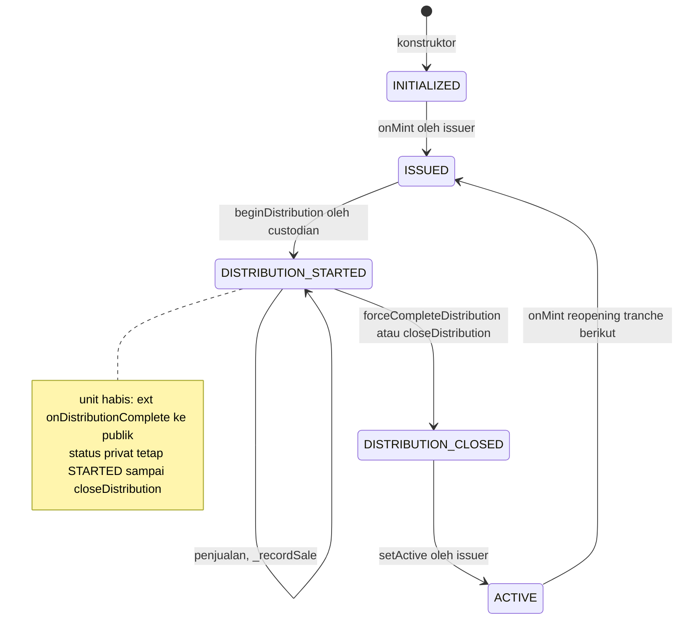

#### 5.5.1 `handleDelegateUnlock` dan bentuk cancel (level kode)

Konteks Noto: begitu lock didelegasikan ke atom, `cancelLock` pada token Noto hanya dapat dipanggil spender (`paladin@v1.0.0:solidity/contracts/domains/noto/Noto.sol:633-646`, modifier `onlySpender`). Domain Noto mengirim `NotoLockSpent` **dan** `NotoLockCancelled` ke hook yang sama (`paladin@v1.0.0:domains/noto/internal/noto/events.go:130-157`), dengan penerima untuk kasus cancel dibangun dari output cancel (`events.go:230-240`): **satu koin kembali ke pemilik lock sebesar seluruh jumlah lock**. Hook dikirim dari identitas notary (`events.go:264`, `From: domainConfig.NotaryLookup`), dan interface menyatakan hook ini dipanggil setelah unlock terkonfirmasi (`INotoHooks.sol:126-137`).

Alur kode `BondTracker.handleDelegateUnlock(sender, lockId, recipients, data)`:

1. **Gate D21:** `require(msg.sender == _issuer || msg.sender == _custodian, "Caller is not the deployer or the custodian")`. Upstream tidak punya gate ini.
2. `lock = _locks.getLock(lockId)`; `_matchesPrepared(lock, recipients)` membandingkan **multiset** pasangan `(to, amount)` dengan `lock.recipients` yang dicatat saat `prepareUnlock`.
3. **Cabang tidak cocok = bentuk cancel.** Harus `lock.amount > 0 && recipients.length == 1 && recipients[0].to == lock.from && recipients[0].amount == lock.amount`, kalau tidak revert `"Recipients do not match the prepared unlock"`. Bila lolos: `_locks.handleDelegateUnlock(lockId, recipients)` (mengurangi `pendingBalance` penerima yang diprepare, `lockedBalance[from] -= amount`, menghapus lock bila habis) lalu `return` — **tanpa `_transfer`, tanpa penghitungan penjualan**.
4. **Cabang cocok = unlock yang diprepare dieksekusi.** `lockFrom = ownerOf`, `_locks.handleDelegateUnlock`, `_transfer(lockFrom, to, amount)` per penerima. Bila `lockFrom == _custodian`: `total` = jumlah ke non-custodian; round berjalan dan cap sama → `_recordSale(total)`; selain itu `total > 0` → `emit StaleLockSettled(lockId, round, total)` (tidak pernah revert karena transfer basis sudah terjadi).

Sebelum perbaikan (`ab8df78`) cabang 3 tidak ada: hook revert untuk setiap cancel padahal base ledger sudah mengembalikan dana, sehingga tracker dan ledger tidak sinkron. Tes: `testDelegateCancelOutcomeAfterPrepareReleasesLockWithoutSale`, `testDelegateCancelOutcomeWithoutPrepareReleasesLock`, `testDelegateCancelOutcomeInvestorLockReturnsToInvestor` (gagal sebelum perbaikan), `testDelegateCancelShapeWrongAmountStillReverts`, `...WrongOwner...`, `...SplitAcrossTwoRecipients...`, `testDelegateCancelShapeStillRequiresD21Sender`, `testLockedBalanceOfTracksOpenLockAndClearsOnCancel`.

### 5.6 Komponen upstream yang dipakai

| Komponen | Sumber | Peran dan batas |
|---|---|---|
| `INotoHooks` | `paladin@v1.0.0:solidity/contracts/domains/interfaces/INotoHooks.sol:14-138` (hook: `onMint:25`, `onTransfer:33`, `onBurn:42`, `onLock:50`, `onPrepareMintUnlock:59`, `onPrepareBurnUnlock:67`, `onUnlock:76`, `onCreateTransferLock:84`, `onCreateMintLock:94`, `onCreateBurnLock:102`, `onPrepareUnlock:111`, `onDelegateLock:119`, `handleDelegateUnlock:132`) | Antarmuka yang diimplementasikan `BondTracker` (lewat `NotoTrackerERC20`) |
| `IPenteExternalCall` | `.../domains/interfaces/IPenteExternalCall.sol:16` | `event PenteExternalCall(address indexed contractAddress, bytes encodedCall)`: ditangkap domain Pente dan dijalankan atomik dengan transisi Pente |
| `ILockableCapability` | `.../domains/interfaces/ILockableCapability.sol` (`LockInfo:50`, `cancelLock:276`, `getLock:291`) | `LockInfo{owner, spender, spendCommitment, cancelCommitment}`; `getLock` dipakai `RestrictedAtom._attemptRelease` |
| `NotoTrackerERC20` | `.../private/NotoTrackerERC20.sol` | Basis hook: `_onMint/_onTransfer/_onBurn/_onLock/_onUnlock/_onPrepareUnlock` mengubah saldo ERC20 privat lalu `emit PenteExternalCall(prepared…)`; `_notary = msg.sender` konstruktor |
| `NotoLocks` | `.../private/NotoLocks.sol` | `onLock`, `onUnlock`, `onPrepareUnlock`, `handleDelegateUnlock`; `lockedBalance`, `pendingBalance`, `ownerOf`, `getLock` |
| `InvestorList` | `.../private/InvestorList.sol` | Whitelist: `addInvestor(s)`, `removeInvestor` (`onlyOwner`), `isRegistered`, `checkTransfer` (`"Investor is not registered"`) |
| `Noto.sol` (domain) | `paladin@v1.0.0:solidity/contracts/domains/noto/Noto.sol:633-646` | `cancelLock` ber-modifier `lockActive` dan `onlySpender`; memancarkan `LockCancelled` dan `NotoLockCancelled` |

### 5.7 Diagram alur lock Noto

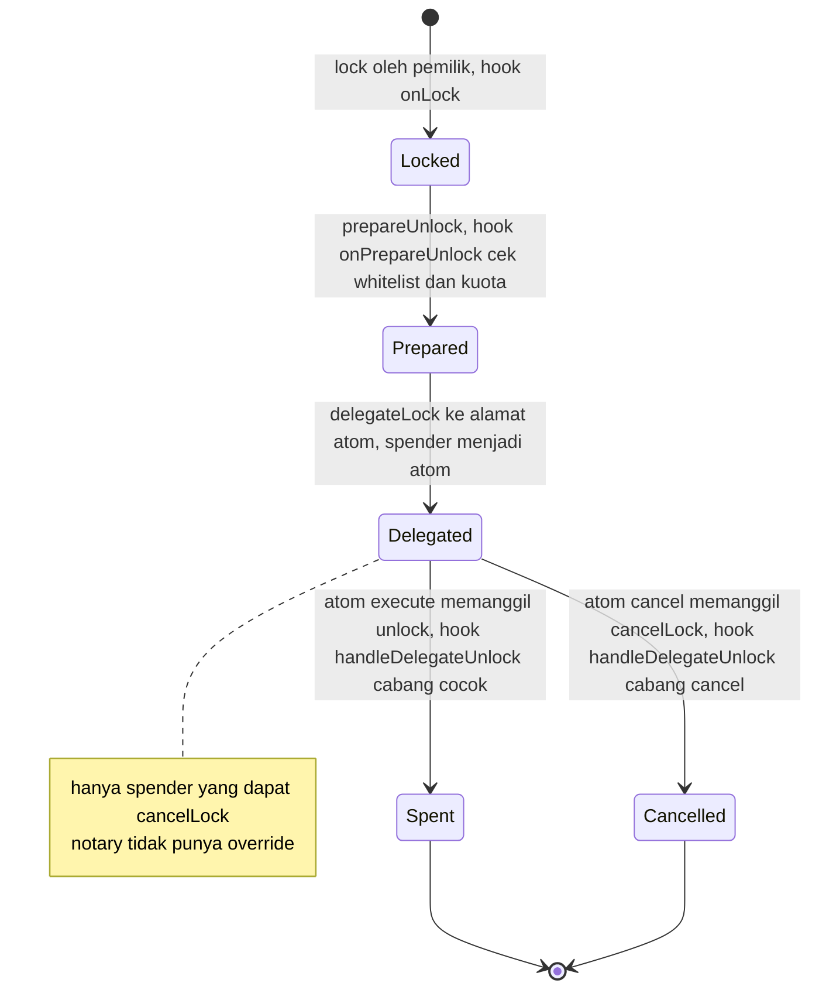

---

## 6. Dynamic view — alur utama

Notasi: **BI** = node1 (`cashIssuer`, `bondIssuer`, `bondCustodian`). Langkah notary pada Noto tidak digambar berulang.

### 6.1 Penerbitan RD

Sumber: `bond/src/index.ts` (bagian kas).

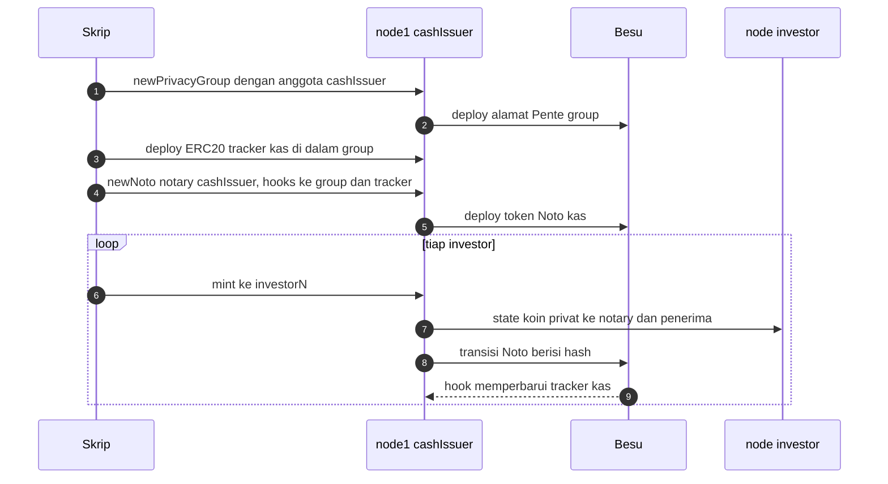

1. Group kas beranggotakan `cashIssuer`; tracker ERC20 di dalamnya adalah cermin saldo.
2. Token Noto kas `notaryMode: hooks` di-deploy.
3. `cashIssuer` `mint` ke tiap investor; state hanya dikirim ke notary dan penerima.

### 6.2 Penerbitan seri (tracker privat + tracker publik status-only)

Sumber: `bond/src/index.ts` (bagian obligasi).

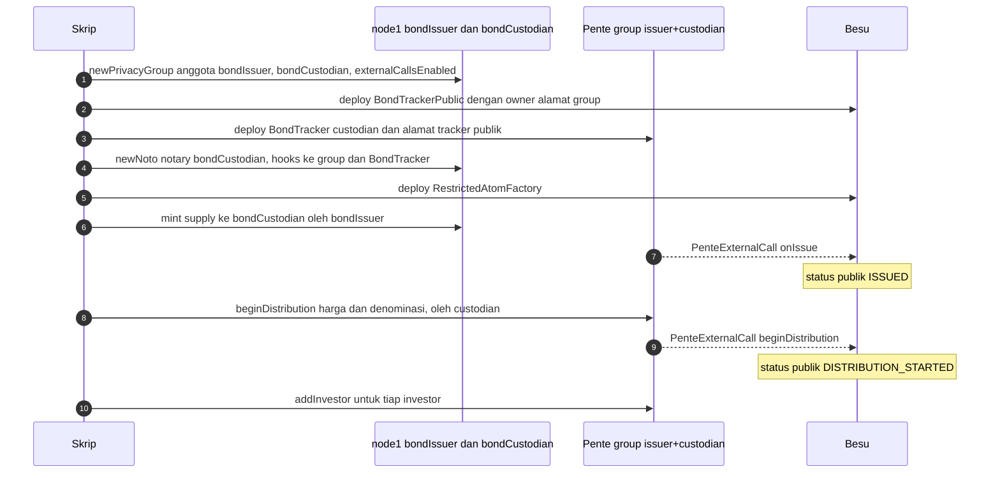

1. Group privat dibuat dengan `externalCallsEnabled`; `BondTrackerPublic` di-deploy dengan owner = alamat group.
2. `BondTracker` privat dan token Noto obligasi (notary `bondCustodian`) di-deploy; `RestrictedAtomFactory` di-deploy satu per seri.
3. `mint` ke custodian memicu `onIssue`; `beginDistribution` menetapkan harga dan denominasi secara privat dan hanya mengirim transisi status.
4. Custodian mendaftarkan investor di `InvestorList`.

### 6.3 Penjualan primer (`RestrictedBondSubscription` + `RestrictedAtom`)

Sumber: `bond/src/index.ts` (loop pembelian).

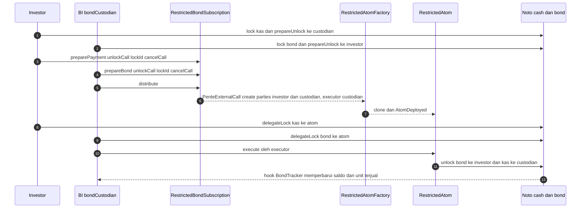

1. Tiap pihak men-lock dan menyiapkan unlock legnya, mencatat `lockId` dan `cancelCall`.
2. `distribute()` menolak bila catatan cancel kosong, lalu memicu `create` pada factory.
3. Kedua pemilik lock mendelegasikan ke atom; custodian menjalankan `execute()`. Gagal satu leg membatalkan seluruh transaksi (R3).
4. Hook memperbarui saldo; bila `_availableUnitsPrivate` mencapai nol, status publik menjadi `DISTRIBUTION_COMPLETE`.

### 6.4 Perdagangan outright

Sumber: `bond/src/lib/outright.ts`.

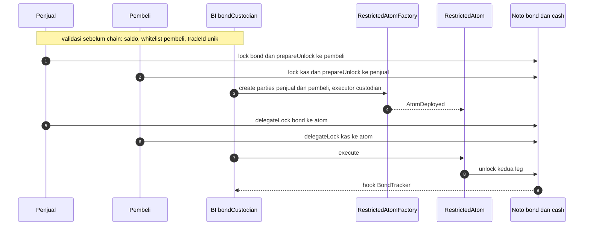

1. Skrip menolak lebih awal bila pihak tidak dikenal, saldo kurang, pembeli tidak di whitelist, atau `tradeId` sudah ada.
2. Urutan: bond lock → prepare → kas lock → prepare → buat atom → delegasi bond → delegasi kas → execute.
3. Kegagalan sebelum delegasi: `rollback` melepas lock. Kegagalan pada `atom-execute`/`settle`: tidak ada rollback otomatis karena dana mungkin sudah berpindah. Idempotency key di-scope per seri dan `tradeId`.

### 6.5 `swap-noto` (aset ↔ kas)

Sumber: `swap-noto/src/index.ts`.

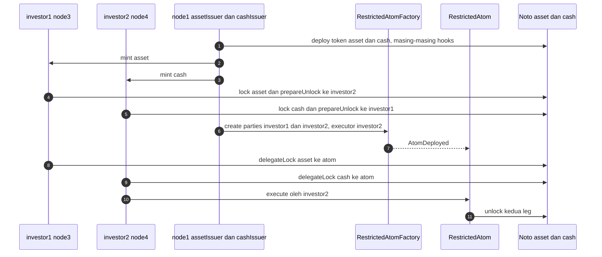

1. Dua token Noto dengan group dan tracker ERC20 masing-masing.
2. Atom: `parties` = kedua investor, `executor` = investor2. Pihak ketiga (misalnya cash issuer) ditolak `NotAParty`.

### 6.6 Pembatalan terbatas pada pihak

Sumber: `contracts/src/RestrictedAtom.sol` (`cancel`, `_attemptRelease`), `contracts/src/BondTracker.sol` (`handleDelegateUnlock`).

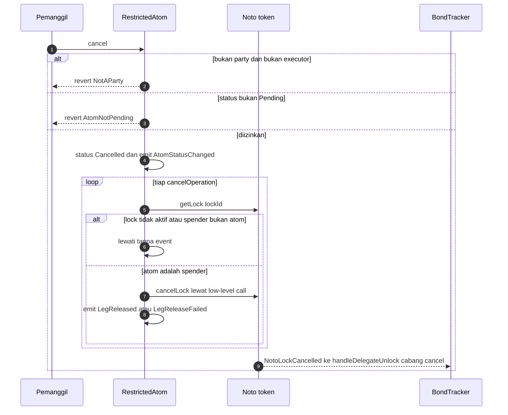

1. Penolakan non-party terjadi saat *gas estimation* (`PD012216`), sehingga tidak ada hash transaksi; bukti berupa teks error.
2. Tiap leg dilepas terisolasi; `retryRelease(index)` tersedia bila pelepasan awal gagal.
3. Hook menerima bentuk cancel (bagian 5.5.1): tracker dan ledger tetap sinkron.

### 6.7 Rekonsiliasi

Sumber: `bond/src/reconcile.ts`, `bond/src/lib/reconcile.ts`.

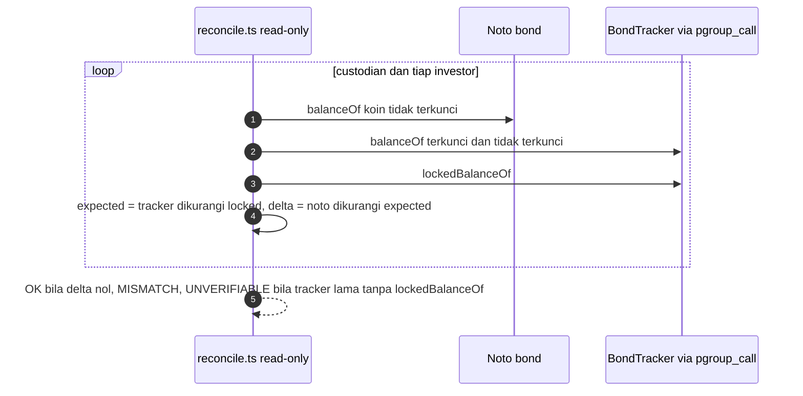

1. Hook tracker berjalan setelah base ledger terkonfirmasi, jadi hook yang gagal meninggalkan selisih tanpa alarm; `reconcile` mendeteksinya.
2. Hanya baca (`balanceOf`, view call); keluar dengan kode 1 bila ada akun berbeda. Pembacaan privat hanya dari node BI.

---

## 7. Model privasi

| Data | BI / notary | Pengirim | Penerima | Bank lain | Publik |
|---|---|---|---|---|---|
| Jumlah dan penerima transfer Noto (state koin) | **Ya** (salinan cleartext) | Ya | Ya | Tidak | Tidak (hash) |
| Saldo per pemegang | **Ya** (juga di `BondTracker`) | Miliknya | Miliknya | Tidak | Tidak |
| Supply, unit belum terjual, harga, denominasi | **Ya** (`pgroup_call`) | Tidak | Tidak | Tidak | Tidak |
| Isi `RestrictedBondSubscription` | Ya (custodian) | Ya (anggota group) | — | Tidak | Tidak |
| Whitelist investor | Ya | Tidak | Tidak | Tidak | Tidak |
| `status()`, `trancheCount`, `custodian`, `schema()` | Ya | Ya | Ya | Ya | **Ya** |
| Syarat instrumen (`issueDate`, `maturityDate`, `faceValue`, `currencyToken`) | Ya | Ya | Ya | Ya | **Ya** (sengaja) |
| Alamat atom, `parties`, `executor`, `lockId`, `AtomStatusChanged`, `LegReleased` | Ya | Ya | Ya | Ya | **Ya** (metadata pseudonim) |

Dasar: distribusi state Noto `{notary, from, to}` (`spikes/cash-leg/spike.ts`); anggota group (`bond/src/index.ts`); ABI tracker publik tanpa getter jumlah (`BondTrackerPublic.t.sol`); verifikasi live P1 sampai P7 (`bond/src/tests/live-verify-privacy.ts`).

**Yang dibuka tracker publik.** Hanya `schema()` (`"status-only-v1"`), `status()`, dan getter metadata. Verifikasi live: ABI 14 fungsi tanpa nama bernuansa amount/unit/price/supply/quantity/balance/denomination/total (P5); `totalSupply()`, `availableUnits()`, `distribution()` tidak ada di chain dan `Execution reverted` (P6); saat unit habis status publik menjadi COMPLETE tanpa jumlah (P4); node investor tidak bisa membuka group issuer+custodian (P7).

**Kebocoran metadata yang tersisa.** Alamat investor dan custodian terlihat di `parties`/`executor` atom dan di parameter `create(...)` yang dikirim sebagai panggilan publik; frekuensi dan waktu interaksi dapat disimpulkan, nilainya tidak. Perubahan status publik ke COMPLETE menandai saat unit habis.

---

## 8. Keamanan, keputusan desain, dan batasan

### 8.1 Mengapa `Atom.cancel()` upstream diganti

`Atom.cancel()` dan `execute()` pada v1.0.0 tidak punya kontrol akses, sehingga siapa pun dapat membatalkan atom yang legnya sudah didelegasikan (griefing). Lebih buruk, begitu lock didelegasikan, `cancelLock` Noto hanya dapat dipanggil spender (`Noto.sol:633-646`); upstream `cancel()` hanya membalik `status`, jadi pembatalan atom yang sebagian terdelegasi membuat dana leg tersangkut selamanya (komentar kepala `RestrictedAtom.sol`). `RestrictedAtom` memperbaikinya dengan `parties`/`executor`, `cancelOperations` yang melepas leg terdelegasi, `retryRelease`, dan pemeriksaan return yang tidak pernah revert. Audit: laporan di `contracts/paladin-contracts-pashov-ai-audit-report-*.md` dan temuan solidity-auditor 12-agent yang tercatat di header berkas.

### 8.2 Perbaikan audit dan lanjutannya (per commit)

| Commit | Perubahan | Bukti |
|---|---|---|
| `ab8df78` | `handleDelegateUnlock` menerima bentuk cancel Noto (satu penerima = pemilik lock, jumlah penuh); tracker tidak desync | `BondTracker.t.sol` `testDelegateCancel*` |
| `69f9853`, `2ae0503` | Tracker publik hanya status (tanpa sale/supply/burn), `schema()` `"status-only-v1"`, view privat `discountPrice`/`minimumDenomination` | `BondTrackerPublic.t.sol`, `BondTrackerPair.t.sol` |
| `2207b67` | Routing klien seri lama vs status-only (di `paladin-client`, dihapus pada `826b393`) | — |
| `8fa44ab` | `bond/` dan `swap-noto/` build dari clone bersih dengan Paladin v1.0.0 yang dipin | build bersih |
| `eb213eb` | Outright lewat `RestrictedAtom` | `bond/src/tests/restricted-atom.ts` |
| `86cdb61` | 8 berkas upstream v1.0.0 di-vendor; `forge test` tanpa path eksternal | `contracts/vendor/paladin-v1.0.0/VENDOR.md` |
| `e8cda9f` | Rekonsiliasi read-only tracker vs Noto, `lockedBalanceOf` | `bond/src/tests/reconcile.ts` |
| `74cf7c1` | Koreksi komentar: RD memakai `notaryMode: hooks` | komentar saja |
| `5dd82ee`, `f8f9009`, `715a426` | `RestrictedBondSubscription`; penerbitan bond dan `swap-noto` lewat `RestrictedAtom` | `RestrictedBondSubscription.t.sol`, uji live |
| `4018dd6` | Contoh bond men-deploy pasangan tracker platform (F1) | E2E S2 dan S3 |

### 8.3 Gate D21, F1, dan F4

- **Gate D21.** Upstream `handleDelegateUnlock` tanpa akses; anggota group mana pun dapat memindahkan buku privat. Kini pemanggil harus `_issuer` atau `_custodian` (hook produksi dikirim dari identitas notary, jadi gate hanya-deployer membuat setiap delegate unlock revert), dan penerima dicocokkan dengan yang diprepare (5.5.1). Anggota group hanya `bondIssuer` dan `bondCustodian`, keduanya BI.
- **F1 (diperbaiki, `4018dd6`).** Contoh `bond` sempat men-deploy artefak tracker upstream, sehingga seri hasil `npm run start` tidak memuat perbaikan cancel dan status-only dan `reconcile` menampilkan `locked=n/a`. Kini memakai build forge dari `contracts/src`. Seri S1 diterbitkan sebelum perbaikan (hanya membuktikan jalur `RestrictedAtom`); S2 dan S3 memuat keduanya.
- **F4 (catatan uji).** Tracker privat diperbarui hook beberapa detik setelah receipt cancel; pembacaan tunggal segera membaca `lockedBalanceOf = 10` sebelum turun ke 0. Skrip uji kini polling. Bukan cacat contract; menegaskan sifat *eventually consistent* dan alasan adanya `reconcile`.

### 8.4 Ketersediaan: pengecualian R2

Target awal: alur tetap berjalan saat node BI offline. **Tidak terpenuhi, by design**, karena BI adalah notary. Saat node1 mati:

- Semua operasi Noto berhenti (`mint`, `lock`, `prepareUnlock`, `delegateLock`, transfer): notary `cashIssuer`, `assetIssuer`, `bondCustodian` ada di node1.
- `execute()` atom penjualan primer dan outright berhenti: executor adalah `bondCustodian`.
- `beginDistribution`, whitelist, `setActive` berhenti (identitas BI di group issuer+custodian).
- Pembaruan `BondTracker` oleh hook tertunda; pembacaan privat `pgroup_call` tidak tersedia.
- `status()` dan `schema()` pada tracker publik tetap terbaca (contract publik di Besu).

Yang **belum diuji live**: perilaku `cancel()` oleh party saat BI mati. Secara kontrak itu transaksi publik yang dapat dikirim party, tetapi pelepasan efektif di sisi Noto dan penyelarasan hook bergantung pada notary; dana yang sudah didelegasikan diperkirakan tetap terkunci sampai notary kembali. Ini analisis desain, bukan hasil uji.

### 8.5 Keputusan desain (ringkas)

| Keputusan | Alasan | Konsekuensi |
|---|---|---|
| Noto `hooks` + tracker privat di Pente | Aturan bisnis tanpa membuka angka | Tracker eventually consistent, butuh `reconcile` |
| Tracker publik status-only | Upstream mempublikasikan tiap penjualan dan supply (melanggar R1) | Klien tidak bisa membaca harga/unit dari chain publik; seri lama tidak kompatibel, `schema()` jadi penanda |
| `RestrictedAtom` di semua jalur | `cancel()` upstream terbuka dan dapat mengunci dana | Satu executor per atom; perlu `cancelCall` dari tiap `prepareUnlock` |
| Fork `BondSubscription` → `RestrictedBondSubscription` | Jalur primer memakai `AtomFactory.create(operations)` tanpa parties/executor | Fork diikuti manual terhadap upstream |
| Satu `RestrictedAtomFactory` per seri | Dipakai penerbitan dan perdagangan | Alamat factory bagian dari data seri; `loadPlatform` menolak data lama tanpanya |
| Vendoring Paladin v1.0.0 | Build hermetik | Pembaruan upstream manual |
| BI sebagai notary | Model BI sebagai satu-satunya penerbit | R2 dikecualikan (8.4) |
| Penghapusan backend (`826b393`) | Keputusan pengguna 2026-10-17: cakupan sama dengan stealth dan zeto | Forge turun dari 143 ke 101 tes; registri metadata berprofil taksonomi dan alur Agreement tidak ada lagi |

### 8.6 Batasan

1. R2 tidak terpenuhi; BI-offline belum diuji live untuk noto.
2. Hanya skrip contoh; tidak ada layanan, API, atau antarmuka pengguna.
3. Metadata pseudonim terlihat di chain publik (bagian 7).
4. Pemetaan ICMA BDT penuh tidak ada; hanya syarat inti pada `BondTrackerPublic` (bagian 3.2).
5. Seri yang diterbitkan sebelum perbaikan status-only tetap memakai pasangan tracker upstream (jumlah publik).
6. Kuota penjualan dicek saat prepare tanpa reservasi (5.5); `minimumDenomination = 0` tidak divalidasi.
7. Notary tunggal dengan peran ganda custodian/notary/eksekutor.
8. `RestrictedAtom.initialize` dan `RestrictedBondSubscription.distribute()` tidak memvalidasi masukan atau memberi guard satu-kali; skrip adalah pemanggil yang benar.
9. Cakupan uji live belum mencakup BI-offline dan pemulihan `retryRelease` pada kegagalan pelepasan nyata (hanya forge).

---

## 9. Pengujian dan bukti

### 9.1 Foundry (`contracts/`)

`forge test`: **101 lulus, 0 gagal, 5 suite**.

| Suite | Tes | Fokus |
|---|---|---|
| `BondTracker.t.sol` | 55 | Siklus, whitelist, round, hook, D21, bentuk cancel, `lockedBalanceOf` |
| `BondTrackerPublic.t.sol` | 16 | Status-only, `schema()`, ABI tanpa jumlah, gate status |
| `BondTrackerPair.t.sol` | 4 | Relay `PenteExternalCall` privat ke tracker publik nyata: sold-out, tranche kedua, force-complete + burn + reopen |
| `RestrictedAtom.t.sol` | 19 | Akses, cancel, isolasi leg, retry, hasil panggilan non-bool, target tanpa kode |
| `RestrictedBondSubscription.t.sol` | 7 | Parties/executor, non-party cancel ditolak, party cancel melepas dua leg, hanya custodian eksekusi |

### 9.2 Skrip

`bond npm test` (3 skrip offline) dan `npm run build` lulus; `swap-noto npm run build` lulus; `common` `tsc --noEmit` lulus.

### 9.3 Uji live E2E

Klaster Paladin v1.0.0 (ACK, 4 node; pod 2/2, restart 0 sebelum dan sesudah). **46 kasus: 29 happy, 17 negative, 0 FAIL, 0 BLOCKED.** Laporan dengan hash transaksi penuh: `docs/e2e-report-2026-10-17.md`.

| Area | Hasil |
|---|---|
| Penerbitan seri lewat `RestrictedBondSubscription` + `RestrictedAtom` (S1 sampai S3) | PASS; atom: parties = [investor, custodian], executor = custodian |
| Outright lewat `RestrictedAtom` | PASS |
| Non-party cancel `NotAParty`; party execute `NotExecutor`; atom tetap Pending, lock tetap terkunci | PASS |
| Party cancel: `Cancelled`, 2 × `LegReleased`, saldo kembali | PASS |
| Cancel atom pending penjualan primer (investor dan custodian) dan swap (investor1 dan investor2) | PASS; `lockedBalanceOf` kembali 0, status publik tidak ke COMPLETE |
| BI membaca jumlah lewat `pgroup_call`; tracker publik hanya status; node non-anggota ditolak | PASS (P1 sampai P7) |
| `npm run reconcile` pada S1 sampai S3, termasuk setelah cancel | OK, delta 0 |
| `swap-noto` aset ↔ kas | PASS |

Skrip uji live: `bond/src/tests/live-restricted-atom.ts`, `live-verify-privacy.ts`, `live-cancel-issuance.ts`, `swap-noto/src/tests/live-cancel-swap.ts`. Penolakan revert terjadi saat *gas estimation* (`PD012216`), jadi bukti berupa teks error, bukan hash.

---

## Lampiran. Peta berkas

| Topik | Berkas |
|---|---|
| Atom terbatas | `contracts/src/RestrictedAtom.sol`, `RestrictedAtomFactory.sol` |
| Subscription primer | `contracts/src/RestrictedBondSubscription.sol` |
| Tracker privat / publik | `contracts/src/BondTracker.sol`, `BondTrackerPublic.sol` |
| Dependensi upstream (vendored) | `contracts/vendor/paladin-v1.0.0/` |
| Penerbitan RD dan seri, penjualan primer | `bond/src/index.ts` |
| Outright | `bond/src/outright.ts`, `bond/src/lib/outright.ts`, `bond/src/lib/platform.ts` |
| Rekonsiliasi | `bond/src/reconcile.ts`, `bond/src/lib/reconcile.ts` |
| Swap | `swap-noto/src/index.ts` |
| ABI hasil build | `bond/src/abis/`, `swap-noto/src/abis/` |
| Uji live | `bond/src/tests/live-*.ts`, `swap-noto/src/tests/live-cancel-swap.ts` |
| Laporan E2E | `docs/e2e-report-2026-10-17.md` |
| Klaster dan akses | `ops/resources/`, `scripts/port-forward-*.sh`, `scripts/e2e.sh` |
