# Arsitektur Sistem (model C4): Jalur Stealth Address untuk RD dan DFABI di Hyperledger Besu

Dokumen ini menjelaskan apa yang **sudah ada** di `besu/stealth-address/` memakai model C4 (Context, Container, Component, Code). Semua klaim diambil dari kode, test, dan dokumen di repositori; path relatif terhadap `besu/stealth-address/` kecuali ditulis lain. Posisi kode: commit `b2a5f2c` (2026-10-17), belum di-push. Istilah teknis dibiarkan dalam bahasa Inggris. Tidak ada layanan, server, login, atau komponen lain yang belum ada di kode yang digambarkan di sini.

---

## 1. Ringkasan

- **Apa ini.** Rel pembayaran dan surat berharga privat langsung di atas Hyperledger Besu (tanpa Paladin): **RD** (Rupiah Digital, ERC-20) dan **DFABI** (obligasi digital, ERC-1400, partition = tranche). Penerima disembunyikan dengan *stealth address* ERC-5564 (scheme 1) dan meta-address dicatat di registri ERC-6538.
- **Bentuk sistem hari ini.** Tujuh smart contract milik kita (plus ERC-1400 vendor), lima modul TypeScript (`ts/`), dan script (`script/`) untuk deploy, smoke, dan E2E. Tidak ada server, API, database, atau UI.
- **R1 (visibilitas).** Hanya BI, pengirim, dan penerima yang melihat transaksi secara utuh (pengirim terautentikasi, penerima, jumlah, token). Jumlah, token, dan alamat pengirim on-chain memang publik; bank lain tidak dapat menautkan alamat penerima ke bank. BI membaca setelah kejadian dengan *view key* tiap bank; pengirim terautentikasi lewat *encrypted sender memo* (AES-256-GCM).
- **R2 (BI offline).** Tidak ada fungsi di jalur transfer yang memanggil atau memerlukan BI. Transfer RD, `settle()` dan `cancel()` DvP berjalan walau BI mati. Transfer DFABI memerlukan penanda-tangan certificate (*custodian*) online; custodian adalah peran terpisah dari BI.
- **R3 (DvP atomik).** Satu `DvPEscrow` per trade (CREATE2 lewat `DvPFactory`): `settle()` menggerakkan kedua leg (bond dan RD) dalam satu transaksi atau tidak sama sekali; setelah `expiry`, `cancel()` mengembalikan tiap leg ke pemiliknya.
- **Data instrumen.** RD dan DFABI memakai data berbasis ICMA BDT v1.2 (catalog 125 field, profil per jenis instrumen, validator generik), di-hash (canonical JSON, keccak256) dan didaftarkan di `InstrumentRegistry`.
- **Status.** Sub-proyek stealth core, RD, DFABI, DvP, dan data instrumen selesai dan diuji di Besu live: forge 84 test, vitest 98 test, E2E 152 kasus (36 happy, 116 negative), semua lulus.

---

## 2. C4 Level 1 – System Context

Siapa memakai sistem dan apa batasnya. "BI", "Bank", dan "Investor" adalah peran yang dipetakan ke alamat dan kunci di kode; tidak ada sistem identitas pengguna di dalamnya.

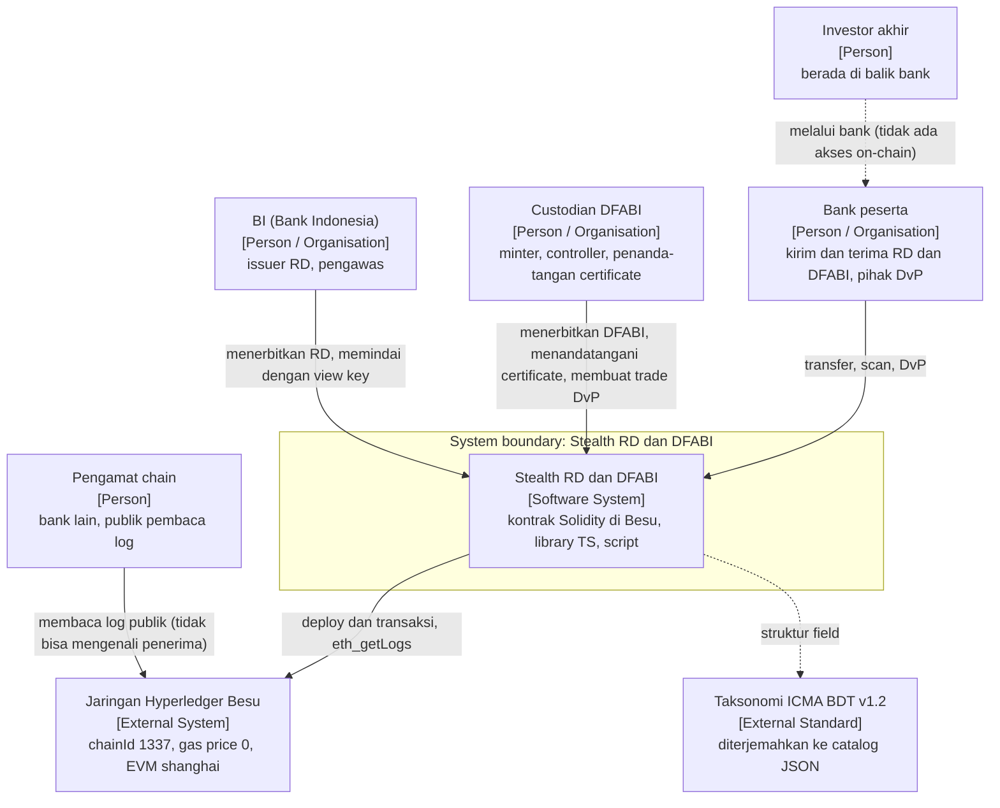

| Elemen | Peran di kode | Bukti |
|---|---|---|
| BI | Alamat `issuer` immutable di `RupiahDigital` (satu-satunya yang boleh `mint`/`mintStealth`); pemegang view key bank untuk RD; registrar/owner `InstrumentRegistry` | `src/RupiahDigital.sol:21,24,34,47`; `ts/stealth.ts:79` (`scanAll`) |
| Custodian DFABI | Minter dan controller `DfabiBond`; certificate signer; satu-satunya yang boleh `DvPFactory.create` | `src/DfabiBond.sol:44`; `src/DvPFactory.sol:14,31` |
| Bank | Pemegang spend key, view key, identity key; mengirim dari alamat stealth miliknya; pihak DvP | `ts/stealth.ts:19` (`generateMetaAddress`), `ts/memo.ts` |
| Investor | Tidak punya representasi di kode | - |
| Pengamat | Siapa saja yang dapat membaca event `Announcement`; tanpa view key hanya melihat data publik | `src/ERC5564Announcer.sol:6-12` |

**Batas sistem.** Di dalam: kontrak, library TS, script, file data instrumen. Di luar: jaringan Besu itu sendiri (validator, konsensus), KYC dan onboarding bank (dilakukan di luar sistem; hasilnya berupa view key yang diserahkan), dan standar ICMA.

**Asumsi kepercayaan yang tertanam di desain.**

1. BI dan custodian memegang view key bank, sehingga dapat mengenali seluruh penerima bank itu secara retroaktif; view key tidak dapat memindahkan dana.
2. Custodian memutuskan siapa yang boleh menerima/mengirim DFABI dengan menandatangani certificate; kontrak tidak memeriksa kebijakan itu.
3. Bank dipercaya menjaga spend key; kehilangan spend key = kehilangan dana.
4. Daftar identitas bank yang sah (alamat identity key penanda-tangan memo) tidak ada di kontrak.
5. Kode vendor ERC-1400 tidak diaudit dan repositori asalnya diarsipkan (`docs/superpowers/specs/2026-10-15-dfabi-bond-token-design.md`, bagian 7).

---

## 3. C4 Level 2 – Container

Container adalah unit yang dijalankan atau disimpan: chain, kumpulan kontrak ter-deploy, library TS, script, material kunci, dan berkas data. Tidak ada container server.

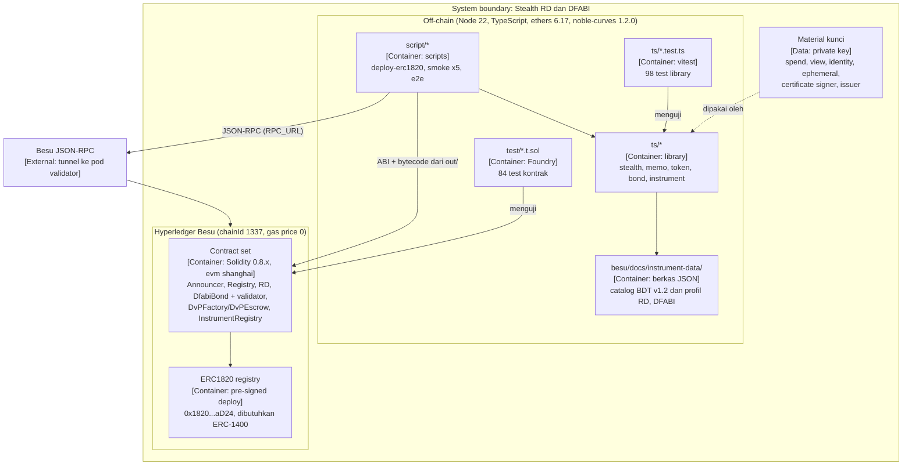

| Container | Isi | Teknologi | Sumber |
|---|---|---|---|
| Besu chain | Jaringan permissioned, chainId 1337, gas price 0 (alamat stealth baru tidak butuh gas); `eth_getLogs` dibatasi rentangnya | Hyperledger Besu | `docs/superpowers/specs/2026-10-15-stealth-core-design.md` bagian 6 |
| Contract set | 7 kontrak milik kita + vendor ERC-1400/validator (lihat Level 3 dan 4) | Solidity ^0.8.20, `evm_version = shanghai`, optimizer 200 runs; OZ 5.4.0 untuk kode kita, OZ 4.9.6 (`oz4`) untuk vendor lewat remapping konteks | `foundry.toml` |
| ERC1820 registry | Registry standar di `0x1820a4B7618BdE71Dce8cdc73aAB6C95905faD24`, wajib ada sebelum `DfabiBond` di-deploy | Pre-signed tx | `script/deploy-erc1820.ts` |
| Library TS | Derivasi dan scan stealth, memo, parser metadata, certificate, validator instrumen | `ethers` 6.17, `@noble/curves` 1.2.0, `node:crypto` | `ts/` |
| Script | `deploy-erc1820.ts`, `smoke.ts`, `smoke-rd.ts`, `smoke-bond.ts`, `smoke-dvp.ts`, `smoke-instrument.ts`, `e2e.ts` | Node >= 22.18 (menjalankan `.ts` langsung) | `script/`, `package.json` |
| Data instrumen | `bdt-v1.2.catalog.json` (125 field, 12 grup), `profiles/DFABI.profile.json`, `profiles/RD.profile.json`; contoh di `docs/samples/` | JSON | `besu/docs/instrument-data/` |
| Test | 7 suite Foundry, 6 file vitest | Foundry (tanpa forge-std, `Vm` inline), vitest 2 | `test/`, `ts/*.test.ts` |
| Material kunci | Tidak ada penyimpanan kunci di kode. Script menerima kunci lewat environment (`DEPLOYER_KEY`, dimuat dari `.env.smoke`) atau membangkitkannya di memori | - | `script/e2e.ts`, `script/smoke-*.ts` |

**Jenis material kunci** (semuanya diproses di `ts/`, tidak ada di kontrak):

| Kunci | Dipegang | Fungsi | Sumber |
|---|---|---|---|
| Spend key | Bank | Kunci alamat stealth = `spend + h mod n` | `ts/stealth.ts:58` (`scan`) |
| View key | Bank; salinan di BI (RD) dan custodian (DFABI) | Mengenali announcement (`scanView`), membuka memo | `ts/stealth.ts:71`, `ts/memo.ts:66` |
| Identity key | Bank (dan BI/custodian untuk issue) | Menandatangani memo | `ts/memo.ts:56` (`buildMemo`) |
| Kunci memo | Turunan: `keccak256("RD-memo-v1" ∥ titik ECDH)` | Enkripsi/dekripsi AES-256-GCM | `ts/memo.ts` |
| Ephemeral key | Pengirim, satu per pembayaran | Menurunkan alamat stealth dan nonce memo | `ts/stealth.ts:26` |
| Certificate signing key | Custodian | Menandatangani certificate transfer/redeem DFABI | `ts/bond.ts:71` |
| Issuer key | BI | Alamat `issuer` RD | `src/RupiahDigital.sol:21` |

---

## 4. C4 Level 3 – Component

### 4.1 Komponen on-chain dan hubungannya

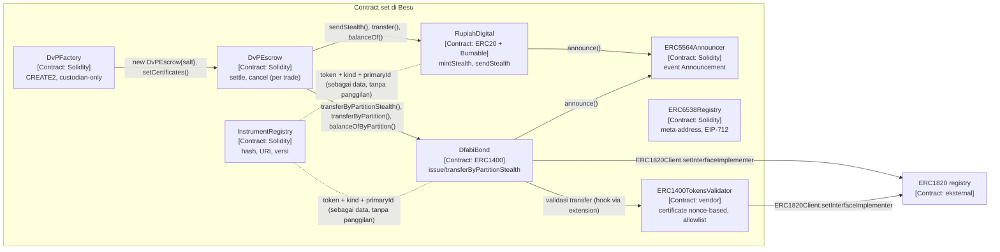

| Pemanggil → dipanggil | Panggilan | Event yang muncul |
|---|---|---|
| `RupiahDigital` → `ERC5564Announcer` | `announce(1, stealth, ephemeralPubKey, metadata)` dari `mintStealth`/`sendStealth` | `Announcement(schemeId=1, stealthAddress, caller=RD, ...)` |
| `DfabiBond` → `ERC5564Announcer` | idem, dari `issueByPartitionStealth`/`transferByPartitionStealth` | `Announcement(..., caller=bond, ...)` |
| `DfabiBond` → `ERC1400TokensValidator` | extension yang didaftarkan lewat `setTokenExtension`; dipanggil dari `_transferByPartition`/`_redeemByPartition`/`_issueByPartition` | - (nonce certificate bertambah di validator) |
| `DvPFactory` → `DvPEscrow` | `new DvPEscrow{salt}(terms)`, lalu `setCertificates(settleCert, refundCert)` | `EscrowCreated(tradeId, escrow)` dari factory |
| `DvPEscrow` → `DfabiBond` | `balanceOfByPartition`, `transferByPartitionStealth` (settle), `transferByPartition` (refund) | `Announcement` dari bond saat settle |
| `DvPEscrow` → `RupiahDigital` | `balanceOf`, `sendStealth` (settle), `transfer` (kelebihan dan refund) | `Announcement` dari RD saat settle |
| `InstrumentRegistry`, `ERC6538Registry` | Tidak memanggil dan tidak dipanggil kontrak lain | `InstrumentRegistered`, `StealthMetaAddressSet` |

### 4.2 Komponen off-chain (`ts/`)

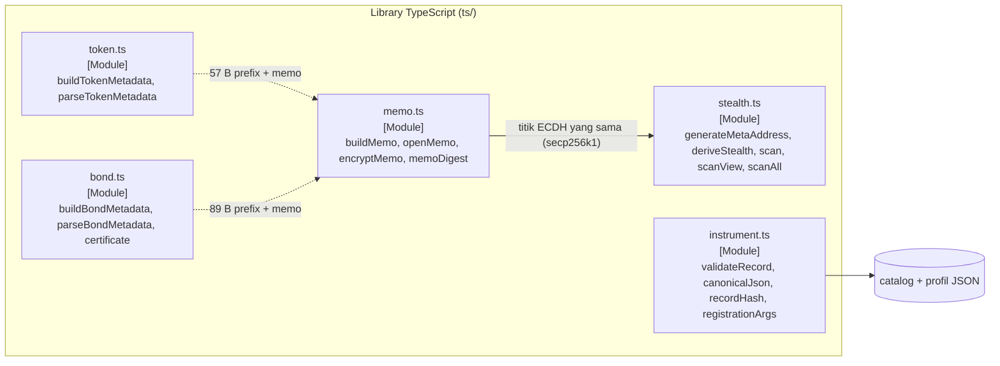

| Modul | Fungsi ekspor (baris) | Peran |
|---|---|---|
| `ts/stealth.ts` | `generateMetaAddress` (19), `deriveStealth` (26), `scan` (58), `scanView` (71), `scanAll` (79) | ERC-5564 scheme 1: `h = keccak256(titik ECDH terkompresi)`, view tag = byte pertama, `P = P_spend + h·G`. `scan` butuh spend key (penerima); `scanView` hanya view key + meta-address (BI, custodian); `scanAll` memetakan announcement ke bank. Entri duplikat dibuang; entri rusak diabaikan. |
| `ts/memo.ts` | `memoDigest` (26), `encryptMemo` (47), `buildMemo` (56), `openMemo` (66), `MAX_MEMO_LENGTH` (13) | Memo 102 byte: versi (1) + AES-256-GCM (85) + tag (16). Plaintext: alamat identity pengirim (20) + tanda tangan r,s,v (65) atas `memoDigest(chainId, token, stealth, amount, ephemeralPubKey [, partition])`. `openMemo` mengembalikan `null` bila bukan untuk kunci ini, rusak, milik pembayaran lain, atau penanda-tangan tidak cocok. |
| `ts/token.ts` | `buildTokenMetadata` (10), `parseTokenMetadata` (19) | Metadata announcement RD: view tag (1) + selector `0xa9059cbb` (4) + token (20) + amount (32) = 57 byte, lalu memo. Parser tidak pernah melempar. |
| `ts/bond.ts` | `buildBondMetadata` (10), `parseBondMetadata` (20), `payloadWithoutCertificate` (44), `certificateDigest` (60), `signCertificate` (71), `CERTIFICATE_LENGTH` (40) | Metadata DFABI 89 byte (selector `0xf3d490db` + token + amount + partition) lalu memo; certificate 97 byte `expiry ∥ r ∥ s ∥ v` atas calldata dikurangi 160 byte terakhir. |
| `ts/instrument.ts` | `validateRecord` (162), `canonicalJson` (261), `recordHash` (275), `registrationArgs` (281), `deriveIssuePrice` (300), `isValidIsin` (60), `isValidLei` (75), `isValidCurrency` (81) | Validator generik berbasis profil: hanya mengenal tipe aturan, bukan nama instrumen. Hash = keccak256 atas canonical JSON (key terurut, tanpa spasi). |

---

## 5. C4 Level 4 – Code: layanan, fungsi, dan logika per smart contract

Format tiap kontrak: tujuan; inheritance/import; state; fungsi (siapa boleh memanggil, precondition, perubahan state, event, kondisi revert); invariant; diagram state bila ada lifecycle. Referensi `file:baris` mengacu ke `src/`.

### 5.0 Katalog layanan & fungsi

Bagian ini adalah daftar **layanan bisnis yang benar-benar diimplementasikan**, dan untuk tiap layanan: kontrak, fungsi, siapa yang memanggil, langkah-langkahnya, event, dan error. Semua dari kode. Referensi `file:baris` untuk kontrak milik kita mengacu ke `src/`; untuk vendor ke `src/vendor/universal-token/`; untuk OpenZeppelin (OZ 5.4.0) ke `node_modules/@openzeppelin/contracts/`. Layanan yang tidak ada ditandai **tidak ada**.

| # | Layanan | Ada? | Kontrak / modul utama |
|---|---|---|---|
| S1 | Registrasi (meta-address, view key) | Ada (meta-address on-chain); serah-terima view key **tidak ada di kode** | `ERC6538Registry`, `ts/stealth.ts` |
| S2 | Penerbitan RD | Ada | `RupiahDigital` |
| S3 | Transfer RD (stealth) | Ada | `RupiahDigital`, `ERC5564Announcer` |
| S4 | Redeem / burn RD | `burn`/`burnFrom` ada; **redeem terkendali BI: tidak ada** | `RupiahDigital` (OZ `ERC20Burnable`) |
| S5 | Penerbitan DFABI | Ada | `DfabiBond`, ERC-1400 vendor |
| S6 | Transfer dan redeem DFABI (certificate) | Ada; **kupon dan pembayaran jatuh tempo: tidak ada** | `DfabiBond`, `ERC1400TokensValidator`, `ts/bond.ts` |
| S7 | DvP escrow (create, fund, settle, refund) | Ada | `DvPFactory`, `DvPEscrow` |
| S8 | Sender memo terenkripsi | Ada (kripto di `ts/`, kontrak hanya membatasi panjang) | `ts/memo.ts`, `RupiahDigital`, `DfabiBond` |
| S9 | BI scan (view key) | Ada (off-chain) | `ts/stealth.ts` (`scanView`, `scanAll`), `ERC5564Announcer` |
| S10 | Data instrumen | Ada | `InstrumentRegistry`, `ts/instrument.ts` |

Singkatan error: `OZ` = custom error OpenZeppelin (`ERC20InsufficientBalance(sender,saldo,butuh)`, `ERC20InvalidReceiver(addr)`, `ERC20InvalidSender(addr)`, `ERC20InsufficientAllowance(spender,allowance,butuh)`, `ERC20InvalidSpender(addr)`, `ERC20InvalidApprover(addr)`). Vendor ERC-1400 memakai string kode: `"50"` transfer gagal, `"52"` saldo kurang, `"53"` allowance kurang, `"54"` transfer ditahan (dipakai validator untuk certificate/allowlist/pause dan oleh `isNotMigratedToken`), `"55"` dana terkunci / penerbitan ditutup, `"56"` sender tidak valid, `"57"` penerima tidak valid.

#### S1. Registrasi meta-address

Yang ada: pencatatan meta-address publik di `ERC6538Registry`. Pembuatan pasangan kunci ada di `ts/stealth.ts`. **Penyerahan view key ke BI/custodian tidak ada di kontrak maupun `ts/`**; itu terjadi di luar sistem. Kode hanya memeriksa, lewat `scanView`, bahwa view key yang diserahkan cocok dengan meta-address (`ts/stealth.ts:71-77`).

| Kontrak / modul | Fungsi | Pemanggil | Langkah | Event | Revert |
|---|---|---|---|---|---|
| `ts/stealth.ts:19` | `generateMetaAddress()` | Bank (off-chain) | 1. Bangkitkan spend key dan view key acak. 2. Meta-address = `spendPub(33) ∥ viewPub(33)` = 66 byte. | - | - |
| `ERC6538Registry.sol:36` | `registerKeys(uint256 schemeId, bytes stealthMetaAddress)` | Siapa saja untuk dirinya (`msg.sender`) | 1. `_checkLength`: skema 1 harus 66 byte. 2. `stealthMetaAddressOf[msg.sender][schemeId] = meta`. | `StealthMetaAddressSet(registrant, schemeId, meta)` | `InvalidMetaAddressLength` |
| `ERC6538Registry.sol:47` | `registerKeysOnBehalf(address registrant, uint256 schemeId, bytes signature, bytes meta)` | Siapa saja (relayer) | 1. `_checkLength`. 2. Hitung digest EIP-712: `"\x19\x01" ∥ DOMAIN_SEPARATOR() ∥ keccak256(abi.encode(TYPEHASH, schemeId, keccak256(meta), nonceOf[registrant]++))` (`:54-62`; nonce dinaikkan saat dibaca). 3. `_isValidSignature`: `ECDSA.tryRecover == registrant`, atau bila `registrant` kontrak, `staticcall isValidSignature(digest, signature)` harus mengembalikan `0x1626ba7e` (`:72-80`). 4. Simpan meta-address. | `StealthMetaAddressSet` | `InvalidMetaAddressLength`, `ERC6538Registry__InvalidSignature` (replay, nonce salah, penanda-tangan salah, meta/skema lain dari yang ditandatangani, tanda tangan rusak) |
| `ERC6538Registry.sol:42` | `incrementNonce()` | Siapa saja untuk dirinya | 1. `nonceOf[msg.sender]++`. Tanda tangan yang sudah dibuat tetapi belum dikirim menjadi tidak berlaku. | `NonceIncremented(registrant, newNonce)` | - |
| `ERC6538Registry.sol:82` | `DOMAIN_SEPARATOR()` (view) | Siapa saja | 1. Bila `block.chainid` sama dengan chain saat deploy: nilai tersimpan; selain itu hitung ulang (`:82-84`). | - | - |
| `ERC6538Registry.sol:22-23` | `stealthMetaAddressOf(registrant, schemeId)`, `nonceOf(registrant)` (view, public mapping) | Siapa saja | Membaca state | - | - |

State yang berubah: `stealthMetaAddressOf`, `nonceOf`. Registri tidak dipanggil oleh kontrak lain; pengirim membacanya dari off-chain sebelum `deriveStealth`.

#### S2. Penerbitan RD

| Kontrak | Fungsi | Pemanggil | Langkah | Event | Revert |
|---|---|---|---|---|---|
| `RupiahDigital.sol:38` | `mintStealth(address stealthAddress, uint256 amount, bytes ephemeralPubKey, bytes1 viewTag, bytes memo)` | Hanya `issuer` (BI) | 1. `msg.sender == issuer` (`:47`). 2. `_mint(stealthAddress, amount)` (OZ: `_update(0, to, amount)`, `totalSupply += amount`). 3. `_announce`: cek `ephemeralPubKey.length == 33`, `amount != 0`, `memo.length <= 256`, lalu `announcer.announce(1, stealthAddress, ephemeralPubKey, viewTag ∥ 0xa9059cbb ∥ address(this) ∥ amount ∥ memo)` (`:67-84`). | `Transfer(0, stealth, amount)`, `Announcement` (caller = RD) | `OnlyIssuer`; `OZ ERC20InvalidReceiver` (alamat 0); `InvalidEphemeralPubKey`; `ZeroAmount`; `MemoTooLong` |
| `RupiahDigital.sol:33` | `mint(address to, uint256 amount)` | Hanya `issuer` | 1. `msg.sender == issuer`. 2. `_mint(to, amount)`. **Tidak ada announcement**: penerima tidak diberi tahu. | `Transfer(0, to, amount)` | `OnlyIssuer`; `OZ ERC20InvalidReceiver` |

State yang berubah: `_balances[stealth]`, `_totalSupply`. Urutan `mintStealth`: mint dulu, announce kemudian, dalam satu transaksi; revert di salah satu membatalkan keduanya.

#### S3. Transfer RD (stealth)

| Kontrak | Fungsi | Pemanggil | Langkah | Event | Revert |
|---|---|---|---|---|---|
| `RupiahDigital.sol:52` | `sendStealth(address stealthAddress, uint256 amount, bytes ephemeralPubKey, bytes1 viewTag, bytes memo)` | Pemegang RD mana pun (sumber = `msg.sender`, tanpa allowance, tanpa certificate) | 1. `_transfer(msg.sender, stealthAddress, amount)` (OZ: tolak alamat 0, `_update`: kurangi saldo pengirim, tambah saldo penerima). 2. `_announce` (cek yang sama dengan S2, event `Announcement` dengan `caller = RD`). | `Transfer(msg.sender, stealth, amount)`, `Announcement` | `OZ ERC20InsufficientBalance`, `OZ ERC20InvalidReceiver`, `InvalidEphemeralPubKey`, `ZeroAmount`, `MemoTooLong` |
| `ERC5564Announcer.sol:14` | `announce(uint256 schemeId, address stealthAddress, bytes ephemeralPubKey, bytes metadata)` | Siapa saja (dipanggil oleh token) | 1. Pancarkan event dengan `caller = msg.sender` (`:17`). Tanpa state, tanpa cek. | `Announcement(schemeId, stealthAddress, caller, ephemeralPubKey, metadata)` | - |
| `ts/stealth.ts:26`, `ts/token.ts:10`, `ts/memo.ts:56` | `deriveStealth`, `buildTokenMetadata`, `buildMemo` | Pengirim (off-chain) | Lihat S8 dan bagian 4.2. | - | melempar error TS pada input salah |

Catatan: `transfer`, `transferFrom`, `approve` ERC-20 biasa ada (bagian 5.9) tetapi **tidak mengumumkan**; penerima tidak diberi tahu.

#### S4. Redeem / burn RD

| Kontrak | Fungsi | Pemanggil | Langkah | Event | Revert |
|---|---|---|---|---|---|
| `ERC20Burnable.sol:20` (diwarisi `RupiahDigital`) | `burn(uint256 value)` | Pemegang untuk dirinya | 1. `_burn(msg.sender, value)`: tolak alamat 0, `_update(account, 0, value)`: kurangi saldo dan `totalSupply`. **Tanpa announcement.** | `Transfer(msg.sender, 0, value)` | `OZ ERC20InsufficientBalance` |
| `ERC20Burnable.sol:35` | `burnFrom(address account, uint256 value)` | Spender yang diberi allowance oleh `account` | 1. `_spendAllowance(account, msg.sender, value)`: allowance berkurang (kecuali `type(uint256).max`). 2. `_burn(account, value)`. | `Approval` (allowance baru, bila berkurang), `Transfer(account, 0, value)` | `OZ ERC20InsufficientAllowance`, `OZ ERC20InsufficientBalance` |
| (redeem terkendali BI) | **tidak ada** | - | Tidak ada fungsi issuer yang membakar saldo orang lain, tidak ada alur "redeem ke BI" di kontrak maupun `ts/`. | - | - |

#### S5. Penerbitan DFABI

| Kontrak | Fungsi | Pemanggil | Langkah | Event | Revert |
|---|---|---|---|---|---|
| `DfabiBond.sol:37` | `issueByPartitionStealth(bytes32 partition, address stealthAddress, uint256 value, bytes ephemeralPubKey, bytes1 viewTag, bytes memo)` | `onlyMinter` (minter atau owner token; custodian) dan `isIssuableToken` | 1. `onlyMinter`: `require(isMinter(msg.sender) \|\| owner() == _msgSender())` tanpa pesan (`ERC1400.sol:155`). 2. `isIssuableToken`: `require(_isIssuable, "55")` (`:141`). 3. `_checkAnnounce`: `ephemeralPubKey.length == 33`, `value != 0`, `memo.length <= 256` (`:65`). 4. `_issueByPartition(partition, msg.sender, stealth, value, "")` (`ERC1400.sol:1199`): validator dipanggil dulu (`_callTokenExtension`; penanda-tangan certificate dikecualikan), lalu `_issue` (`_totalSupply += value`, `_balances[to] += value`, `"57"` bila `to == 0`), lalu saldo partition bertambah. 5. `announcer.announce(1, stealth, ephemeralPubKey, viewTag ∥ 0xf3d490db ∥ address(this) ∥ value ∥ partition ∥ memo)` (`:73-86`). | `Issued`, `Transfer(0, to, value)`, `IssuedByPartition`, `Announcement` | revert tanpa data (bukan minter); `"55"`; `"57"`; `InvalidEphemeralPubKey`; `ZeroAmount`; `MemoTooLong`; `"54"` bila validator menolak (mis. pause) |
| `ERC1400.sol:574` | `issueByPartition(bytes32 partition, address tokenHolder, uint256 value, bytes data)` | `onlyMinter`, `isIssuableToken` | Sama dengan langkah 4 di atas tanpa `_announce`: **penerbitan diam** (tidak ada announcement). | `Issued`, `Transfer`, `IssuedByPartition` | idem |

State yang berubah: `_balances`, `_totalSupply`, `_balanceOfByPartition[to][partition]`, `_totalSupplyByPartition[partition]`, daftar partition.

#### S6. Transfer dan redeem DFABI (certificate)

Setiap perpindahan bond melewati `_callTokenExtension` (`ERC1400.sol:1091`) yang memanggil `ERC1400TokensValidator.tokensToValidate(msg.data, partition, operator, from, to, value, data, operatorData)` (`ERC1400TokensValidator.sol:286`). Validator, berurutan: (1) `_canValidateCertificateToken` → `require(..., "54")`, lalu `_useCertificateIfActivated` menaikkan `_usedCertificateNonce[token][operator]` (`:1259-1262`); (2) `_canValidateAllowlistAndBlocklistToken` → `"54"`; (3) `!paused` → `"54"`; (4) granularity `"50"` dan hold `"55"` (tidak aktif di setup ini). Untuk certificate NonceBased (`:1301`): panjang 97, `expiry >= block.timestamp`, `v` 27/28, digest `keccak256(domainSeparator ∥ keccak256(operator ∥ token ∥ calldataTanpa160ByteTerakhir ∥ expiry ∥ nonce))`, `ecrecover` harus certificate signer. Operator yang sendiri certificate signer dilewati (`:355`).

| Kontrak | Fungsi | Pemanggil | Langkah | Event | Revert |
|---|---|---|---|---|---|
| `DfabiBond.sol:51` | `transferByPartitionStealth(bytes32 partition, address stealthAddress, uint256 value, bytes ephemeralPubKey, bytes1 viewTag, bytes memo, bytes data)` | Pemegang bond (sumber = `msg.sender`); `data` = certificate 97 byte, **argumen terakhir** | 1. `_checkAnnounce` (33 byte, `value != 0`, memo <= 256). 2. `_transferByPartition(partition, msg.sender, msg.sender, stealth, value, data, "")` (`ERC1400.sol:883`): `require(saldo partition >= value, "52")`; panggil sender extension dan validator (certificate); kurangi saldo partition; `_transferWithData` (`:855`: `"50"`, `"57"` bila penerima 0, `"52"`, pindah saldo agregat); tambah saldo partition penerima; recipient extension. 3. `announce(1, stealth, R, viewTag ∥ 0xf3d490db ∥ token ∥ value ∥ partition ∥ memo)`. | `Transfer`, `TransferByPartition`, `Announcement` | `"54"` (tanpa certificate, kedaluwarsa, penanda-tangan salah, pengirim/jumlah/memo berbeda, nonce salah, replay), `"52"`, `"57"`, `InvalidEphemeralPubKey`, `ZeroAmount`, `MemoTooLong` |
| `ERC1400.sol:411` | `transferByPartition(bytes32 partition, address to, uint256 value, bytes data)` | Pemegang; `data` = certificate | `_transferByPartition(partition, msg.sender, msg.sender, to, value, data, "")` seperti di atas, **tanpa announcement**. Dipakai untuk mendanai escrow DvP dan refund bond. | `Transfer`, `TransferByPartition` | `"54"`, `"52"`, `"57"` |
| `ERC1400.sol:434` | `operatorTransferByPartition(partition, from, to, value, data, operatorData)` | Operator pemegang atau controller | 1. `require(_isOperatorForPartition(...) \|\| value <= allowanceByPartition, "53")`. 2. Kurangi allowance bila ada. 3. `_transferByPartition(..., operatorData)`. Jika `operatorData` tidak kosong dan `data >= 64` byte dengan flag `0xff..ff`, partition tujuan dapat diganti (`:_getDestinationPartition`). Controller adalah operator untuk semua pemegang (`_isOperator`, `:1147`). | `TransferByPartition`, bila partition berubah `ChangedPartition` | `"53"`, `"54"`, `"52"` |
| `ERC1400.sol:625` | `redeemByPartition(bytes32 partition, uint256 value, bytes data)` | Pemegang; `data` = certificate | `_redeemByPartition(partition, msg.sender, msg.sender, value, data, "")` (`:1251`): `"52"`; sender extension; validator; kurangi saldo partition; `_redeem` (`:1228`: `"50"`, `"56"` bila `from == 0`, `"52"`, kurangi saldo dan `_totalSupply`). Tanpa announcement. | `Redeemed`, `Transfer(from, 0, value)`, `RedeemedByPartition` | `"54"`, `"52"`, `"56"`, `"50"` |
| `ERC1400.sol:638` | `operatorRedeemByPartition(partition, tokenHolder, value, operatorData)` | Operator pemegang atau controller | Cek operator/allowance (`"53"`), lalu `_redeemByPartition`. Controller dapat membakar saldo siapa pun; validator tidak menuntut certificate dari certificate signer. | idem | `"53"`, `"54"`, `"52"` |
| `ERC1400.sol:591` | `redeem(uint256 value, bytes data)` | Pemegang | `_redeemByDefaultPartitions` (`:1278`): memakai partition bawaan; `"55"` bila tidak ada partition bawaan; `"52"` bila saldo kurang. | idem | `"55"`, `"52"`, `"54"` |
| `ERC1400.sol:603` | `redeemFrom(address from, uint256 value, bytes data)` | Operator atau spender ber-allowance | `require(_isOperator(...) \|\| value <= _allowed[from][msg.sender], "53")`, kurangi allowance, lalu `_redeemByDefaultPartitions`. | idem | `"53"`, `"55"`, `"52"`, `"54"` |
| `ts/bond.ts:44,60,71` | `payloadWithoutCertificate`, `certificateDigest`, `signCertificate` | Custodian (off-chain) | 1. Kode calldata dengan placeholder 97 byte; buang 160 byte terakhir. 2. Digest `keccak256(domainSeparator ∥ keccak256(msgSender ∥ token ∥ payload ∥ expiry ∥ nonce))`. 3. Tanda tangan mentah r,s,v; keluaran `expiry(32) ∥ r ∥ s ∥ v` = 97 byte. | - | melempar error TS untuk input di luar rentang |

Kupon dan pembayaran jatuh tempo: **tidak ada**. Tidak ada fungsi yang membayar RD atas bond; `Maturity Date` hanya field data di record instrumen.

State yang berubah per transfer: `_balances`, `_balanceOfByPartition`, `_totalSupplyByPartition` (dan daftar partition bila habis), `_usedCertificateNonce[token][sender]` di validator.

#### S7. DvP escrow (create, fund, settle, refund)

| Kontrak | Fungsi | Pemanggil | Langkah | Event | Revert |
|---|---|---|---|---|---|
| `DvPFactory.sol:25` | `predict(Terms t)` (view) | Siapa saja (custodian sebelum menandatangani) | 1. `salt = keccak256(abi.encode(t))` (`:20`). 2. Alamat = `keccak256(0xff ∥ factory ∥ salt ∥ keccak256(creationCode ∥ abi.encode(t)))[12:]`. | - | - |
| `DvPFactory.sol:30` | `create(Terms t, bytes settleCert, bytes refundCert)` | Hanya `custodian` | 1. `msg.sender == custodian` (`:31`). 2. `new DvPEscrow{salt}(t)` (konstruktor menyimpan `factory = msg.sender` dan `terms`, `DvPEscrow.sol:79-82`). 3. `e.setCertificates(settleCert, refundCert)`. | `EscrowCreated(tradeId, escrow)` | `OnlyCustodian`; revert tanpa data bila alamat sudah terpakai (trade sama dibuat dua kali); error `setCertificates` |
| `DvPEscrow.sol:91` | `setCertificates(bytes settleCert_, bytes refundCert_)` | Hanya `factory` | 1. `msg.sender == factory`. 2. Belum diset. 3. Keduanya 97 byte. 4. `uint256(settleCert[:32]) >= terms.expiry`. 5. `uint256(refundCert[:32]) >= terms.expiry + terms.refundWindow`. 6. Simpan; `certificatesSet = true`. Kebenaran tanda tangan **tidak** diperiksa. | - | `OnlyFactory`, `CertificatesAlreadySet`, `BadCertificateLength`, `CertificateExpiresTooEarly` |
| `DfabiBond` (`ERC1400.sol:411`) | `transferByPartition(partition, escrow, bondAmount, cert)` | Penjual, dari alamat stealth `seller`, dengan certificate custodian miliknya | Mendanai leg bond: saldo bond partition escrow bertambah (tanpa announcement). | `TransferByPartition` | seperti S6 |
| `RupiahDigital` (`OZ ERC20.sol:99`) | `transfer(escrow, rdAmount)` | Pembeli, dari alamat stealth `buyer` | Mendanai leg RD (tanpa announcement). | `Transfer` | `OZ ...` |
| `DvPEscrow.sol:103` | `settle()` | Siapa saja | 1. `settled` salah (`:104`). 2. `certificatesSet` (`:105`). 3. `block.timestamp < expiry` (`:107`). 4. `bond.balanceOfByPartition(partition, escrow) >= bondAmount` (`:108`). 5. `rd.balanceOf(escrow) >= rdAmount` (`:110`). 6. `settled = true` (`:112`). 7. `bond.transferByPartitionStealth(partition, bondLeg.receiver, bondAmount, R, tag, memo, settleCert)` (`:113-115`): escrow adalah `msg.sender` sehingga validator memeriksa `settleCert` untuk escrow dan nonce 0. 8. `rd.sendStealth(rdLeg.receiver, rdAmount, R, tag, memo)` (`:116`). 9. Bila saldo RD > `rdAmount`, kelebihan ditransfer ke `buyer` (`:117`). | `Settled(tradeId)`; `Announcement` dari bond dan RD (caller = token) | `AlreadySettled`, `NotReady`, `Expired`, `NotFunded`; revert dari token/validator (mis. `"54"`) membatalkan seluruh transaksi termasuk `settled = true` |
| `DvPEscrow.sol:124` | `cancel()` | Siapa saja | 1. `settled` salah (`:125`). 2. `block.timestamp >= expiry` (`:127`). 3. Bila `certificatesSet` dan saldo bond >= `bondAmount`: `try bond.transferByPartition(partition, seller, bondAmount, refundCert)` (`:130-136`); sukses → `bondRefunded = true`, gagal → `BondRefundFailed`. 4. Seluruh saldo RD ditransfer ke `buyer` (`:139`). 5. Bila bond tidak dikembalikan dan RD = 0 → revert. | `Cancelled(tradeId, bondRefunded, rdRefunded)`, `BondRefundFailed` | `AlreadySettled`, `NotExpired`, `NothingToRefund` |
| `DvPEscrow.sol:84` | `getTerms()` (view); `certificatesSet`, `settled`, `factory` (public) | Siapa saja | Membaca state | - | - |

State yang berubah: `settled`, `certificatesSet`, `settleCert`, `refundCert`; saldo bond/RD di escrow dan di penerima. Lifecycle ada di diagram 5.6.

#### S8. Sender memo terenkripsi

Kontrak tidak melakukan kripto. Yang ada di kontrak hanyalah parameter `memo` dan batas panjangnya; memo menjadi ekor `metadata` announcement.

| Kontrak / modul | Fungsi | Pemanggil | Langkah | Event | Revert |
|---|---|---|---|---|---|
| `RupiahDigital.sol:77` (`_announce`), `DfabiBond.sol:68` (`_checkAnnounce`) | cek `memo.length <= MAX_MEMO (256)` | Internal | Memo (bisa kosong) ditempelkan setelah prefix 57/89 byte | `Announcement` | `MemoTooLong` |
| `ts/memo.ts:56` | `buildMemo({senderKey, ephemeralKey, receiverMetaAddress, ctx})` | Pengirim | 1. Periksa `ctx.ephemeralPubKey` = kunci publik `ephemeralKey`. 2. Tanda tangan identity key atas `memoDigest(ctx)` (`chainId, token, stealth, amount, ephemeralPubKey [, partition]`). 3. Plaintext = alamat pengirim (20) ∥ r ∥ s ∥ v (85 byte). 4. `encryptMemo`: kunci = `keccak256("RD-memo-v1" ∥ titik ECDH(ephemeral, viewPub))`, nonce = 12 byte pertama `keccak256("RD-memo-nonce" ∥ ephemeralPubKey)`, AES-256-GCM, AAD = versi. 5. Keluaran: versi (1) ∥ ciphertext (85) ∥ tag (16) = 102 byte. | - | melempar bila ephemeral key tidak cocok atau meta-address bukan 66 byte |
| `ts/memo.ts:66` | `openMemo(memo, viewKey, ctx)` | Penerima atau BI (pemegang view key) | 1. Panjang harus 102 dan versi 1. 2. Dekripsi GCM dengan titik ECDH(viewKey, ephemeralPubKey). 3. Pulihkan penanda-tangan dari tanda tangan atas `memoDigest(ctx)`; harus sama dengan alamat pengirim di plaintext. 4. Kembalikan `{sender}`. | - | tidak melempar: mengembalikan `null` untuk kunci salah, memo rusak/terpotong, konteks lain, atau penanda-tangan palsu |
| `ts/memo.ts:26,47` | `memoDigest`, `encryptMemo` | Internal / pengujian | Seperti di atas | - | - |

#### S9. BI scan (view key)

Tidak ada fungsi on-chain khusus; BI membaca event `Announcement` dari Announcer lewat `eth_getLogs` (rentang dibatasi node) dan memprosesnya di `ts/`.

| Modul | Fungsi | Pemanggil | Langkah | Hasil / error |
|---|---|---|---|---|
| `ts/stealth.ts:79` | `scanAll(announcements, holders)` | BI (holders = `{id, viewKey, metaAddress}` per bank) | 1. Untuk tiap bank panggil `scanView`. 2. Gabungkan hasil menjadi `{bank, announcement}`. | Announcement bank tak dikenal tidak muncul |
| `ts/stealth.ts:71` | `scanView(announcements, holder)` | BI, custodian | 1. Meta-address harus 66 byte dan kunci publik `viewKey` harus sama dengan 33 byte terakhirnya. 2. Untuk tiap announcement (skema 1): `h = keccak256(ECDH(viewKey, ephemeralPubKey))`; byte pertama `h` harus sama dengan byte pertama metadata (view tag); alamat = `spendPub + h·G` harus sama dengan `stealthAddress`; duplikat dibuang. 3. Hanya memakai kunci publik spend: tidak bisa menggerakkan dana. | melempar `view key does not match meta-address of <id>` bila tidak cocok; entri rusak diabaikan |
| `ts/stealth.ts:58` | `scan(announcements, viewKey, spendKey)` | Penerima (bank) | Sama dengan `scanView`, plus kunci privat alamat = `(spendKey + h) mod n` | melempar bila view key tidak valid |
| `ts/token.ts:19`, `ts/bond.ts:20` | `parseTokenMetadata`, `parseBondMetadata` | BI, bank | Memastikan panjang dan selector (`0xa9059cbb` / `0xf3d490db`), memisahkan token, jumlah, partition, memo | mengembalikan `null` bila bukan format ini (tidak melempar) |
| `ts/memo.ts:66` | `openMemo` | BI, bank | Lihat S8 | `{sender}` atau `null` |

Aturan kepercayaan: hanya announcement dengan `caller == alamat token` yang dipercaya; saldo `balanceOf`/`balanceOfByPartition` adalah otoritas, bukan metadata (script E2E RD-29, BOND-24).

#### S10. Data instrumen

| Kontrak / modul | Fungsi | Pemanggil | Langkah | Event | Revert |
|---|---|---|---|---|---|
| `InstrumentRegistry.sol:75` | `register(token, kind, profileVersion, primaryId, dataHash, dataUri)` | `onlyRegistrar` | 1. Registrar (`:58`). 2. Token belum punya entri (`:83`). 3. `_append`: semua input tidak kosong dan `token != 0` (`:132-137`); versi = panjang array + 1; simpan `Instrument` dengan `registrant = msg.sender`, `registeredAt = block.timestamp`. | `InstrumentRegistered(token, kind, version, primaryId, dataHash, dataUri, registrant)` | `NotRegistrar`, `AlreadyRegistered`, `EmptyInput` |
| `InstrumentRegistry.sol:89` | `registerVersion(...)` | `onlyRegistrar` (registrar mana pun) | 1. Token sudah terdaftar (`:98`). 2. `kind` dan `primaryId` sama dengan versi 1 (`:99`). 3. `_append`. Versi lama tidak berubah. | `InstrumentRegistered` | `NotRegistrar`, `NotRegisteredYet`, `IdentityChanged`, `EmptyInput` |
| `InstrumentRegistry.sol:104,111,118,122` | `getInstrument`, `getInstrumentVersion`, `versionCount`, `isRegistered` (view) | Siapa saja | Membaca entri terbaru / versi 1-based / jumlah / status | - | `UnknownInstrument` (token tak terdaftar, versi 0 atau di luar rentang) |
| `InstrumentRegistry.sol:63,68` | `setRegistrar(address, bool)`, `transferOwnership(address)` | `onlyOwner` | Ubah `isRegistrar` / `owner` | `RegistrarSet`, `OwnershipTransferred` | `NotOwner`; `EmptyInput` untuk owner 0 |
| `ERC1400.sol:304` | `setDocument(bytes32 name, string uri, bytes32 hash)` | Controller token | `require(_isController[msg.sender])`; simpan dokumen "ICMA-BDT-v1.2" | `DocumentUpdated` | revert tanpa data bila bukan controller |
| `ts/instrument.ts:162,261,275,281` | `validateRecord`, `canonicalJson`, `recordHash`, `registrationArgs` | Registrar (off-chain) | 1. Validasi record terhadap profil `kind`-nya (sebelum hashing). 2. Canonical JSON: key terurut, tanpa spasi. 3. Hash = keccak256. 4. `registrationArgs` mengembalikan `{kind bytes32, profileVersion, primaryId, dataHash}` untuk `register`. | - | `validateRecord` mengembalikan `{valid, errors[]}`; `registrationArgs` melempar `invalid instrument record: ...` |

### Logika per kontrak (5.1 sampai 5.8)

Bagian ini merinci tiap kontrak milik kita: tujuan, state, fungsi, invariant, dan diagram state. Katalog 5.0 di atas melihatnya dari sisi layanan.

### 5.1 `ERC5564Announcer` (`ERC5564Announcer.sol`)

- **Tujuan.** Pemancar event ERC-5564. Tempat semua pembayaran stealth diumumkan agar penerima dapat memindai.
- **Inheritance/import.** Tidak ada (`:5`).
- **State.** Tidak ada.
- **Event.** `Announcement(uint256 indexed schemeId, address indexed stealthAddress, address indexed caller, bytes ephemeralPubKey, bytes metadata)` (`:6-12`).
- **Fungsi.**

  | Fungsi | Siapa | Precondition | Efek | Revert |
  |---|---|---|---|---|
  | `announce(schemeId, stealthAddress, ephemeralPubKey, metadata)` (`:14-18`) | Siapa saja (standar mewajibkan terbuka) | Tidak ada | Memancarkan `Announcement` dengan `caller = msg.sender` (`:17`) | Tidak ada |

- **Invariant.** `caller` selalu `msg.sender` dan tidak dapat diisi pemanggil, jadi scanner yang memfilter `caller == alamat token` hanya melihat announcement yang benar-benar dipancarkan token itu. Kontrak tidak memeriksa isi; announcement sampah/palsu valid bagi kontrak.

### 5.2 `ERC6538Registry` (`ERC6538Registry.sol`)

- **Tujuan.** Registri meta-address stealth per `(registrant, schemeId)`, termasuk pendaftaran atas nama dengan tanda tangan EIP-712 (EOA atau ERC-1271).
- **Import.** OpenZeppelin `ECDSA`, `IERC1271` (`:4-5`). Pemeriksaan tanda tangan ditulis inline karena `SignatureChecker` OZ 5.4 memakai `mcopy` (Cancun) sedangkan target `shanghai` (`:11-12`).
- **State.**

  | Nama | Tipe | Arti |
  |---|---|---|
  | `stealthMetaAddressOf` (`:22`) | `mapping(address => mapping(uint256 => bytes))` | Meta-address per registrant dan skema |
  | `nonceOf` (`:23`) | `mapping(address => uint256)` | Nonce EIP-712 per registrant |
  | `ERC6538REGISTRY_ENTRY_TYPE_HASH` (`:25`) | `bytes32` constant | `keccak256("Erc6538RegistryEntry(uint256 schemeId,bytes stealthMetaAddress,uint256 nonce)")` |
  | `INITIAL_CHAIN_ID`, `INITIAL_DOMAIN_SEPARATOR` (`:28-29`) | immutable | Untuk menghitung ulang domain bila chainId berubah |

- **Event.** `StealthMetaAddressSet(registrant indexed, schemeId indexed, stealthMetaAddress)` (`:19`), `NonceIncremented(registrant indexed, newNonce)` (`:20`).
- **Error.** `InvalidMetaAddressLength` (`:16`), `ERC6538Registry__InvalidSignature` (`:17`).
- **Fungsi.**

  | Fungsi | Siapa | Precondition | Efek | Revert |
  |---|---|---|---|---|
  | `registerKeys(schemeId, meta)` (`:36`) | Siapa saja, untuk dirinya (`msg.sender`) | Skema 1: panjang tepat 66 byte | Menyimpan meta-address; `StealthMetaAddressSet` | `InvalidMetaAddressLength` |
  | `incrementNonce()` (`:42`) | Siapa saja, untuk dirinya | - | `nonceOf[msg.sender]++`; `NonceIncremented`. Mencabut tanda tangan yang sudah dibuat tetapi belum dikirim | - |
  | `registerKeysOnBehalf(registrant, schemeId, signature, meta)` (`:47-70`) | Siapa saja (relayer) | Panjang meta valid (`:53`); tanda tangan sah atas digest EIP-712 `"\x19\x01" ∥ DOMAIN_SEPARATOR ∥ hash(typeHash, schemeId, keccak256(meta), nonceOf[registrant])` | Nonce registrant dinaikkan (`:60`, dikonsumsi sebelum cek, tetapi revert membatalkan semuanya); menyimpan meta; `StealthMetaAddressSet` | `InvalidMetaAddressLength`; `ERC6538Registry__InvalidSignature` (replay, nonce salah, penanda-tangan salah, meta/skema berbeda dari yang ditandatangani, tanda tangan rusak) |
  | `DOMAIN_SEPARATOR()` (`:82`) | view | - | Mengembalikan domain awal, atau menghitung ulang bila `block.chainid` berubah | - |
  | `_isValidSignature` (`:72-80`, private) | - | - | `ECDSA.tryRecover == registrant` → sah; selain itu bila `registrant` kontrak: `staticcall isValidSignature(digest, signature)` harus mengembalikan magic `0x1626ba7e` | - |

- **Domain EIP-712.** name `ERC6538Registry`, version `1.0`, chainId, alamat kontrak (`:86-96`).
- **Invariant.** (1) Nonce hanya naik. (2) Setiap tanda tangan on-behalf hanya berlaku sekali (nonce ikut dalam digest). (3) Meta-address skema 1 yang tersimpan selalu 66 byte (kedua jalur memeriksa `_checkLength`, `:99-101`). (4) Tanda tangan high-s ditolak oleh `ECDSA.tryRecover`.
- **Catatan.** Skema selain 1 tidak diperiksa panjangnya. Registri tidak dipanggil oleh kontrak lain; pengirim membacanya off-chain.

### 5.3 `RupiahDigital` (`RupiahDigital.sol`)

- **Tujuan.** Token RD: ERC-20 dengan pengiriman yang langsung mengumumkan penerima stealth dan memo.
- **Inheritance/import.** `ERC20`, `ERC20Burnable` (OZ 5.4.0), `ERC5564Announcer` (`:4-6,12`).
- **State.**

  | Nama | Tipe | Arti |
  |---|---|---|
  | `issuer` (`:21`) | `address immutable` | BI; satu-satunya yang boleh mint |
  | `announcer` (`:22`) | `ERC5564Announcer immutable` | Alamat Announcer |
  | `MAX_MEMO` (`:19`) | `uint256 constant = 256` | Batas panjang memo |
  | saldo, `totalSupply`, allowance | dari `ERC20` | - |

- **Nama/simbol/decimals.** "Rupiah Digital", "RD", `decimals() = 0` (`:24,29`).
- **Error.** `OnlyIssuer`, `InvalidEphemeralPubKey`, `ZeroAmount`, `MemoTooLong` (`:13-16`) ditambah error OZ (`ERC20InsufficientBalance`, `ERC20InvalidReceiver`, `ERC20InsufficientAllowance`).
- **Fungsi.**

  | Fungsi | Siapa | Precondition | Efek | Event | Revert |
  |---|---|---|---|---|---|
  | `mint(to, amount)` (`:33`) | Hanya `issuer` | - | `_mint`; **tanpa announcement** | `Transfer` | `OnlyIssuer` |
  | `mintStealth(stealth, amount, ephemeralPubKey, viewTag, memo)` (`:38-50`) | Hanya `issuer` | Lihat `_announce` | `_mint(stealth, amount)` lalu announce, satu transaksi | `Transfer`, `Announcement` (caller = RD) | `OnlyIssuer`, `InvalidEphemeralPubKey`, `ZeroAmount`, `MemoTooLong`, `ERC20InvalidReceiver` |
  | `sendStealth(stealth, amount, ephemeralPubKey, viewTag, memo)` (`:52-65`) | Pemegang mana pun (`msg.sender` = sumber) | Saldo cukup; lihat `_announce` | `_transfer(msg.sender, stealth, amount)` lalu announce | `Transfer`, `Announcement` | `ERC20InsufficientBalance`, `ERC20InvalidReceiver`, `InvalidEphemeralPubKey`, `ZeroAmount`, `MemoTooLong` |
  | `_announce(...)` (`:67-84`, private) | - | `ephemeralPubKey.length == 33`, `amount != 0`, `memo.length <= 256` (`:75-77`) | `announcer.announce(1, stealth, ephemeralPubKey, viewTag ∥ 0xa9059cbb ∥ address(this) ∥ amount ∥ memo)` (`:78-83`) | `Announcement` | tiga error cek |
  | `burn(amount)`, `burnFrom(account, amount)` | Pemegang; `burnFrom` butuh allowance | Saldo/allowance cukup | Mengurangi saldo dan supply; **tanpa announcement** | `Transfer` ke 0 | `ERC20InsufficientBalance`, `ERC20InsufficientAllowance` |
  | `transfer`, `transferFrom`, `approve` | Standar ERC-20 | - | Tidak mengumumkan apa pun (penerima tidak diberi tahu) | `Transfer`/`Approval` | error OZ |

- **Invariant.** (1) Jumlah yang diumumkan selalu sama dengan jumlah yang dipindahkan/dicetak, karena dibangun dari variabel yang sama dalam satu fungsi. (2) Hanya `issuer` yang menambah supply. (3) Metadata selalu mulai dengan view tag (EIP-5564 scanner tetap bekerja) lalu prefix 57 byte tetap, lalu memo tak diubah. (4) Kontrak tidak melakukan kripto: memo hanya dibatasi panjangnya.
- **Tidak ada.** Pause, blacklist, KYC, redeem terkendali issuer. `burn` ada tetapi dilakukan pemegang sendiri.

### 5.4 `DfabiBond` (`DfabiBond.sol`) dan vendor ERC-1400

- **Tujuan.** Token obligasi DFABI per seri: partition ERC-1400 = tranche. Menambahkan penerbitan dan transfer ke alamat stealth dengan announcement, di atas ERC-1400 yang tidak dimodifikasi.
- **Inheritance/import.** `DfabiBond is ERC1400` (`:15`); `ERC5564Announcer` (`:5`). Konstruktor: `(name, symbol, controllers, defaultPartitions, announcer)`, granularity tetap 1 (`:25-31`).
- **State.**

  | Nama | Tipe | Arti |
  |---|---|---|
  | `announcer` (`:23`) | `ERC5564Announcer immutable` | Alamat Announcer |
  | `MAX_MEMO` (`:21`) | constant 256 | Batas memo |
  | (dari ERC1400) saldo per partition, `totalSupplyByPartition`, controllers, extension, dokumen ERC-1643, `_isIssuable`, `_migrated` | - | Lihat ringkasan vendor di bawah |

- **Error.** `InvalidEphemeralPubKey`, `ZeroAmount`, `MemoTooLong` (`:16-18`).
- **Fungsi tambahan.**

  | Fungsi | Siapa | Precondition | Efek | Event | Revert |
  |---|---|---|---|---|---|
  | `issueByPartitionStealth(partition, stealth, value, ephemeralPubKey, viewTag, memo)` (`:37-48`) | `onlyMinter` (minter atau owner; custodian) dan `isIssuableToken` (`:44`) | `_checkAnnounce` lolos | `_issueByPartition(partition, msg.sender, stealth, value, "")` lalu announce | `Announcement` (caller = bond) plus event ERC-1400 `IssuedByPartition` | bukan minter: revert tanpa data (`require` polos di `onlyMinter`); `"55"` bila penerbitan ditutup; `InvalidEphemeralPubKey`, `ZeroAmount`, `MemoTooLong` |
  | `transferByPartitionStealth(partition, stealth, value, ephemeralPubKey, viewTag, memo, data)` (`:51-63`) | Pemegang (`msg.sender` = sumber dan operator) | `_checkAnnounce`; `data` = certificate 97 byte dan **argumen terakhir**; saldo partition cukup | `_transferByPartition(partition, msg.sender, msg.sender, stealth, value, data, "")` (validator memeriksa certificate dan menaikkan nonce) lalu announce | `Announcement`, `TransferByPartition` | `"54"` (tanpa/salah certificate), `"52"` (saldo kurang), tiga error cek |
  | `_checkAnnounce` (`:65-69`) | - | `ephemeralPubKey.length == 33`, `value != 0`, `memo.length <= 256` | - | - | tiga error |
  | `_announce` (`:73-87`) | - | - | `announce(1, stealth, ephemeralPubKey, viewTag ∥ 0xf3d490db ∥ address(this) ∥ value ∥ partition ∥ memo)` (89 byte prefix) | `Announcement` | - |

- **Ringkasan vendor yang dipakai** (`vendor/universal-token/ERC1400.sol`, 1442 baris; commit Consensys `54320c6f`, Apache-2.0, tidak diubah; `ERC1400 is IERC20, IERC1400, Ownable, ERC1820Client, ERC1820Implementer, MinterRole, DomainAware`, `:31`):

  | Fungsi | Siapa | Catatan |
  |---|---|---|
  | `transfer`, `transferFrom` (`:232,264`) | Pemegang/spender | Jalur ERC-20; **tidak** memerlukan certificate, tetapi dikunci oleh allowlist validator (`54`) |
  | `transferByPartition` (`:411`) | Pemegang | Butuh certificate; **tanpa announcement** (dipakai pendanaan DvP dan refund) |
  | `operatorTransferByPartition` (`:434`) | Operator/controller | Tanpa announcement |
  | `issueByPartition` (`:574`) | `onlyMinter`, `isIssuableToken` | Penerbitan **tanpa announcement** |
  | `redeemByPartition` (`:625`) | Pemegang | Butuh certificate; membakar saldo partition |
  | `operatorRedeemByPartition` (`:638`) | Operator/controller | Dapat membakar saldo pemegang tanpa certificate |
  | `setDocument` / `getDocument` (`:304,290`) | Controller (`require(_isController[msg.sender])`) / siapa saja | ERC-1643; dipakai untuk "ICMA-BDT-v1.2" |
  | `setTokenExtension` (`:818`) | `onlyOwner` | Mendaftarkan validator |
  | `migrate` (`:837`) | `onlyOwner` | Membekukan token (definitif) |
  | modifier `onlyMinter` (`:155`) | - | `require(isMinter(msg.sender) \|\| owner() == _msgSender())` tanpa pesan |

  Semua perpindahan lewat `_transferByPartition` (`:883`), `_issueByPartition` (`:1199`), `_redeemByPartition` (`:1251`) memanggil extension validator.

- **`ERC1400TokensValidator`** (`vendor/.../extensions/tokenExtensions/ERC1400TokensValidator.sol:34`, 1468 baris): dikonfigurasi lewat `registerTokenSetup(token, CertificateValidation, allowlist, blocklist, granularity, holds, operators)` (`:219`) oleh controller token. Setup yang dipakai kode ini: certificate **NonceBased**, allowlist aktif dengan hanya custodian di dalamnya. Aturan yang relevan:
  - Certificate 97 byte `expiry ∥ r ∥ s ∥ v`; digest `keccak256(domainSeparator ∥ keccak256(msgSender ∥ token ∥ payloadTanpaCertificate ∥ expiry ∥ nonce[token][msgSender]))` ditandatangani mentah; payload = calldata dikurangi 160 byte terakhir, jadi certificate wajib argumen ABI terakhir (`_canValidateCertificateToken`, `:342-392`).
  - Selector ERC-20 `transfer`/`transferFrom` dikecualikan dari certificate (`_functionSupportsCertificateValidation`, `:1243`); untuk keduanya berlaku allowlist (`:394-432`): pengirim dan penerima harus ada di allowlist (hanya custodian), jadi transfer ERC-20 antar alamat lain revert `54`.
  - Certificate signer dikecualikan dari pemeriksaan certificate (`:355`); itu sebabnya custodian menerbitkan tanpa certificate.
  - Nonce naik sekali per certificate yang dipakai (`_useCertificateIfActivated`, `:1259-1262`); dapat dibaca lewat `usedCertificateNonce(token, sender)` (`:1293`).
- **Invariant `DfabiBond`.** (1) Metadata announcement dibangun dari variabel yang menggerakkan saldo (jumlah dan partition yang diumumkan = yang dipindahkan). (2) Setiap `transferByPartitionStealth` butuh certificate valid dari penanda-tangan terdaftar (selama setup validator tetap). (3) Bond tidak dapat dikirim lewat jalur ERC-20 antar non-allowlist.
- **Batas yang nyata.** `transferByPartition`, `issueByPartition`, jalur operator/controller tidak mengumumkan; owner dapat mengubah setup validator atau menerbitkan diam-diam; controller dapat membakar tanpa certificate; kebijakan konsistensi `(stealth, R, tag)` hanya ditegakkan di sisi penanda-tangan (bagian 8).

### 5.5 `DvPFactory` (`DvPFactory.sol`)

- **Tujuan.** Membuat satu `DvPEscrow` per trade di alamat CREATE2 yang dapat dihitung sebelum ada, agar custodian bisa menandatangani certificate untuk alamat itu.
- **Import.** `DvPEscrow`, `Terms` (`:4`).
- **State.** `custodian` (`address immutable`, `:14`).
- **Event/Error.** `EscrowCreated(bytes32 indexed tradeId, address indexed escrow)` (`:12`); `OnlyCustodian` (`:10`).
- **Fungsi.**

  | Fungsi | Siapa | Precondition | Efek | Revert |
  |---|---|---|---|---|
  | `predict(terms)` (`:25-28`) | Siapa saja (view) | - | `CREATE2`: `keccak256(0xff ∥ factory ∥ salt ∥ keccak256(creationCode ∥ abi.encode(terms)))`, salt = `keccak256(abi.encode(terms))` (`:20-22`, termasuk `tradeId`) | - |
  | `create(terms, settleCert, refundCert)` (`:30-36`) | Hanya `custodian` | Alamat CREATE2 belum terpakai | `new DvPEscrow{salt}(terms)`, lalu `setCertificates(...)` dalam transaksi yang sama; `EscrowCreated` | `OnlyCustodian`; revert tanpa data bila trade yang sama dibuat dua kali (tabrakan CREATE2); error dari `setCertificates` |

- **Invariant.** Dua trade dengan terms identik tetap beralamat berbeda karena `tradeId` bagian dari salt; trade yang sama tidak bisa dibuat dua kali; pihak ketiga tidak dapat membuat escrow (mencegah perebutan alamat dengan certificate buruk).

### 5.6 `DvPEscrow` (`DvPEscrow.sol`)

- **Tujuan.** Menahan kedua leg satu trade (bond dan RD) dan menyelesaikannya atomik, atau mengembalikan tiap leg setelah `expiry`. Tidak ada fungsi yang menerima tujuan: pemanggil hanya memicu apa yang sudah tertulis di terms.
- **Import.** `IERC20` (`:4`); antarmuka lokal `IDvPBond` (`:31`) dan `IDvPRd` (`:45`).
- **Struct.** `Leg {receiver, ephemeralPubKey, viewTag, memo}` (`:7-12`); `Terms {tradeId, bond, partition, bondAmount, rd, rdAmount, seller, buyer, expiry, refundWindow, bondLeg, rdLeg}` (`:16-29`).
- **State.**

  | Nama | Tipe | Arti |
  |---|---|---|
  | `factory` (`:72`) | `address immutable` | Pembuat; satu-satunya yang boleh `setCertificates` |
  | `terms` (`:73`) | `Terms internal` | Terms immutable sejak konstruktor (`:79-82`) |
  | `settleCert`, `refundCert` (`:74-75`) | `bytes internal` | Certificate 97 byte: satu untuk settle, satu untuk refund bond |
  | `certificatesSet` (`:76`) | `bool public` | Certificate sudah dipasang |
  | `settled` (`:77`) | `bool public` | Trade sudah diselesaikan |

- **Error.** `OnlyFactory`, `CertificatesAlreadySet`, `BadCertificateLength`, `CertificateExpiresTooEarly`, `NotReady`, `AlreadySettled`, `Expired`, `NotExpired`, `NotFunded`, `NothingToRefund` (`:57-66`). **Event.** `Settled(tradeId)`, `Cancelled(tradeId, bondRefunded, rdRefunded)`, `BondRefundFailed(tradeId)` (`:68-70`).
- **Fungsi.**

  | Fungsi | Siapa | Precondition | Efek | Event | Revert |
  |---|---|---|---|---|---|
  | `getTerms()` (`:84`) | Siapa saja (view) | - | Mengembalikan terms | - | - |
  | `setCertificates(settleCert, refundCert)` (`:91-100`) | Hanya `factory` | Belum diset; keduanya 97 byte; `settleCert.expiry >= expiry`; `refundCert.expiry >= expiry + refundWindow` (expiry dibaca dari 32 byte pertama) | Menyimpan, `certificatesSet = true`. Tidak memeriksa kebenaran tanda tangan | - | `OnlyFactory`, `CertificatesAlreadySet`, `BadCertificateLength`, `CertificateExpiresTooEarly` |
  | `settle()` (`:103-119`) | Siapa saja | Belum settle; `certificatesSet`; `block.timestamp < expiry`; saldo bond partition di escrow `>= bondAmount`; saldo RD `>= rdAmount` | `settled = true` (`:112`); bond → `bondLeg.receiver` lewat `transferByPartitionStealth` dengan `settleCert`; RD → `rdLeg.receiver` lewat `sendStealth`; kelebihan RD → `buyer`. Revert di leg mana pun membatalkan semuanya | `Settled`; `Announcement` dari bond dan RD | `AlreadySettled`, `NotReady`, `Expired`, `NotFunded`, revert dari token/validator (`54`) |
  | `cancel()` (`:124-142`) | Siapa saja | Belum settle; `block.timestamp >= expiry` | Bond (bila saldo `>= bondAmount` dan certificate ada): `transferByPartition(partition, seller, bondAmount, refundCert)` dalam `try/catch` (gagal → `BondRefundFailed`, tidak memblokir RD); seluruh saldo RD → `buyer`. Leg tak terdanai dilewati. Dapat dipanggil lagi | `Cancelled`; `BondRefundFailed` | `AlreadySettled`, `NotExpired`, `NothingToRefund` (tidak ada yang bergerak) |

- **Invariant.** (1) Terms tidak berubah setelah dibuat. (2) `settle()` dan `cancel()` tidak menerima argumen, sehingga penerima tidak bisa dialihkan. (3) `settled` mencegah settle ganda dan cancel setelah settle. (4) `block.timestamp == expiry` milik `cancel` (settle revert `Expired`). (5) Nonce certificate escrow dipakai bersama oleh settle dan refund (keduanya ditandatangani untuk nonce yang sama), jadi settle dan refund bond tidak dapat sama-sama terjadi. (6) Saldo escrow = uang trade itu saja (satu escrow per trade).
- **Batas.** Bond yang dikirim ke escrow di luar terms (kelebihan atau sesudah refund) hanya dapat dipulihkan controller; kebenaran tanda tangan certificate tidak diperiksa saat pembuatan; refund bond yang gagal karena gas dapat ditunda (certificate tidak terpakai, `cancel()` dapat diulang).

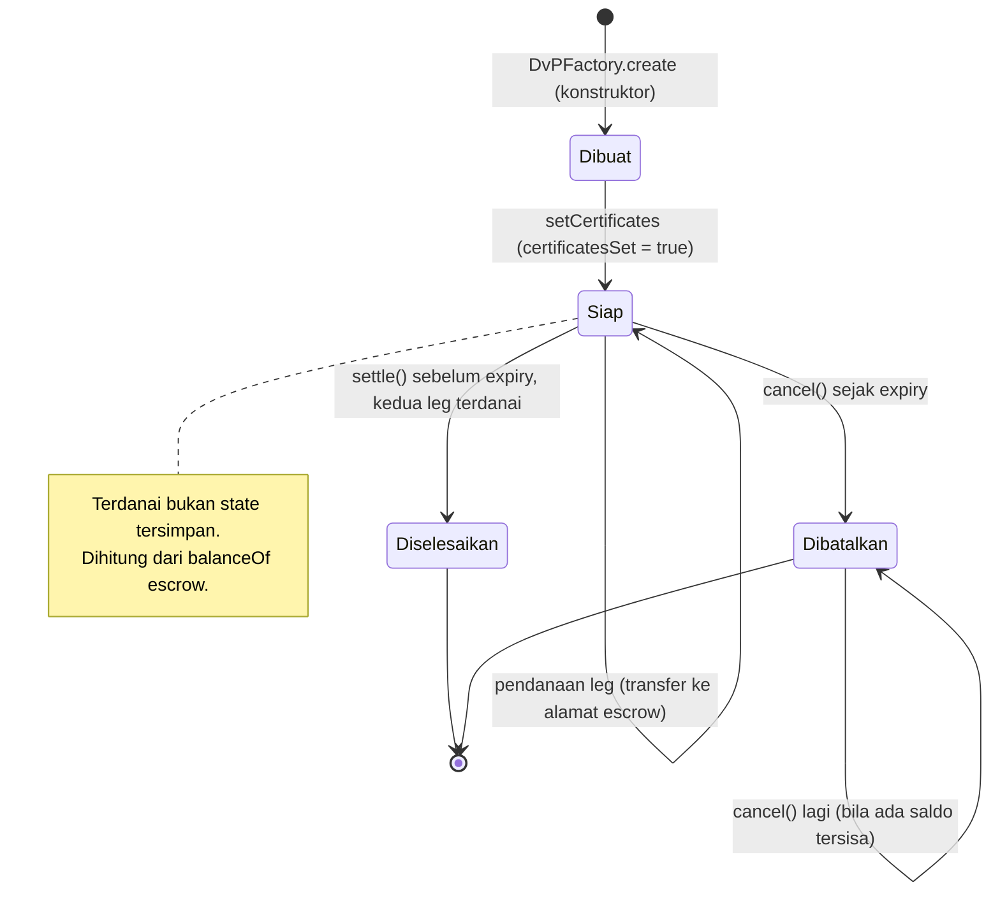

Catatan: "Dibuat" dan "Siap" terjadi dalam satu transaksi `create`. `settled` adalah satu-satunya flag yang berubah setelahnya; status "dibatalkan" tidak disimpan (hanya event `Cancelled`).

### 5.7 `InstrumentRegistry` (`InstrumentRegistry.sol`)

- **Tujuan.** Indeks on-chain data instrumen: per token menyimpan hash canonical JSON dan URI record off-chain, dengan riwayat versi yang tidak pernah ditimpa. Satu registri untuk jalur stealth dan Zeto.
- **Inheritance/import.** Tidak ada.
- **State.**

  | Nama | Tipe | Arti |
  |---|---|---|
  | `owner` | `address` | Mengelola registrar dan kepemilikan |
  | `isRegistrar` | `mapping(address => bool)` | Pihak yang boleh mendaftar |
  | `_versions` | `mapping(address => Instrument[])` | Riwayat per token (indeks = versi - 1) |
  | `Instrument` (struct) | `{token, kind bytes32, profileVersion string, primaryId string, dataHash bytes32, dataUri string, registrant, registeredAt, version}` | Satu entri |

- **Error.** `NotOwner`, `NotRegistrar`, `AlreadyRegistered`, `NotRegisteredYet`, `IdentityChanged`, `UnknownInstrument`, `EmptyInput` (`:12-18`). **Event.** `InstrumentRegistered(token indexed, kind indexed, version, primaryId, dataHash, dataUri, registrant)`, `RegistrarSet`, `OwnershipTransferred`.
- **Fungsi.**

  | Fungsi | Siapa | Precondition | Efek | Revert |
  |---|---|---|---|---|
  | konstruktor (`:48-51`) | deployer | - | `owner = msg.sender` | - |
  | `setRegistrar(registrar, allowed)` (`:63`) | `onlyOwner` (`:53-56`) | - | Mengubah `isRegistrar` | `NotOwner` |
  | `transferOwnership(newOwner)` (`:68`) | `onlyOwner` | `newOwner != 0` | Ganti owner | `NotOwner`, `EmptyInput` |
  | `register(token, kind, profileVersion, primaryId, dataHash, dataUri)` (`:75-85`) | `onlyRegistrar` (`:58-61`) | Token belum punya entri; `_append` lolos | Membuat versi 1; `InstrumentRegistered` | `NotRegistrar`, `AlreadyRegistered`, `EmptyInput` |
  | `registerVersion(...)` (`:89-101`) | `onlyRegistrar` (registrar mana pun) | Token sudah terdaftar; `kind` dan `primaryId` sama dengan versi 1 | Menambah versi berikut; versi lama tidak berubah | `NotRegistrar`, `NotRegisteredYet`, `IdentityChanged`, `EmptyInput` |
  | `getInstrument(token)` (`:104-108`), `getInstrumentVersion(token, v)` (`:111-115`) | view | `v` dalam `1..n` | Entri terbaru / versi tertentu | `UnknownInstrument` |
  | `versionCount(token)` (`:118`), `isRegistered(token)` (`:122`) | view | - | - | - |
  | `_append` (`:126-143`) | private | `token != 0`, `kind != 0`, `profileVersion`, `primaryId`, `dataUri` tidak kosong, `dataHash != 0` | Menambah entri; `InstrumentRegistered` | `EmptyInput` |

- **Invariant.** (1) Entri tidak pernah ditimpa atau dihapus. (2) `kind` dan `primaryId` token tetap seperti versi 1 (ISIN yang salah di versi 1 hanya bisa diperbaiki dengan registrasi token baru). (3) Versi dimulai 1 dan bertambah 1.
- **Catatan.** `kind` adalah `bytes32` bebas (bukan enum); kontrak tidak mengenal RD atau DFABI. Kontrak tidak memeriksa isi hash.

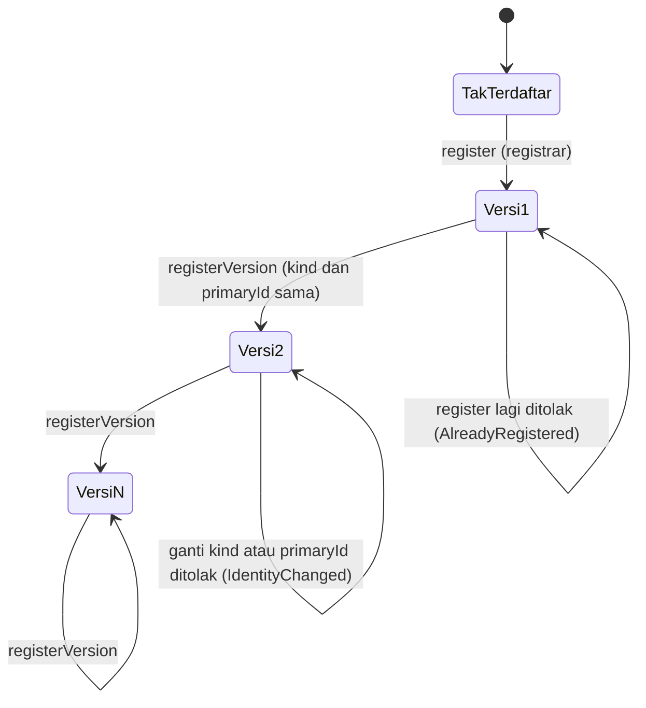

### 5.8 Ringkasan siapa-boleh-apa

| Kontrak | Fungsi yang membatasi pemanggil | Pembatas |
|---|---|---|
| `RupiahDigital` | `mint`, `mintStealth` | `issuer` (immutable) |
| `DfabiBond` | `issueByPartitionStealth` | minter/owner (`onlyMinter`, vendor) |
| `DfabiBond` | `transferByPartitionStealth`, `redeemByPartition`, `transferByPartition` | certificate custodian (validator) |
| `DvPFactory` | `create` | `custodian` (immutable) |
| `DvPEscrow` | `setCertificates` | `factory` (immutable) |
| `InstrumentRegistry` | `register`, `registerVersion` | registrar; `setRegistrar`, `transferOwnership`: owner |
| `ERC6538Registry` | `registerKeysOnBehalf` | tanda tangan registrant (EOA atau ERC-1271) |
| `ERC5564Announcer`, `DvPEscrow.settle/cancel` | - | Terbuka untuk siapa saja |

### 5.9 Fungsi token standar yang diwarisi

Fungsi di bawah tidak ditulis oleh kita; perilakunya diambil dari OpenZeppelin 5.4.0 (RD) dan UniversalToken ERC-1400 (DFABI). Semuanya tetap bisa dipanggil di kontrak ter-deploy, jadi relevan untuk privasi dan keamanan.

#### 5.9.1 `RupiahDigital`: OpenZeppelin `ERC20` dan `ERC20Burnable`

| Fungsi | Pemanggil | Langkah dan state yang berubah | Event | Revert |
|---|---|---|---|---|
| `transfer(to, value)` (`ERC20.sol:99`) | Pemegang | `_transfer(msg.sender, to, value)` (`:159`): alamat 0 ditolak, lalu `_update` (`:176`): kurangi `_balances[from]`, tambah `_balances[to]`. **Tidak mengumumkan.** Tidak dibatasi (tanpa pause, tanpa allowlist). | `Transfer` | `ERC20InvalidReceiver`, `ERC20InsufficientBalance` |
| `approve(spender, value)` (`:120`) | Pemegang | `_allowances[msg.sender][spender] = value` | `Approval` | `ERC20InvalidSpender` (spender 0) |
| `transferFrom(from, to, value)` (`:142`) | Spender ber-allowance | `_spendAllowance(from, msg.sender, value)` (`:294`; allowance berkurang kecuali `type(uint256).max`), lalu `_transfer`. **Tidak mengumumkan.** | `Transfer`, `Approval` (bila allowance berkurang) | `ERC20InsufficientAllowance`, `ERC20InvalidReceiver`, `ERC20InsufficientBalance` |
| `mint` (`RupiahDigital.sol:33`) | `issuer` saja | `_mint(to, value)` (`ERC20.sol:214`): `_update(0, to, value)`, `totalSupply += value`. Tanpa announcement | `Transfer(0, to, value)` | `OnlyIssuer`, `ERC20InvalidReceiver` |
| `burn(value)` (`ERC20Burnable.sol:20`) | Pemegang | `_burn(msg.sender, value)` (`ERC20.sol:229`): `_update(account, 0, value)`, kurangi saldo dan `totalSupply`. Tanpa announcement | `Transfer(account, 0, value)` | `ERC20InsufficientBalance` |
| `burnFrom(account, value)` (`ERC20Burnable.sol:35`) | Spender ber-allowance | `_spendAllowance`, lalu `_burn(account, value)` | `Transfer`, `Approval` | `ERC20InsufficientAllowance`, `ERC20InsufficientBalance` |
| `balanceOf`, `totalSupply`, `allowance`, `name`, `symbol` | Siapa saja (view) | Membaca state; `decimals()` dioverride menjadi 0 (`RupiahDigital.sol:29`) | - | - |

Akibat: di RD hanya `mintStealth` dan `sendStealth` yang memberi tahu penerima. `transfer`/`transferFrom` ke alamat stealth tetap berjalan dan diam.

#### 5.9.2 `DfabiBond`: UniversalToken ERC-1400

| Fungsi | Pemanggil | Langkah dan state yang berubah | Event | Revert |
|---|---|---|---|---|
| `transfer(to, value)` (`ERC1400.sol:232`) | Pemegang | `_transferByDefaultPartitions(msg.sender, msg.sender, to, value, "")` (`:929`): `"55"` bila tidak ada partition bawaan; menguras partition bawaan berurutan lewat `_transferByPartition`; `"52"` bila sisa > 0. Validator: selector `transfer` dikecualikan dari certificate, tetapi **allowlist** berlaku sehingga pengirim dan penerima harus di allowlist (hanya custodian) → `"54"` untuk alamat lain | `Transfer`, `TransferByPartition` | `"54"` (terkunci), `"55"`, `"52"` |
| `approve(spender, value)` (`:251`) | Pemegang | `require(spender != 0, "56")`; `_allowed[msg.sender][spender] = value` | `Approval` | `"56"` |
| `transferFrom(from, to, value)` (`:264`) | Operator atau spender ber-allowance | `require(_isOperator(msg.sender, from) \|\| value <= _allowed[from][msg.sender], "53")`; kurangi allowance; `_transferByDefaultPartitions`. Allowlist berlaku seperti `transfer` | `Transfer`, `TransferByPartition` | `"53"`, `"54"`, `"55"`, `"52"` |
| `transferByPartition` (`:411`), `operatorTransferByPartition` (`:434`) | Lihat S6 | Butuh certificate (pemegang), controller dikecualikan bila certificate signer | `TransferByPartition` | `"54"`, `"53"`, `"52"` |
| `issueByPartition` (`:574`) | `onlyMinter`, `isIssuableToken` | Penerbitan diam (S5) | `Issued`, `IssuedByPartition` | revert tanpa data, `"55"` |
| `redeem` (`:591`), `redeemFrom` (`:603`), `redeemByPartition` (`:625`), `operatorRedeemByPartition` (`:638`) | Lihat S6 | Membakar saldo dan `_totalSupply`; tanpa announcement | `Redeemed`, `RedeemedByPartition` | `"54"`, `"53"`, `"52"`, `"55"` |
| `authorizeOperator` / `revokeOperator` (`:482,492`), `authorizeOperatorByPartition` / `revokeOperatorByPartition` (`:502,512`) | Pemegang | Mengubah `_authorizedOperator[operator][msg.sender]` atau versi partition. `authorizeOperator` menolak `operator == msg.sender` (`require` tanpa pesan) | `AuthorizedOperator`, `RevokedOperator` (+ ByPartition) | revert tanpa data |
| `setDocument` (`:304`), `removeDocument` (`:320`) | Controller | `setDocument`: `require(_isController[msg.sender])`; `removeDocument`: `require(_isController, "Unauthorized")` dan dokumen harus ada (`"Document doesnt exist"`); mengubah dokumen ERC-1643 | `DocumentUpdated`, `DocumentRemoved` | `setDocument`: revert tanpa data; `removeDocument`: string di samping |
| `setTokenExtension` (`:818`) | `onlyOwner` | Mendaftarkan validator (ERC1820) dan peran extension | - | `Ownable` |
| `setDefaultPartitions` (`:774`) | `onlyOwner` | Mengubah partition bawaan | - | `Ownable` |
| `migrate(newContract, definitive)` (`:837`) | `onlyOwner` | `_migrate` (`:1424`): mengarahkan antarmuka ERC1820 ke kontrak baru; bila `definitive`, `_migrated = true` sehingga `_transferWithData`, `_issue`, `_redeem` revert `"54"` (`isNotMigratedToken`) | - | `Ownable` |
| `balanceOf`, `totalSupply`, `balanceOfByPartition`, `totalSupplyByPartition`, `partitionsOf`, `getDocument`, `isOperator`, `isControllable`, `isIssuable` | Siapa saja (view) | Membaca state | - | `getDocument`: revert tanpa data bila dokumen kosong (`:291`) |

Akibat: di bond, hanya `transferByPartitionStealth` memberi tahu penerima; jalur ERC-20 (`transfer`, `transferFrom`) terkunci oleh allowlist selama setup validator tidak diubah owner (diuji: E2E BOND-07).

#### 5.9.3 `ERC1400TokensValidator` (vendor)

| Fungsi | Pemanggil | Langkah dan state yang berubah | Revert |
|---|---|---|---|
| `registerTokenSetup(token, certificate, allowlist, blocklist, granularity, holds, operators)` (`:219`) | `onlyTokenController`: token itu sendiri, owner token, atau controller terdaftar (`:129-136`) | Menyimpan mode validasi per token; setup dipakai: certificate NonceBased (`1`), allowlist aktif | `"Sender is not a token controller."` |
| `addCertificateSigner(token, account)`, `removeCertificateSigner` (`CertificateSignerRole.sol:33,37`) | Certificate signer yang ada (`onlyCertificateSigner`) | Menambah/mencabut penanda-tangan; setiap signer dapat mengubah signer lain | revert bila bukan signer |
| `addAllowlisted(token, account)` (`AllowlistedRole.sol:36`) | Allowlist admin (`onlyAllowlistAdmin`) | Menambah alamat ke allowlist (hanya custodian di setup ini) | revert bila bukan admin |
| `tokensToValidate(...)` (`:286`) | Hanya dipanggil token | Alur validasi di S6; menaikkan `_usedCertificateNonce[token][operator]` saat certificate dipakai | `"54"`, `"50"`, `"55"` |
| `usedCertificateNonce(token, sender)` (`:1293`) | Siapa saja (view) | Nonce certificate berikutnya yang harus ditandatangani | - |

---

## 6. Dynamic view: alur utama

Konvensi: **S** = alamat stealth, **R** = ephemeral public key, **tag** = view tag (byte pertama hash bersama). Pada semua diagram yang memakai Announcer, `caller` event adalah alamat token, bukan pengirim.

### 6.1 Registrasi / onboarding

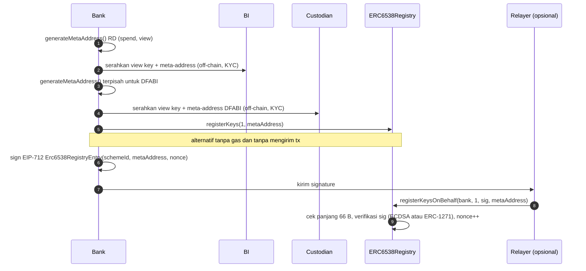

1. Bank membuat dua meta-address: satu untuk RD, satu untuk bond. Memisahkannya mencegah custodian (yang memegang view key bond) ikut melihat penerimaan RD bank.
2. View key dan meta-address diserahkan ke BI (RD) dan custodian (DFABI) di luar chain, saat onboarding/KYC. Spend key tidak pernah diserahkan.
3. Bank mendaftarkan meta-address di registri (`registerKeys`) agar pengirim dapat menemukannya; atau menandatangani EIP-712 dan membiarkan relayer mengirim `registerKeysOnBehalf` (wallet kontrak didukung lewat ERC-1271).
4. Registri menolak meta-address 66-byte yang salah (`InvalidMetaAddressLength`), tanda tangan salah/replay/nonce salah (`ERC6538Registry__InvalidSignature`); `incrementNonce` mencabut tanda tangan yang belum dikirim (E2E REG-02..19).

### 6.2 Penerbitan RD (BI mint)

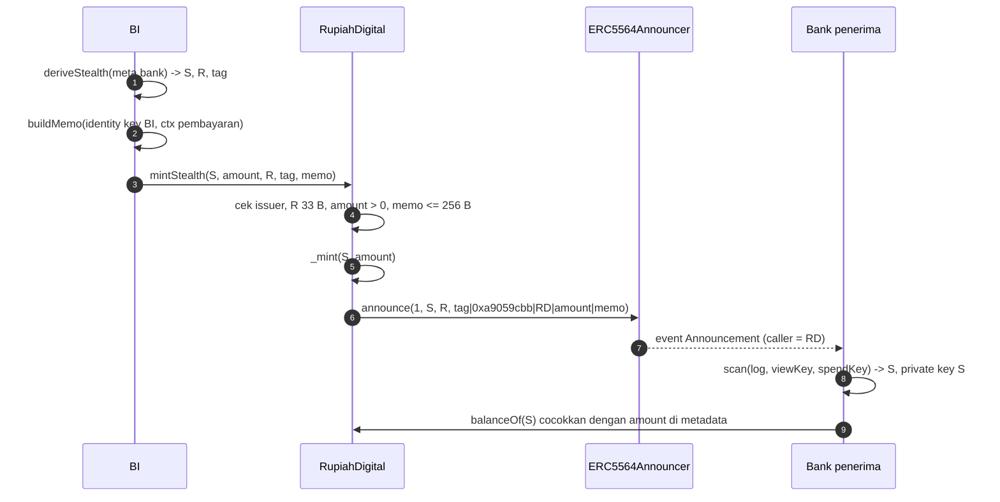

1. BI menurunkan S dari meta-address bank dan menyusun memo yang ditandatangani identity key BI.
2. `mintStealth` mencetak RD ke S dan men-announce dalam satu transaksi, sehingga jumlah yang diumumkan selalu sama dengan jumlah yang dicetak.
3. Bank memfilter log dengan `caller == alamat RD`, mencocokkan view tag, lalu memeriksa `balanceOf(S)`; saldo on-chain adalah otoritas, metadata hanya petunjuk.
4. Non-issuer ditolak dengan `OnlyIssuer`; `ZeroAmount`, `InvalidEphemeralPubKey`, `MemoTooLong` (E2E RD-01..08).

### 6.3 Transfer RD dan redeem/burn

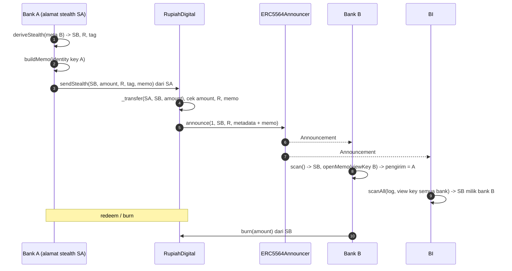

1. Bank A mengirim dari alamat stealth miliknya sendiri (SA), yang tidak punya saldo gas (gas price 0). Sisa saldo (kembalian) tetap di SA.
2. RD memindahkan saldo lalu men-announce metadata 57 byte + memo.
3. Bank B menemukan SB dengan view key dan spend key, lalu membuka memo untuk mengetahui pengirim terautentikasi.
4. BI memakai `scanAll` dengan view key semua bank untuk memetakan SB ke bank B dan membuka memo; tidak ada langkah online saat transfer.
5. **Redeem RD** saat ini hanya `burn`/`burnFrom` bawaan ERC20Burnable oleh pemegang sendiri. **Tidak ada alur redeem yang dikendalikan BI** (bagian 8.3). `burn` tidak men-announce.
6. `transfer`/`transferFrom` ERC-20 biasa ke alamat stealth tetap bisa, tetapi diam (tidak ada announcement), sehingga penerima tidak diberi tahu; wallet harus memakai `sendStealth`.

### 6.4 Penerbitan DFABI

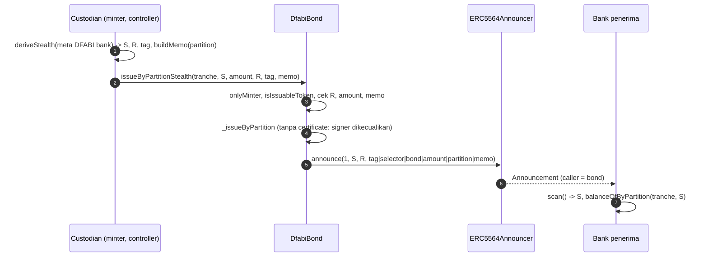

1. Hanya minter (custodian) yang boleh menerbitkan; non-minter ditolak (revert tanpa data, karena `onlyMinter` di vendor adalah `require` polos).
2. Penerbitan tidak membutuhkan certificate karena certificate signer dikecualikan oleh validator.
3. Metadata 89 byte memperluas layout ERC-20 EIP-5564 dengan partition (EIP tidak mendefinisikan layout ERC-1400).

### 6.5 Transfer DFABI dengan certificate

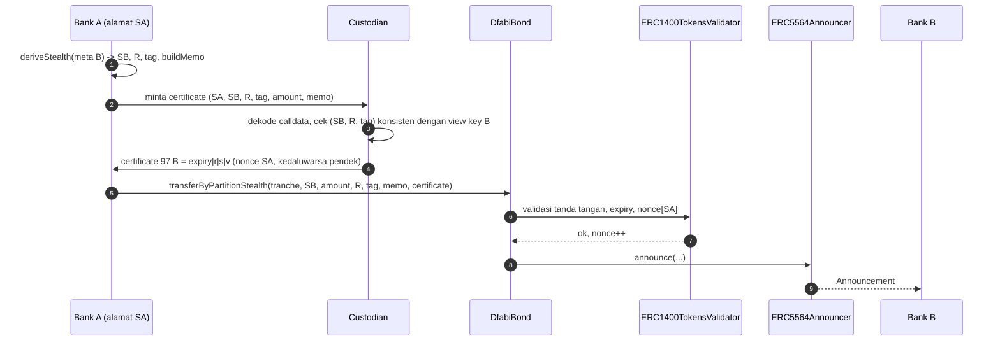

1. Certificate mengikat `msgSender`, token, seluruh calldata (kecuali ekor certificate), `expiry` dan `nonce` milik pengirim; karena itu certificate harus menjadi argumen ABI **terakhir**.
2. Custodian memutuskan kebijakan: ia hanya menandatangani selector `transferByPartitionStealth` dan `redeemByPartition`, dan hanya bila `(SB, R, tag)` konsisten. Kontrak tidak memeriksanya.
3. Penolakan yang diuji di E2E (semua revert `54`): tanpa certificate, jalur ERC-20 `transfer`, certificate kedaluwarsa, penanda-tangan bukan signer, pengirim/jumlah/memo lain, nonce salah, replay. Saldo kurang → `52`.
4. **Redeem**: `redeemByPartition(tranche, amount, certificate)` juga butuh certificate; custodian sebagai controller dapat membakar saldo lewat `operatorRedeemByPartition` tanpa certificate (bagian 8.1).
5. **Kupon/jatuh tempo**: DFABI adalah zero-coupon; tidak ada kode kupon, jadwal, atau pembayaran RD otomatis saat jatuh tempo (bagian 8.3). Maturity hanya data (`Maturity Date`) di record instrumen.

### 6.6 DvP atomik lewat escrow CREATE2

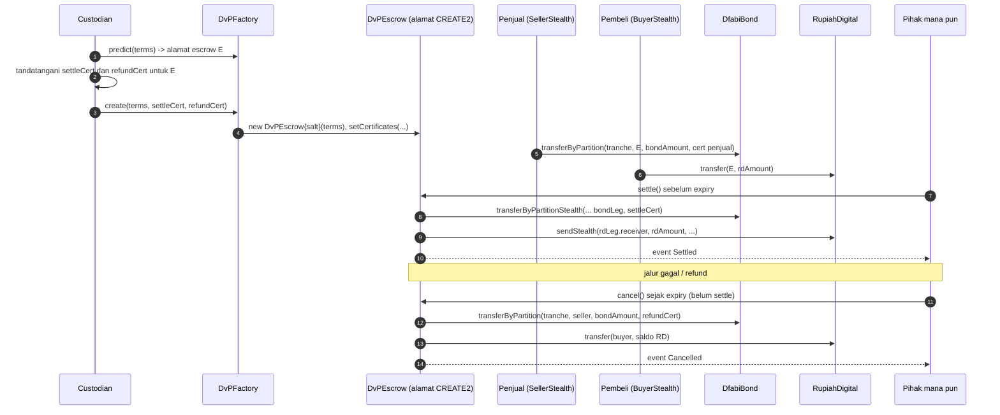

1. Terms (immutable): `tradeId`, token bond/partition/jumlah, token RD/jumlah, alamat stealth `seller` dan `buyer` (pendana dan penerima refund), `expiry`, `refundWindow`, serta dua leg (`receiver`, `ephemeralPubKey`, `viewTag`, `memo`). Tidak ada yang dapat diubah setelah dibuat, jadi penerima tidak dapat ditukar.
2. Custodian menghitung alamat escrow lewat `predict`, menandatangani certificate untuk alamat itu (certificate terikat `msgSender` = escrow), lalu `create`. Certificate dipasang segera setelah pembuatan (`setCertificates`, hanya factory, sekali), memecahkan sirkularitas "alamat bergantung terms, certificate bergantung alamat".
3. Cek on-chain pada pembuatan: certificate 97 byte (`BadCertificateLength`), `settleCert.expiry >= expiry` dan `refundCert.expiry >= expiry + refundWindow` (`CertificateExpiresTooEarly`). Kebenaran tanda tangan tidak diperiksa on-chain.
4. Penjual mendanai leg bond dengan certificate miliknya sendiri; pembeli mendanai leg RD dengan `transfer` biasa.
5. `settle()` (siapa saja, hanya `block.timestamp < expiry`): menolak `NotFunded` bila salah satu leg kurang, lalu menggerakkan kedua leg lewat `transferByPartitionStealth` dan `sendStealth` (jadi `caller` announcement adalah token). Revert di salah satu leg membatalkan keduanya. Kelebihan RD dikembalikan ke pembeli. `settle()` kedua → `AlreadySettled`; pada atau setelah `expiry` → `Expired`.
6. **Jalur gagal**: `cancel()` (siapa saja, mulai `expiry`, belum settle). Per leg: bond sebesar `bondAmount` kembali ke `seller` memakai refund certificate; seluruh saldo RD kembali ke `buyer`. Leg yang tidak didanai dilewati; `NothingToRefund` bila tak ada yang bergerak; sebelum `expiry` → `NotExpired`. Kegagalan refund bond (certificate kedaluwarsa) ditangkap (`BondRefundFailed`) agar tidak memblokir refund RD.
7. Nonce certificate escrow sama untuk settle dan refund, sehingga keduanya tidak mungkin sama-sama dieksekusi.
8. `settle()` dan `cancel()` tidak menerima argumen dan tidak butuh BI maupun custodian. E2E DVP-01..31 menguji seluruh jalur di atas, termasuk settle tanpa pendanaan penuh, settle setelah expiry, dan tiga bentuk cancel (kedua leg, hanya bond, hanya RD).

### 6.7 BI membaca lewat view key

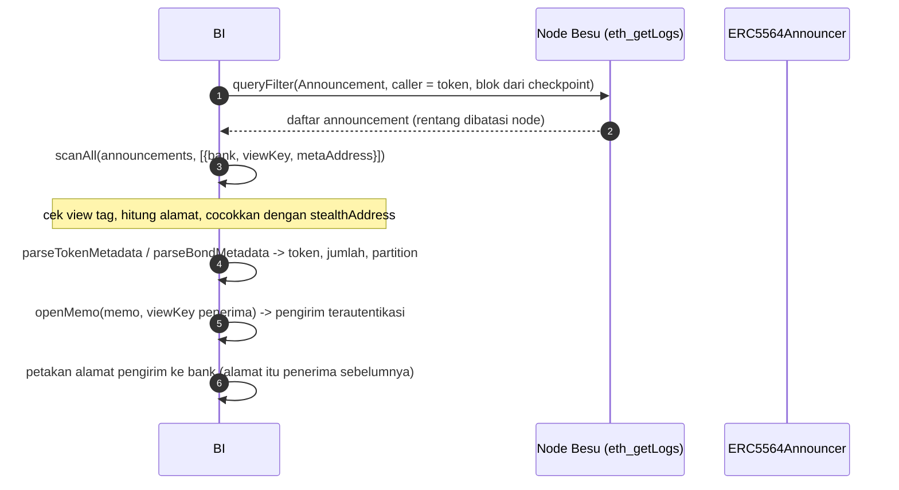

1. BI membaca log dalam rentang blok terbatas dan menyimpan checkpoint (Besu menolak `eth_getLogs` dari blok 0).
2. `scanAll` memakai view key plus *meta-address* (kunci publik spend) tiap bank: cukup untuk mengenali penerima, **tidak cukup untuk memindahkan dana**. `scanView` memeriksa bahwa view key cocok dengan meta-address.
3. Hanya announcement dengan `caller == alamat token` yang dipercaya (pemalsuan lewat `announce` langsung tampak di scan tanpa filter, tidak di scan terfilter; E2E RD-29, BOND-24).
4. `openMemo` membuka memo dengan view key penerima, memverifikasi tag GCM dan tanda tangan pengirim atas `memoDigest`; memo tertukar, dipotong, diubah, atau dari pembayaran lain menghasilkan `null`.
5. Hasil: untuk tiap pembayaran, bank penerima, jumlah, token (dan tranche), serta identitas pengirim; saldo otoritatif tetap dari `balanceOf`/`balanceOfByPartition`.

---

## 7. Model privasi

Legenda: **penuh** = penerima (bank), jumlah, token, pengirim terautentikasi (memo). **Alamat** = alamat stealth sekali-pakai yang tidak dapat dikaitkan ke bank tanpa view key.

### 7.1 Per pihak

| Informasi | BI | Pengirim | Penerima | Bank lain | Publik (pembaca log) |
|---|---|---|---|---|---|
| **RD: jumlah dan token** | Ya | Ya | Ya | Ya (metadata publik) | Ya |
| **RD: alamat pengirim** | Ya, dan dipetakan ke bank | Ya | Ya (alamat) | Ya (alamat), tak bisa dipetakan | Ya (alamat) |
| **RD: identitas bank pengirim** | Ya (memo + peta alamat) | Ya | Ya (memo terautentikasi) | **Tidak** | **Tidak** |
| **RD: bank penerima** | Ya (view key) | Ya (ia yang memilih) | Ya | **Tidak** | **Tidak** |
| **RD: isi memo** | Ya | Ya | Ya | **Tidak** (hanya panjang 102 B terlihat) | **Tidak** |
| **DFABI: jumlah, token, tranche** | Ya | Ya | Ya | Ya (metadata publik) | Ya |
| **DFABI: bank penerima** | Custodian ya; BI hanya bila memegang view key bond | Ya | Ya | **Tidak** | **Tidak** |
| **DFABI: identitas pengirim** | Custodian ya (memo + calldata saat menandatangani) | Ya | Ya (memo) | **Tidak** | **Tidak** |
| **DvP: terms escrow (`getTerms`)** | Ya | Ya | Ya | Ya (dua alamat penerima + jumlah + token + `tradeId`) | Ya |
| **DvP: bank di balik tiap leg** | Ya (view key) | Penjual/pembeli melihat kedua penerima | Idem | **Tidak** | **Tidak** |
| **DvP: memo tiap leg** | Ya | Ya | Ya (penerima leg itu) | **Tidak** | **Tidak** |

### 7.2 Yang tetap terlihat (dengan sengaja)

- **Jumlah, token, tranche, dan alamat pengirim** adalah data publik (kebutuhan rancangan: lihat `docs/superpowers/specs/2026-10-15-stealth-core-design.md` bagian 1 dan 7 spec itu).
- **Graf alamat**: pengamat dapat melihat `SA → SB` dan bahwa keduanya milik pihak tak dikenal; bila sebuah alamat dipakai ulang (mis. kembalian di alamat pengirim), transfer yang dilakukannya dapat dikaitkan satu sama lain.
- **DvP**: kedua leg dalam satu transaksi `settle()` menautkan dua alamat penerima sebagai pasangan satu trade, dan rasio `rdAmount : bondAmount` (harga) publik.
- **Pengiriman tanpa memo**: kontrak mengizinkan memo kosong (E2E RD-08), sehingga identitas pengirim hanya terjamin bila pengirim memakainya (bagian 8.3).

### 7.3 Sebelum dan sesudah memo

Tanpa memo, BI hanya tahu penerima. Dengan memo (ditambahkan 2026-10-16), penerima dan BI mendapat identitas pengirim yang terautentikasi (tanda tangan identity key atas konteks pembayaran), dan bank lain tetap tidak dapat membacanya: kunci memo diturunkan dari titik ECDH yang sama dengan EIP-5564, sehingga hanya pemegang view key penerima (atau ephemeral key pengirim) yang bisa membukanya (`ts/memo.ts`).

---

## 8. Keamanan, keputusan desain & batasan

Hanya hal yang nyata di kode, test, dan spec.

### 8.1 Keamanan

**Kompromi kunci**

| Kunci | Dampak bila bocor | Yang ada di kode |
|---|---|---|
| Spend key bank | Dana di semua alamat turunan meta-address itu dapat dipindahkan | Spend key tidak diserahkan ke BI/custodian; `scanView` hanya memakai view key dan meta-address (`ts/stealth.ts:71`) |
| View key bank | Penerima dan memo terbaca (retroaktif); dana aman | Meta-address terpisah untuk RD dan bond dimungkinkan (view key bond yang dipegang custodian tidak membuka penerimaan RD) |
| Certificate signing key | Penerima dapat meng-*authorize* transfer/redeem bond | Certificate terikat `msgSender`, token, calldata, `expiry`, nonce (`ts/bond.ts:60`) |
| Owner token DFABI | Dapat mengubah setup validator/allowlist (membuka jalur ERC-20), menerbitkan tanpa announcement (`issueByPartition`), `migrate` | Tidak ada perlindungan di kontrak; dicatat di spec |
| Controller custodian | Dapat memaksa transfer dan membakar saldo (`operatorRedeemByPartition`) tanpa certificate | Dicatat di spec |
| Issuer RD | Penerbitan RD | `issuer` immutable (`RupiahDigital.sol:21`) |

**Front-running dan pemalsuan**

- Dana hanya dapat digerakkan pemilik private key alamat stealth (`spend + h`); pihak yang melihat transaksi di mempool tidak dapat mengalihkannya.
- `announce` terbuka, tetapi `caller` diisi Announcer dari `msg.sender` (`ERC5564Announcer.sol:17`): scanner memfilter `caller == token`; announcement palsu hanya muncul di scan tanpa filter (E2E RD-29, BOND-24). Saldo on-chain (`balanceOf`/`balanceOfByPartition`) adalah otoritas, bukan metadata.
- Dust: announcement 1 unit oleh pemegang token tetap lolos filter `caller`; `ZeroAmount` hanya menutup amount 0.
- DvP: `create` hanya custodian; tujuan tetap di terms; certificate terikat alamat escrow dan seluruh calldata termasuk memo (E2E DVP-23); `settle()`/`cancel()` tanpa argumen.

**Replay**

| Permukaan | Perlindungan | Bukti E2E |
|---|---|---|
| Certificate bond | Nonce per `msgSender` di validator, `expiry`, terikat calldata dan token | BOND-08..13, BOND-19 |
| `registerKeysOnBehalf` | Nonce per registrant, domain EIP-712 (chainId, alamat kontrak), terikat `schemeId` dan meta-address | REG-06..10, REG-16 |
| Memo | Tanda tangan atas `chainId, token, stealthAddress, amount, ephemeralPubKey [, partition]` | RD-24, BOND-23 |
| DvP | Flag `settled`; nonce certificate escrow dipakai bersama settle dan refund | DVP-14, DVP-15, DVP-27 |
| Lintas chain | `DOMAIN_SEPARATOR` registri dihitung ulang bila `chainid` berubah; domain separator token di digest certificate | `ERC6538Registry.sol:82` |

**Integritas memo.** AES-256-GCM (tag 16 byte, AAD = versi) ditambah tanda tangan identity key pengirim. Ciphertext/tag diubah, memo dipotong, konteks lain (jumlah, tranche), atau tanda tangan dari kunci lain membuat `openMemo` mengembalikan `null` (E2E RD-21..25, BOND-23). Nonce AES-GCM diturunkan dari ephemeral key sehingga ephemeral key harus baru untuk setiap pembayaran (`deriveStealth` membuatnya otomatis). Kontrak hanya membatasi panjang (`MAX_MEMO = 256`); pada DFABI, custodian ikut menjamin memo karena certificate mencakup seluruh calldata (`test_certificate_is_bound_to_the_memo`).

### 8.2 Keputusan desain (ADR ringkas)

Sumber: `docs/superpowers/specs/`.

| # | Keputusan | Alternatif | Alasan |
|---|---|---|---|
| 1 | Besu langsung, tanpa Paladin | Noto/Zeto di Paladin | Key manager Paladin tidak dapat menyimpan private key turunan sembarang, sehingga UTXO milik alamat stealth tidak dapat ditandatangani |
| 2 | ERC-5564 scheme 1 + ERC-6538, ditulis sendiri dari interface EIP | Menyalin ScopeLift | Kontrak kecil, tidak ada isu lisensi; kecocokan diverifikasi dengan vektor SDK referensi; tanda tangan registri diperiksa inline karena `mcopy` (Cancun) tidak ada di `shanghai` |
| 3 | Token yang memanggil `announce` | Pengirim memanggil Announcer sendiri | `caller == token` tak dapat dipalsukan dan jumlah yang diumumkan = jumlah yang dipindahkan, atomik |
| 4 | View key dibagi ke BI, scan setelah kejadian | Persetujuan BI per transfer | BI tidak berada di jalur transaksi (R2) dan tetap melihat penuh (R1) |
| 5 | Kripto memo di luar chain; kontrak hanya batasi panjang | Verifikasi on-chain atau memo wajib | Kontrak kecil tanpa kripto kurva; byte pertama metadata tetap view tag sehingga scanner EIP-5564 jalan |
| 6 | Kunci memo dari titik ECDH yang sama dengan EIP-5564 | Kunci khusus | View key penerima (dan BI) otomatis dapat membuka memo |
| 7 | ERC-1400 vendor tanpa modifikasi (Consensys UniversalToken, commit `54320c6f`) | Subset buatan sendiri | Keputusan pengguna; partition, ERC-1643, validator certificate sudah tersedia |
| 8 | Certificate nonce-based dari custodian + allowlist | Allowlist saja | Certificate mengikat calldata sehingga custodian dapat memeriksa penerima dan memo; allowlist menutup `transfer`/`transferFrom` |
| 9 | DvP: satu escrow per trade via CREATE2 | Pool bersama; HTLC | Saldo escrow = uang satu trade; atomik dalam satu chain; tanpa BI |
| 10 | Certificate dipasang setelah pembuatan (`setCertificates`) | Certificate bagian dari terms | Alamat escrow bergantung terms, certificate terikat alamat |
| 11 | `create` hanya custodian | Siapa saja | Custodian memeriksa KYC kedua penerima; pihak ketiga tidak dapat merebut alamat dengan certificate buruk |
| 12 | `settle()`/`cancel()` terbuka, tanpa argumen | Hanya pihak tertentu | Tidak butuh BI/custodian saat eksekusi; tujuan terkunci |
| 13 | Refund bond dalam `try/catch` | Revert bila gagal | Certificate refund kedaluwarsa tidak boleh menahan refund RD |
| 14 | Instrumen: hash on-chain, JSON off-chain; `kind` bytes32 bebas; validator berbasis profil | Terms on-chain; enum jenis | Jenis instrumen baru = file profil, tanpa perubahan kontrak/kode |
| 15 | `IdentityChanged` (kind dan primaryId tetap) | Koreksi bebas | Identitas token tidak boleh ditulis ulang |
| 16 | RD `decimals() = 0` | Desimal | Asumsi rupiah utuh (sama dengan backend) |
| 17 | `evm_version = shanghai` | Cancun | Selaras kontrak lain di repo dan terbukti berjalan di Besu live |

### 8.3 Batasan (fakta, bukan rencana)

| # | Batasan |
|---|---|
| 1 | **Tidak ada redeem RD yang dikendalikan BI.** RD hanya punya `burn`/`burnFrom` bawaan ERC20Burnable oleh pemegang; `burn` tidak men-announce. |
| 2 | **Tidak ada kupon atau pembayaran jatuh tempo.** DFABI zero-coupon; `Maturity Date` hanya data di record instrumen. `redeemByPartition` membakar bond dan tidak membayar RD. |
| 3 | **Memo tidak diwajibkan oleh kontrak.** Memo kosong diterima (E2E RD-08); identitas pengirim terautentikasi hanya bila pengirim memakai memo. |
| 4 | **Transfer ERC-20 polos RD (`transfer`, `transferFrom`) tidak mengumumkan apa pun** dan tidak diblokir. Pada bond jalur ini dikunci oleh allowlist validator. |
| 5 | **Daftar identitas bank yang sah (alamat penanda-tangan memo) tidak ada di kontrak.** |
| 6 | **Kebenaran tanda tangan certificate DvP tidak diperiksa saat `create`**; hanya panjang dan `expiry`. |
| 7 | **Transfer bond inheren ERC-1400 tidak mengumumkan:** `transferByPartition`, operator, `issueByPartition`; kebijakan penanda-tangan certificate adalah satu-satunya gerbang. |
| 8 | **Kunci:** script menerima kunci dari environment atau membangkitkannya di memori; tidak ada penyimpanan, rotasi, atau pencabutan kunci di kode. Eksplorasi memakai satu kunci deployer untuk BI, custodian, owner, dan registrar. |
| 9 | **Transfer DFABI memerlukan custodian online** (certificate nonce-based per transfer). Pembuatan trade DvP juga memerlukan custodian; `settle()`/`cancel()` tidak. |
| 10 | **Refund bond DvP** bisa tertunda atau tertahan: bila `cancel()` baru dipanggil setelah `expiry + refundWindow` refund certificate bisa kedaluwarsa (RD tetap kembali, bond menunggu controller); pemanggil dapat memberi gas yang cukup untuk selesai tetapi tidak untuk refund bond (`BondRefundFailed`, `cancel()` dapat diulang). Bond di luar terms hanya dapat dipulihkan controller. |
| 11 | **Dust:** satu unit announcement oleh pemegang token membebani setiap scanner dengan satu komputasi ECDH. `eth_getLogs` Besu dibatasi rentangnya sehingga scanner memakai checkpoint. |
| 12 | **DvP hanya 1:1:** tanpa partial fill, multi-leg, penemuan harga, atau pembatalan bersama sebelum `expiry`. |
| 13 | **Kode vendor ERC-1400 belum diaudit** dan repositori asalnya diarsipkan; kontrak milik kita juga belum diaudit pihak ketiga. |
| 14 | **Tidak ada backend, UI, atau adapter RTGS** untuk jalur ini; RD ini belum menggantikan Noto RD. |
| 15 | **Hanya profil RD dan DFABI.** Jenis lain (SBN, SRBI, sukuk) tidak punya profil; grup `extensions.sharia` dan `extensions.schedule` hanya dicadangkan di catalog. |
| 16 | **Gas price 0** pada jaringan ini; pada jaringan berbiaya alamat stealth baru memerlukan dana gas. |
| 17 | **Alamat stealth yang dipakai ulang** (mis. kembalian di alamat pengirim) membuat transfer-transfernya dapat dikaitkan satu sama lain. |
| 18 | **Hash instrumen cocok dengan jalur Zeto** diperiksa manual lintas repositori; bukan test otomatis di repo ini. |

---

## 9. Pengujian & bukti

### 9.1 Total (posisi `b2a5f2c`)

| Suite | Hasil |
|---|---|
| `forge test` | **84 lulus**, 0 gagal, 7 suite: Announcer 2, CertificateVector 1, RupiahDigital 15, InstrumentRegistry 11, ERC6538Registry 14, DfabiBond 19, DvP 22 |
| `npm test` (`tsc --noEmit` + vitest) | **98 lulus**, 6 file: token 7, bond 10, instrument 50, stealth 14, memo 11, viewscan 6 |
| E2E live Besu (`npm run e2e`, `script/e2e.ts`) | **152 kasus lulus, 0 gagal**: happy **36/36**, negative **116/116** |

Sebaran E2E: REG 19, RD 35, BOND 31, DVP 31, INS 36. Laporan lengkap (matriks per kasus: ID, fitur, tipe, expected, actual, hasil, hash tx): `docs/e2e-report-2026-10-17.md`. Setiap kasus negatif memeriksa nama revert yang persis (custom error, string revert vendor `"54"`/`"52"`, atau "revert (no data)" untuk `require` polos), bukan sekadar gagal. E2E men-deploy kontrak baru pada setiap jalan.

### 9.2 Cakupan E2E per kontrak

| Kontrak | Happy | Negative (error persis) |
|---|---|---|
| `ERC6538Registry` | `registerKeys`, sender flow + spend, `registerKeysOnBehalf` (EIP-712, ERC-1271), `incrementNonce`, DOMAIN_SEPARATOR | `InvalidMetaAddressLength`; `ERC6538Registry__InvalidSignature` (replay, nonce, penanda-tangan, meta/skema berbeda, tanda tangan rusak, nonce dicabut, wallet 1271 salah) |
| `RupiahDigital` | `mintStealth`, `mint`, `sendStealth`, scan penerima, scan BI, `burn` | `OnlyIssuer`, `ZeroAmount`, `InvalidEphemeralPubKey`, `MemoTooLong`, `ERC20InsufficientBalance`, `ERC20InvalidReceiver`, `ERC20InsufficientAllowance` |
| `DfabiBond` + validator | issue, transfer, redeem dengan certificate, scan, memo | revert tanpa data (non-minter), `"54"` (tanpa/kedaluwarsa/salah signer/pengirim/jumlah/memo/nonce/replay/jalur ERC-20), `"52"`, `MemoTooLong`, `InvalidEphemeralPubKey`, `ZeroAmount` |
| `DvPFactory` / `DvPEscrow` | create, settle oleh pihak ketiga, cancel (kedua leg, hanya bond, hanya RD), visibilitas BI | `OnlyCustodian`, `OnlyFactory`, `CertificateExpiresTooEarly`, `BadCertificateLength`, `NotFunded`, `AlreadySettled`, `Expired`, `NotExpired`, `NothingToRefund`, tabrakan CREATE2 |
| `InstrumentRegistry` | register RD dan DFABI, `registerVersion`, baca ulang, hash dihitung ulang dari JSON, `setDocument` | `AlreadyRegistered`, `NotRegistrar`, `NotRegisteredYet`, `IdentityChanged`, `EmptyInput`, `UnknownInstrument`, `NotOwner` |
| Validator instrumen (`ts/instrument.ts`) | RD dan DFABI contoh valid | Pesan persis: ISIN/LEI salah, field wajib hilang, field terlarang, mata uang, tipe, kind, schema |

### 9.3 Bukti tambahan

- Smoke live per fitur: `script/smoke.ts`, `smoke-rd.ts`, `smoke-bond.ts`, `smoke-dvp.ts`, `smoke-instrument.ts`; hasilnya tercatat di bagian Results spec masing-masing.
- Mutation check manual pada batas DvP (`expiry`, refund window, refund kelebihan RD, flag `settled`): tiap mutasi menggagalkan setidaknya satu test (`docs/superpowers/specs/2026-10-16-dvp-design.md`, bagian 5).

---

*Dokumen ini tidak memuat private key, isi `.env`, maupun teks dari PDF ICMA.*
