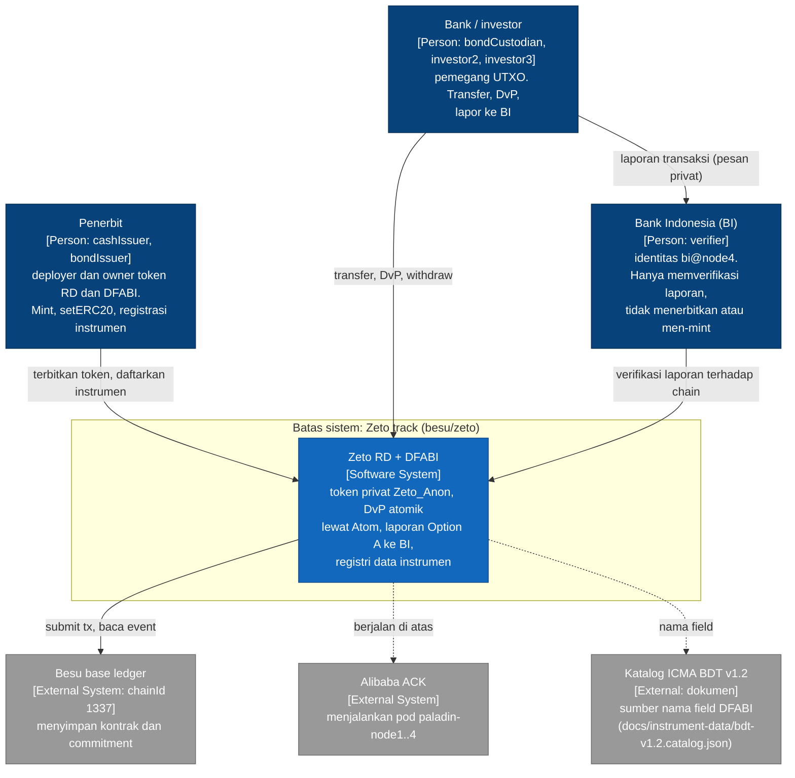
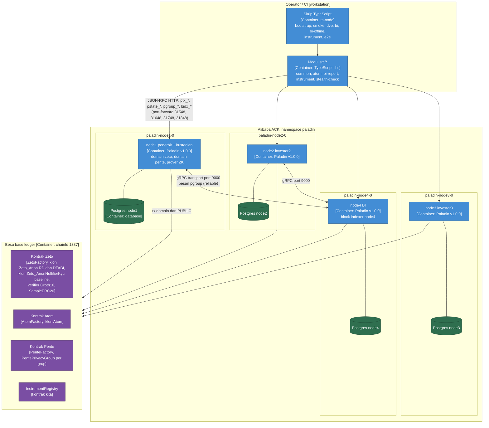
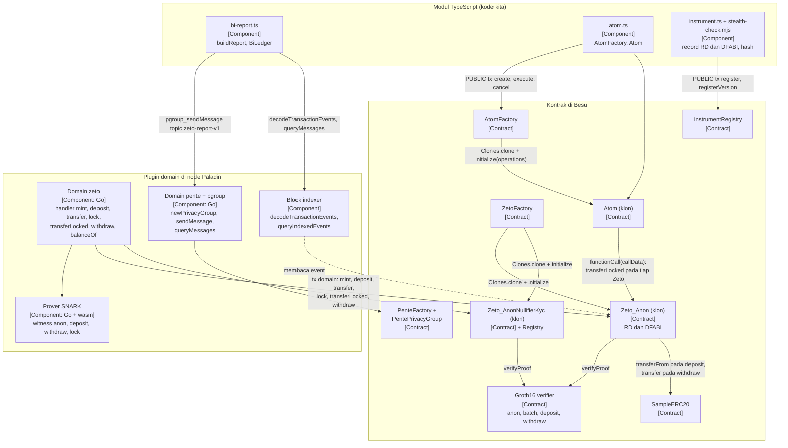
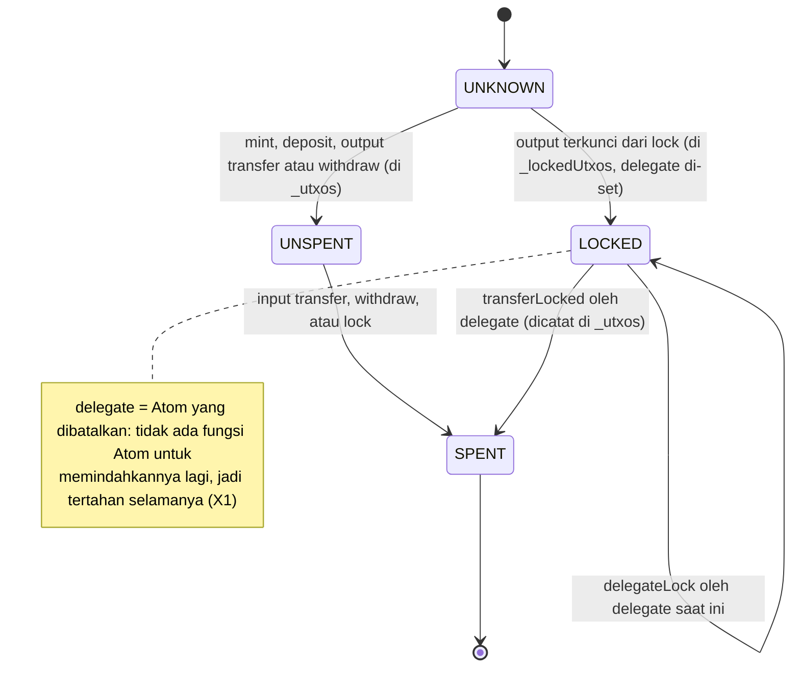
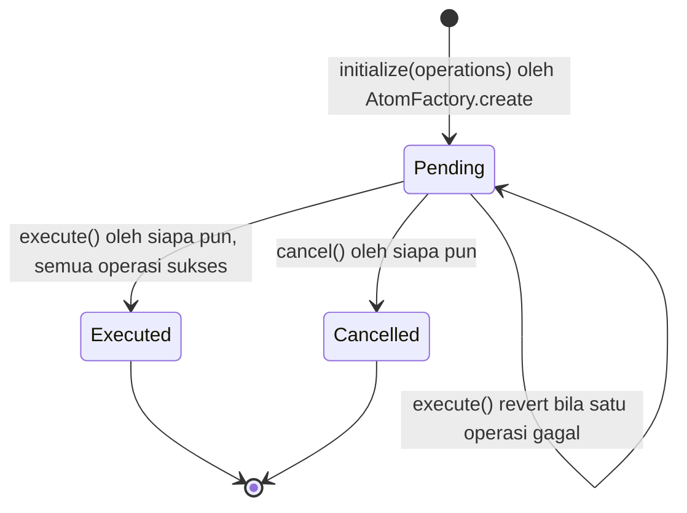
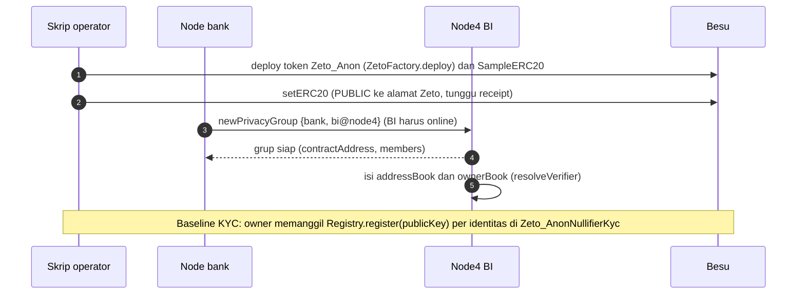
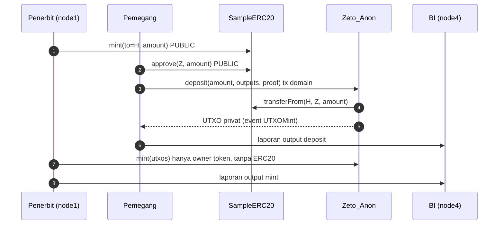
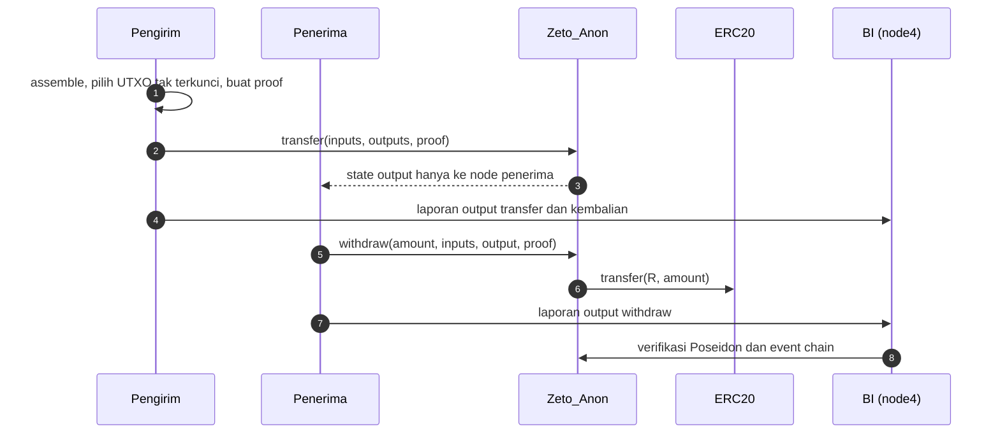
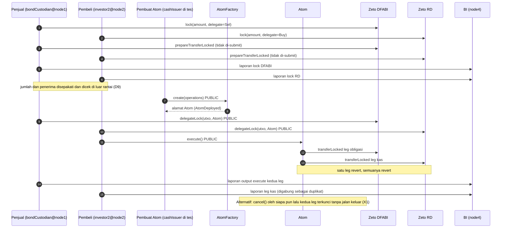
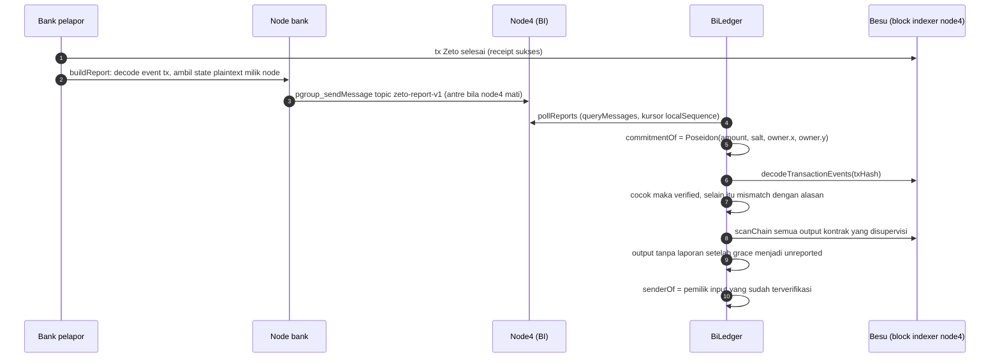

# Zeto Track: Architecture Brief (model C4)

Dokumen arsitektur untuk eksplorasi RD (Rupiah Digital) dan DFABI di atas Paladin `zeto` domain. Hanya
yang **sudah ada dan terbukti dari kode, tes, atau docs** yang ditulis di sini. Tanggal acuan: 2026-10-17.
Status: eksplorasi mandiri, tidak terintegrasi dengan backend Noto+Pente.

> **Pembaruan platform dan topologi.** Kode sekarang menargetkan Zeto V1 (Paladin main + PR #1189) dan BI di node1. Bagian "Platform" dan
> bagian 10 di bawah adalah sumber kebenaran untuk keadaan sekarang. Bagian 1 sampai 9 ditulis untuk **V0 / Paladin v1.0.0 dengan BI di node4**; isinya
> dipertahankan sebagai riwayat temuan dan hanya ditandai, tidak dihapus. Bila ada perbedaan, bagian 10 yang berlaku.
>
> **V0 dipensiunkan (2026-10-21).** Config domain `zeto` hanya memuat `Zeto_Anon_V1`; deploy token V0 ditolak (`PD210000`). Kontrak v0.2.2 dan
> token V0 lama tetap di chain tetapi tidak dipakai. Lensa sudah di-bootstrap ulang ke token V1. Backup dan rollback: `out/domain-v0-removal-backup-20261021/`.

## Platform

- Paladin: `main` 559567e38 digabung PR #1189 "Zeto V1 support with multi-version support" (merge 82fbd49ce), worktree `/home/ecs-user/eksplorasi-paladin/build-v1/paladin` (branch `build-main-zeto-v1`).
- Zeto contracts v0.5.1, sumbu V1: token dideploy dengan `tokenName: "Zeto_Anon_V1"` (nama implementasi V1 di factory cluster; `Zeto_Anon` masih v0.2.2), `domainConfigSchema: "v1"`, `zetoVariant: 1`, `factoryVersion: 1` (`ZETO_V1`, `src/zeto-v1.ts`; `P@main:examples/swap/src/index.ts:136-143`).
- Prover: rapidsnark `main` (thread-safe). Akar masalah "Invalid proof" konkuren sebelumnya (stress multi-token) adalah ThreadPool rapidsnark v0.0.7 yang tidak thread-safe.
- Topologi: node1 = BI (`bi`, `cashIssuer`, `bondIssuer`, `bondCustodian` semuanya BI), node2-4 = bank (`investor2`, `investor3`, `investor4`). Node4 bukan BI lagi.

Notasi rujukan:

- `kode kita` = path relatif terhadap `besu/zeto/` (mis. `src/bi-report.ts:41`).
- `Z@v0.2.2:file:baris` = repo `hyperledger-labs/zeto` tag `v0.2.2`, direktori `solidity/contracts/`. Versi ini dipin oleh
  `paladin@v1.0.0:domains/zeto/build.gradle:36,96` dan `paladin@v1.0.0:solidity/package.json:15`. Source dibaca dari clone tag v0.2.2.
- `P@v1.0.0:file:baris` = repo `LFDT-Paladin/paladin` tag `v1.0.0` (dibaca dengan `git show v1.0.0:<path>`).
- Nama fungsi dan nomor baris Solidity berasal dari source tersebut. Bytecode yang berjalan di cluster dibangun dari artefak yang sama,
  tetapi tidak dibandingkan byte-per-byte.

Daftar isi: 10 Zeto V1 dan topologi BI di node1 (keadaan sekarang), 1 Ringkasan, 2 C4 Level 1 System Context, 3 C4 Level 2 Container, 4 C4 Level 3 Component,
5 C4 Level 4 Code (katalog layanan dan fungsi, logika per kontrak), 6 Dynamic view, 7 Model privasi,
8 Keamanan, keputusan desain dan batasan, 9 Pengujian dan bukti.

---

## 1. Ringkasan (V0 / Paladin v1.0.0, BI di node4)

1. Track ini menjalankan RD (kas) dan DFABI (obligasi) sebagai token `Zeto_Anon` di Paladin v1.0.0 (Alibaba ACK, 4 node) di atas
   Besu. Hanya komponen resmi Paladin v1.0.0 yang dipakai, tanpa patch image dan tanpa custom circuit (`docs/plans/2026-10-16-option-a-bi-reporting.md`).
2. **R1 (hanya BI, pengirim, penerima melihat transaksi penuh):** terpenuhi dengan prosedur plus deteksi, bukan protokol. Zeto mengirim state
   hanya ke pemilik (`P@v1.0.0:domains/zeto/internal/zeto/fungible/states.go:62`). Bank melaporkan plaintext output ke BI lewat pesan
   Pente privacy group, BI menghitung ulang commitment Poseidon dan mencocokkannya dengan event chain (`src/bi-report.ts`).
3. **R2 (jalan saat node BI mati):** terbukti sekali. Tes 2026-10-17: node4 mati sekitar 56 detik, 3 flow selesai, 5 laporan antre lalu terverifikasi semua.
4. **R3 (DvP atomik):** terpenuhi lewat `Atom` (semua operasi dalam satu transaksi EVM, satu gagal berarti semua gagal). Output yang dimanipulasi menghasilkan
   `Invalid proof` dan tidak ada yang berpindah.
5. Status uji: E2E 94 kasus, happy 40/40, negatif 51/52, finding 2/2. Satu FAIL (N6) adalah celah di Paladin v1.0.0 dengan mitigasi aplikasi.
6. Temuan kode yang penting: `Atom` tidak mengikat jumlah dan penerima (D9), `Atom.cancel()` tanpa kontrol akses dan membekukan kedua leg tanpa jalan keluar (X1),
   dan transaksi PUBLIC ke kontrak Zeto tanpa handler domain dapat membuat node crash-loop (`setERC20`).
7. Tidak ada di track ini: login, gateway, manajemen kunci terpisah, burn, unlock, KYC pada DvP, dan mint oleh BI. Detail di bagian 5.1 dan 8.

---

## 2. C4 Level 1: System Context

Siapa memakai sistem, dan apa yang ada di luarnya. Batas sistem = apa yang berada di `besu/zeto/` dan cluster Paladin yang dipakainya.

### 2.1 Aktor dan penempatan node (V0, BI di node4; topologi sekarang di bagian 10.1)

Identitas ini dipakai konsisten oleh skrip (`bootstrap-zeto.ts:41-48`, `spike-zeto-dvp-zz.ts:46-49`, `spike-zeto-bi.ts`, `spike-zeto-bi-offline.ts`).

| Node (pod) | Identitas | Peran di track |
|---|---|---|
| node1 (`paladin-node1-0`) | `cashIssuer`, `bondIssuer`, `bondCustodian` | Penerbit RD, penerbit DFABI, kustodian/penjual DFABI |
| node2 (`paladin-node2-0`) | `investor2` | Pembeli DvP, penerima transfer |
| node3 (`paladin-node3-0`) | `investor3` | Kontrol privasi: tidak boleh melihat apa pun |
| node4 (`paladin-node4-0`) | `bi`, `investor4` | BI sebagai verifier. `investor4` dipakai tes `Atom.cancel()` oleh non-peserta (X1) |

Node4 sengaja menjadi node BI agar tes offline tidak menyentuh node1 (`docs/plans/2026-10-16-option-a-bi-reporting.md`, bagian Design).

### 2.2 Asumsi kepercayaan (yang berlaku di kode)

1. Operator tiap node memegang kunci identitasnya sendiri (kunci signer secp256k1 dan kunci Zeto BabyJubJub). Aplikasi hanya meminta tanda tangan atas nama identitas
   (`bootstrap-zeto.ts:51-60`, `spike-zeto-bi.ts:165-171`).
2. BI mempercayai pemetaan kunci ke identitas. `BiLedger` menerima `addressBook` dan `ownerBook` dari luar (`src/bi-report.ts:76-90`). Di tes, skrip mengisinya lewat
   `resolveVerifier` pada node BI (`spike-zeto-bi.ts:165-171`).
3. Bank bisa tidak jujur dalam melapor tetapi tidak bisa memalsukan: laporan dicocokkan dengan commitment on-chain. Menahan laporan terdeteksi (B6).
4. Pesan privacy group tidak punya jaminan urutan atau non-repudiation (`paladin@v1.0.0:doc-site/docs/architecture/pente.md:130-134`, dikutip README). Chain adalah sumber kebenaran.
5. Besu dipercaya untuk finalitas. Konsensus dan validator Besu tidak diperiksa di dokumen ini.

---

## 3. C4 Level 2: Container

Unit yang berjalan atau dideploy secara terpisah.

### 3.1 Daftar container

| Container | Teknologi | Isi dan fungsi | Sumber |
|---|---|---|---|
| `paladin-node1..4-0` | Paladin v1.0.0, 1 pod per node. Limit pod cpu 3 / mem 4Gi, request cpu 200m | Menjalankan domain `zeto` dan `pente`. Memilih state, membuat proof ZK, menandatangani dan men-submit tx, menyimpan dan mengirim pesan pgroup, mengindeks blok | README "Zeto domain install"; `besu/noto+pente/ops/resources/limitrange.yaml` (commit 07148d3) |
| Postgres per node | Postgres milik Paladin | Menyimpan transaksi, state privat, pesan. Dipakai pada pemulihan poison-pill (hapus baris `transaction_history` dan `transactions`) | README "Poison-pill" |
| Besu | chainId 1337 | Base ledger. Tempat semua kontrak di bawah ini | `src/instrument.ts:101` |
| Kontrak Zeto | `Z@v0.2.2` | `ZetoFactory`, klon `Zeto_Anon` (token RD dan DFABI di alur utama), klon `Zeto_AnonNullifierKyc` (baseline `bootstrap-zeto.ts`), verifier Groth16, `SampleERC20` | bagian 5 |
| Kontrak Atom | `P@v1.0.0:solidity/contracts/shared/` | `AtomFactory` dan klon `Atom` untuk DvP | bagian 5 |
| Kontrak Pente | `P@v1.0.0:solidity/contracts/domains/pente/` | `PenteFactory` dan `PentePrivacyGroup` per grup `{bank, bi@node4}` | bagian 5 |
| `InstrumentRegistry` | kontrak kita, commit stealth `8a89bc3` | Registri hash data instrumen. Satu-satunya kontrak buatan sendiri | `abis/InstrumentRegistry.json`; sumber `besu/stealth-address/src/InstrumentRegistry.sol` |
| Modul `src/*` | TypeScript | `common.ts` (koneksi node, timeout), `atom.ts` (wrapper AtomFactory/Atom), `bi-report.ts` (laporan dan `BiLedger`), `instrument.ts` (builder record RD dan DFABI), `stealth-check.mjs` (validator dan hash dari track stealth) | file masing-masing |
| Skrip | `ts-node`, dry-run kecuali `--execute` | `bootstrap-zeto.ts`, `smoke-zeto.ts`, `spike-zeto-dvp-zz.ts`, `spike-bi-messaging.ts`, `spike-zeto-bi.ts`, `spike-zeto-bi-offline.ts`, `spike-zeto-instrument.ts`, `spike-zeto-e2e.ts` | `package.json:6-14` |

### 3.2 Varian Zeto yang benar-benar dipakai

| Varian | Dipakai? | Di mana |
|---|---|---|
| `Zeto_Anon` | **Ya**, alur utama | DvP (`spike-zeto-dvp-zz.ts`), BI (`spike-zeto-bi.ts:81`), E2E, BI-offline. Satu-satunya yang mendukung lock dan `transferLocked` di Paladin v1.0.0 |
| `Zeto_AnonNullifierKyc` | **Ya**, hanya baseline | `bootstrap-zeto.ts:41`, `smoke-zeto.ts`, K1. `out/zeto-contract-data.json` memuat `tokenName` ini |
| `Zeto_AnonNullifier`, `Zeto_AnonEnc` | Terdaftar di factory (CR `core_v1alpha1_smartcontractdeployment_zeto_impl_*.yaml`), **tidak dipakai** | Satu baris perbandingan di bagian 5.2.2 |

Domain Zeto di Paladin v1.0.0 memetakan fungsi `mint`, `transfer`, `transferLocked`, `lock`, `deposit`, `withdraw`, `balanceOf`
(`P@v1.0.0:domains/zeto/internal/zeto/zeto.go:338-364`). `setERC20` dan `delegateLock` dikirim sebagai transaksi PUBLIC ke alamat Zeto
(`P@v1.0.0:sdk/typescript/src/domains/zeto.ts:207-235`).

---

## 4. C4 Level 3: Component

Komponen di dalam container: kontrak, plugin domain Paladin, dan modul TypeScript, beserta panggilan di antaranya.

### 4.1 Daftar komponen dan panggilan

| Komponen | Memanggil / dipanggil | Catatan |
|---|---|---|
| Domain `zeto` | Dipanggil SDK lewat `ptx_sendTransaction` bertipe PRIVATE (`zeto.ts:99-273`). Tiap handler punya fase `Init`, `Assemble`, `Endorse`, `Prepare` (mis. `handler_transferLocked.go:102,135,245,249`). `Prepare` mengubah hasil menjadi panggilan ke kontrak Zeto | `P@v1.0.0:domains/zeto/internal/zeto/fungible/handler_*.go` |
| Prover SNARK | Dipanggil domain pada `Assemble` lewat permintaan proving (`formatTransferProvingRequest`, `handler_transferLocked.go:219`) | Circuit wasm dan proving key datang dari artefak `zeto-wasm-v0.2.2` dan `zeto-test-proving-keys-v0.2.2` (`build.gradle:79-88,144-146`) |
| Pemilihan input | `buildInputsForExpectedTotal` (`fungible/states.go`) | Sumber N6 (bagian 8.1) |
| `ZetoFactory` | Dipanggil Paladin saat deploy token | `P@v1.0.0:solidity/contracts/domains/zeto/ZetoFactory.sol:17-47` |
| `Zeto_Anon`, `Zeto_AnonNullifierKyc` | Dipanggil Paladin (tx domain), SDK (tx PUBLIC `delegateLock`, `setERC20`, `register`), dan `Atom` (`transferLocked`) | Bagian 5 |
| `SampleERC20` | Dipanggil penerbit/pemegang (PUBLIC `mint`, `approve`) dan oleh kontrak Zeto (`transferFrom`, `transfer`) | `Z@v0.2.2:erc20.sol:28-38` |
| `AtomFactory`, `Atom` | Dipanggil `src/atom.ts` lewat tx PUBLIC | Bagian 5 |
| `BiLedger` | Membaca hanya node4 sendiri: `pgroup.queryMessages`, `bidx.queryIndexedEvents`, `bidx.decodeTransactionEvents`, `bidx.getTransactionByHash` | `src/bi-report.ts:128-146` |
| `InstrumentRegistry` | Dipanggil `spike-zeto-instrument.ts` lewat tx PUBLIC dari `bondIssuer`/`cashIssuer` | Bagian 5 |

---

## 5. C4 Level 4: Code

### 5.1 Katalog layanan dan fungsi

**Layanan bisnis yang diimplementasikan track ini.** Semuanya berupa kombinasi kontrak, domain Paladin, dan skrip. Tidak ada layanan server terpisah.

| # | Layanan | Ada? | Fungsi kontrak utama | Bukti kode/tes |
|---|---|---|---|---|
| S1 | Onboarding / KYC | Sebagian | `PenteFactory.newPrivacyGroup`, `Registry.register` (hanya token KYC baseline) | `spike-zeto-bi.ts:158-171`, `bootstrap-zeto.ts:96-98`, K1, M1-M5 |
| S2 | Penerbitan RD (mint, deposit) | Ya | `SampleERC20.mint`/`approve`, `Zeto_Anon.deposit`, `Zeto_Anon.mint` | L1, L3, L5, L7 |
| S3 | Transfer RD | Ya | `Zeto_Anon.transfer` | L9, L11-L14 |
| S4 | Penebusan RD (burn/withdraw) | Withdraw ya. **Burn tidak ada** | `Zeto_Anon.withdraw` | W1, W3, W4 |
| S5 | Penerbitan DFABI (mint, deposit) | Ya | sama dengan S2 pada token DFABI | L2, L4, L6 |
| S6 | Transfer dan redeem DFABI | Ya | `transfer` dan `withdraw` pada token DFABI | L8, L10, W2 |
| S7 | DvP: lock, prepare, approve (delegateLock), execute, cancel | Ya | `Zeto_Anon.lock`, `transferLocked`, `delegateLock`, `AtomFactory.create`, `Atom.execute`/`cancel` | S1 (E2E), D1-D10, N1-N9, F1-F3, X1-X5 |
| S8 | Laporan Option A ke BI | Ya (off-chain) | Tidak ada fungsi Zeto. Pesan `pgroup_sendMessage` | B1-B7 |
| S9 | Verifikasi oleh BI | Ya (off-chain) | Tidak ada kontrak. `BiLedger` membaca event Zeto | U1-U6, B5, B6 |
| S10 | Registri data instrumen | Ya | `InstrumentRegistry.register`/`registerVersion` | G1-G14, V1-V12 |
| - | Unlock lock | **Tidak ada** di Paladin. Kontrak punya `unlock` (`Z@v0.2.2:zeto_anon.sol:208-215`) tetapi domain tidak memetakannya (`P@v1.0.0:solidity/contracts/domains/interfaces/IZetoFungible.sol:9-28`). Reclaim = `transferLocked` ke diri sendiri | N9 |
| - | Mint oleh BI | **Tidak ada**. BI verifier-only | N3 (`out/bi-offline.md`) |
| - | KYC pada DvP | **Tidak ada** (circuit `transferLocked` KYC tidak dikirim di image v1.0.0, README "DvP findings") | README |

Konvensi tabel di bawah: `Proof` = struct `(uint256[2] pA, uint256[2][2] pB, uint256[2] pC)` (`Z@v0.2.2:lib/common.sol:22-26`).
**Tx domain** = SDK `ptx_sendTransaction` bertipe PRIVATE ke domain `zeto`: Paladin memilih state, membuat proof, lalu men-submit.
**Tx PUBLIC** = SDK mengirim panggilan kontrak biasa. Penanda tangan: `mint`, `deposit`, `withdraw` ditandatangani identitas pemanggil (`RequiredSigner = From`,
`handler_mint.go:156`, `handler_deposit.go:225`, `handler_withdraw.go:247`), sedangkan `transfer` biasa dan `lock` tanpa `RequiredSigner`, sehingga memakai kunci sekali pakai Paladin
(`handler_transfer.go:271-281`, `src/bi-report.ts:70-73`).

#### S1. Onboarding / KYC (V0 / Paladin v1.0.0; token V1 tanpa KYC)

| Kontrak | Fungsi | Pemanggil dan jalur | Langkah | Event | Revert |
|---|---|---|---|---|---|
| `PenteFactory` | `newPrivacyGroup(bytes32 transactionId, bytes data)` (`P@v1.0.0:solidity/contracts/domains/pente/PenteFactory.sol:30-42`) | Anggota grup, lewat SDK `PenteFactory.newPrivacyGroup({members, evmVersion, externalCallsEnabled})` (`spike-zeto-bi.ts:158`) | 1) membuat `ERC1967Proxy` ke implementasi `PentePrivacyGroup` dengan `initialize(data)`. 2) mengumumkan alamat ke Paladin | `PaladinRegisterSmartContract_V0(txId, instance, data)` | `PenteUnsupportedConfigType` bila selector config salah |
| `Registry` (di dalam `Zeto_AnonNullifierKyc`) | `register(uint256[2] publicKey, bytes data)` onlyOwner (`Z@v0.2.2:lib/registry.sol:45-50,69-80`) | Owner token (`bootstrap-zeto.ts:96-98`), tx PUBLIC ke alamat Zeto | 1) hash Poseidon kunci. 2) cek leaf belum ada. 3) `addLeaf` ke SMT `_publicKeysTree` | `IdentityRegistered(publicKey, data)` | `OwnableUnauthorizedAccount`, `AlreadyRegistered(publicKey)` |
| `Registry` | `isRegistered(uint256[2])`, `getIdentitiesRoot()` (view) | Siapa pun | Membaca SMT | - | - |

Buku BI (`addressBook`, `ownerBook`) bukan kontrak: diisi skrip dari `resolveVerifier` (`spike-zeto-bi.ts:165-171`). Pada token `Zeto_Anon` tidak ada KYC on-chain.

#### S2. Penerbitan RD (dan S5 DFABI: fungsi yang sama pada token DFABI oleh `bondIssuer`)

| Kontrak | Fungsi | Pemanggil dan jalur | Langkah | Event | Revert |
|---|---|---|---|---|---|
| `SampleERC20` | `mint(address to, uint256 amount)` onlyOwner (`Z@v0.2.2:erc20.sol:35-37`) | Penerbit (owner ERC20), tx PUBLIC (`spike-zeto-e2e.ts:160`) | `_mint(to, amount)` ERC20 | `Transfer(0, to, amount)` | `OwnableUnauthorizedAccount` |
| `SampleERC20` | `approve(address spender, uint256 value)` | Pemegang, tx PUBLIC | Set allowance ke alamat Zeto | `Approval` | - |
| `Zeto_Anon` | `deposit(uint256 amount, uint256[] outputs, Proof proof, bytes data)` (`Z@v0.2.2:zeto_anon.sol:142-150`) | Pemegang. **Tx domain** `deposit` (`zeto.ts:240`), ditandatangani identitas pemegang | 1) `_deposit`: verifikasi proof dengan public input `[amount, outputs[0], outputs[1]]` (`lib/zeto_fungible.sol:54-68`). 2) `_erc20.transferFrom(msg.sender, this, amount)` (`:70-73`). 3) `_mint(outputs)`: `validateOutputs`, set `_utxos[o] = UNSPENT` | `UTXOMint(outputs, submitter, data)` dan `Transfer` ERC20 | `Invalid proof`, `Failed to transfer ERC20 tokens`, error ERC20 allowance/saldo, `UTXODuplicate`, `UTXOAlreadyOwned`, `UTXOAlreadySpent` |
| `Zeto_Anon` | `mint(uint256[] utxos, bytes data)` onlyOwner (`zeto_anon.sol:172-177`) | Owner token (deployer). **Tx domain** `mint` (`zeto.ts:124`), `RequiredSigner = From` | `_mint(utxos)` seperti di atas. Tidak ada proof dan tidak ada ERC20, sehingga unit ini **tidak ditopang** ERC20 | `UTXOMint` | `OwnableUnauthorizedAccount` (L5, L6), `UTXODuplicate`, `UTXOAlreadyOwned` |
| `Zeto_Anon` | `setERC20(IERC20 erc20)` onlyOwner (`lib/zeto_fungible.sol:42-44`) | Owner, **tx PUBLIC ke alamat Zeto** (`zeto.ts:225`) | Menyimpan alamat ERC20 | - | `OwnableUnauthorizedAccount` |

#### S3. Transfer RD (dan S6 DFABI: fungsi yang sama)

| Kontrak | Fungsi | Pemanggil dan jalur | Langkah | Event | Revert |
|---|---|---|---|---|---|
| `Zeto_Anon` | `transfer(uint256[] inputs, uint256[] outputs, Proof proof, bytes data)` (`zeto_anon.sol:89-108`) | Pengirim. **Tx domain** `transfer` (`zeto.ts:141`), kunci sekali pakai | 1) `checkAndPadCommitments`: pad ke 2, atau ke `MAX_BATCH`=10 bila lebih dari 2 (`lib/zeto_common.sol:70-97`). 2) `validateTransactionProposal(..., false)`. 3) `verifyProof`: public input `[in0, in1, out0, out1]` (batch: 10+10) (`zeto_anon.sol:217-289`). 4) `processInputsAndOutputs`: input `SPENT`, output `UNSPENT` | `UTXOTransfer(inputs, outputs, submitter, data)` | `UTXOArrayTooLarge`, `UTXODuplicate`, `UTXONotMinted`, `UTXOAlreadySpent`, `UTXOAlreadyLocked`, `UTXOAlreadyOwned`, `Invalid proof`, `Invalid proof (batch)` |
| `Zeto_Anon` | `spent(uint256)`, `locked(uint256)` (view) (`lib/zeto_base.sol:54-58,287-292`) | Siapa pun | Membaca mapping status | - | - |
| Domain `zeto` | `balanceOf(string account)` (`handler_balanceOf.go:81`) | `ptx_call` | Menjumlahkan state tidak terkunci milik akun di node | - | - |

Sebelum kontrak, domain memilih input lewat `buildInputsForExpectedTotal` (`fungible/states.go`), dan di sinilah N6 bermula (bagian 8.1).
Pre-check saldo di aplikasi adalah mitigasinya. `Insufficient funds` (`PD210033`) muncul dari domain saat assemble (L10, L11, L14).

#### S4. Penebusan (withdraw) RD dan DFABI

| Kontrak | Fungsi | Pemanggil dan jalur | Langkah | Event | Revert |
|---|---|---|---|---|---|
| `Zeto_Anon` | `withdraw(uint256 amount, uint256[] inputs, uint256 output, Proof proof, bytes data)` (`zeto_anon.sol:152-170`) | Pemegang. **Tx domain** `withdraw` (`zeto.ts:254`), `RequiredSigner = From` | 1) pad input dan output, `validateTransactionProposal(..., false)`. 2) `_withdraw`: verifikasi proof dengan `[amount, inputs..., output]` (4, atau 12 untuk batch) (`lib/zeto_fungible_withdraw.sol:47-125`). 3) `_erc20.transfer(msg.sender, amount)` (`:127-130`). 4) input `SPENT`, output `UNSPENT` | `UTXOWithdraw(amount, inputs, output, submitter, data)` (**amount publik**) dan `Transfer` ERC20 | `Invalid proof`, `WithdrawArrayTooLarge`, `Failed to transfer ERC20 tokens`, `UTXO*` |

**Burn tidak ada** pada `Zeto_Anon`: `_burn` (`lib/zeto_base.sol:213-225`) hanya dipanggil oleh varian burnable (`lib/zeto_fungible_burn.sol:84`) yang tidak dipakai.
Event `UTXOBurn` ada di ABI tetapi tidak dipancarkan oleh token kita. Penebusan = `withdraw` (W1, W2).

#### S7. DvP: lock, prepare, approve (delegateLock), execute, cancel (V0 / Paladin v1.0.0; V1 di bagian 10.2)

| Kontrak | Fungsi | Pemanggil dan jalur | Langkah | Event | Revert |
|---|---|---|---|---|---|
| `Zeto_Anon` | `lock(uint256[] inputs, uint256[] outputs, uint256[] lockedOutputs, Proof proof, address delegate, bytes data)` (`zeto_anon.sol:179-206`) | Pemilik leg. **Tx domain** `lock` (`zeto.ts:193`, `handler_lock.go:118-170`); output terkunci dimiliki pengirim sendiri (`:156`) | 1) `validateTransactionProposal`. 2) proof transfer biasa atas `inputs` dan `outputs + lockedOutputs`. 3) input `SPENT` di `_utxos`, `lockedOutputs` jadi `UNSPENT` di `_lockedUtxos`. 4) `_lock`: `delegates[lockedOutput] = delegate` (`lib/zeto_base.sol:231-263`) | `UTXOsLocked(inputs, outputs, lockedOutputs, delegate, submitter, data)` | `NotLockDelegate` (bila output terkunci sudah punya delegate lain), `UTXO*`, `Invalid proof` |
| Domain `zeto` | `prepareTransferLocked` = `transferLocked` dengan intent PREPARE (`zeto.ts:175`) | Pemilik leg, via domain, **tidak di-submit** | `Assemble` memuat input terkunci (`handler_transferLocked.go:155`, tolak bila tidak terkunci: `:335-336`, `PD210128`), membuat proof dan output untuk penerima. `Prepare` mengembalikan calldata `transferLocked` (`:249-309`) | - | `PD210134` bila state terkunci sudah tidak ada |
| `Zeto_Anon` | `delegateLock(uint256[] utxos, address delegate, bytes data)` (`lib/zeto_base.sol:269-285`) | Delegate saat ini. **Tx PUBLIC ke alamat Zeto** (`zeto.ts:207`), ditandatangani identitas pemilik | 1) tiap UTXO: `delegates[utxo]` harus `msg.sender`. 2) set delegate baru (= alamat Atom) | `LockDelegateChanged(utxos, oldDelegate, newDelegate, data)` | `NotLockDelegate(utxo, delegate, sender)` (D1, N3, N4) |
| `AtomFactory` | `create(Operation[] operations)` (`P@v1.0.0:solidity/contracts/shared/AtomFactory.sol:16-20`) | Siapa pun. Di tes: `cashIssuer`, tx PUBLIC (`src/atom.ts:56-79`) | 1) `Clones.clone(logic)`. 2) `Atom.initialize(operations)` | `AtomDeployed(addr)` | - |
| `Atom` | `initialize(Operation[])` (`Atom.sol:46-54`) | Hanya sekali, oleh factory | Simpan operasi, `status = Pending` | `AtomStatusChanged(Pending)` | `InvalidInitialization` |
| `Atom` | `execute()` (`Atom.sol:60-71`) | **Siapa pun** (tx PUBLIC, di tes: pembeli, `src/atom.ts:92-102`) | 1) harus `Pending`, set `Executed`. 2) tiap operasi: `contractAddress.functionCall(callData)` = `Zeto.transferLocked(...)` dengan `msg.sender` = Atom | `AtomStatusChanged(Executed)` dan `UTXOTransfer` per leg | `AtomNotPending` (D4). Revert Zeto diteruskan: `NotLockDelegate` (D1), `UTXONotMinted` (D7), `Invalid proof` (N1, N2) |
| `Zeto_Anon` | `transferLocked(uint256[] inputs, uint256[] outputs, Proof proof, bytes data)` (`zeto_anon.sol:120-140`) | Delegate (Atom) saat `execute`. Atau pemilik sendiri untuk reclaim (N9) | 1) `validateTransactionProposal(..., true)`: `delegates[input]` harus `msg.sender` atau `0`. 2) `verifyProof`. 3) input `SPENT`, output `UNSPENT` | `UTXOTransfer` | `NotLockDelegate`, `UTXONotMinted`, `UTXOAlreadySpent`, `Invalid proof` |
| `Atom` | `cancel()` (`Atom.sol:102-108`) | **Siapa pun** (X1). Di tes `investor4`, tx PUBLIC | Harus `Pending`, set `Cancelled` | `AtomStatusChanged(Cancelled)` | `AtomNotPending` |
| `Atom` | `simulate()`, `getOperation(n)`, `getOperations()`, `getOperationCount()`, `status` | Siapa pun | `simulate` selalu revert dengan hasil operasi (untuk `eth_call`), lainnya view | - | `ExecutionResult(result)` |

Reclaim tanpa Atom (N9): pemilik memanggil `transferLocked` ke dirinya sendiri sebelum `prepareTransferLocked`/delegasi. Setelah itu tidak mungkin (F1, F2, X3, X4).

#### S8. Laporan Option A ke BI

Tidak ada fungsi kontrak Zeto. Jalurnya: SDK `pgroup.sendMessage({domain: "pente", group, topic: "zeto-report-v1", data})` (`spike-zeto-bi.ts:117-119`).

| Langkah | Kode | Catatan |
|---|---|---|
| 1. Ambil id output tx dari event | `chainOutputs` -> `bidx.decodeTransactionEvents` (`src/bi-report.ts:41-53`) | Event: `UTXOMint`, `UTXOTransfer`, `UTXOTransferWithEncryptedValues`, `UTXOWithdraw`, `UTXOBurn`, `UTXOsLocked` (`:6-10`) |
| 2. Ambil plaintext milik node bank | `buildReport`: `pstate.queryContractStates` pada skema `ZetoCoin` (`:57-68`) | Hanya state yang node itu pegang |
| 3. Kirim | `pgroup.sendMessage` | Paladin menyimpan pesan lokal dan mengirimnya sebagai reliable message via gRPC (`docs/plans/...`) |
| 4. Isi `Report` | `{v:1, token, contract, txHash, reporter, outputs[{commitment, amount, salt, owner}]}` (`:22-23`) | Tidak ditandatangani |

Kontrak `PentePrivacyGroup` per grup ada di chain, tetapi pesan laporan tidak melewati kontrak itu (jalur gRPC antar node).

#### S9. Verifikasi oleh BI (`BiLedger`, `src/bi-report.ts:76-161`)

| Fungsi | Langkah | Hasil |
|---|---|---|
| `check(r)` (`:96-112`) | 1) ambil output tx dari event. 2) per output hitung `Poseidon(amount, salt, owner.x, owner.y)` (`commitmentOf`, `:32-38`). 3) bandingkan dengan `commitment` dan dengan himpunan output on-chain | `verified` atau `mismatch` dengan alasan |
| `ingest(r)` (`:114-124`) | Abaikan kontrak yang tidak disupervisi (`:115`). Duplikat digabung | `verified`, `mismatches`, `duplicates` |
| `pollReports()` (`:127-134`) | `pgroup.queryMessages` topic `zeto-report-v1`, kursor `localSequence` | pesan baru |
| `scanChain()` (`:137-148`) | Semua event Zeto sejak `fromBlock`, tx sender via `getTransactionByHash` | peta output chain |
| `senderOf(o)` (`:152-155`) | Pemilik input yang sudah `verified`, atau `unknown-input-owner`, atau signer untuk mint/deposit | atribusi |
| `unreported(graceMs)` (`:157-160`) | Output chain tanpa laporan terverifikasi setelah grace | daftar `unreported` |

BI **tidak** memanggil kontrak apa pun. Tidak ada notifikasi atau alert otomatis: `unreported()` hanya mengembalikan daftar.

#### S10. Registri data instrumen (`InstrumentRegistry`, `besu/stealth-address/src/InstrumentRegistry.sol`)

| Fungsi | Pemanggil dan jalur | Langkah | Event | Revert |
|---|---|---|---|---|
| `setRegistrar(address, bool)` onlyOwner (`:63-66`) | Owner (`bondIssuer`), tx PUBLIC | Set allow-list | `RegistrarSet` | `NotOwner` |
| `register(token, kind, profileVersion, primaryId, dataHash, dataUri)` onlyRegistrar (`:75-85`) | `cashIssuer` (RD), `bondIssuer` (DFABI), tx PUBLIC | Tolak bila token sudah ada. `_append` membuat versi 1 (`:126-143`) | `InstrumentRegistered` | `NotRegistrar`, `AlreadyRegistered`, `EmptyInput` |
| `registerVersion(...)` onlyRegistrar (`:89-101`) | Registrar, tx PUBLIC | Harus ada v1. `kind` dan `primaryId` harus sama dengan v1. Tambah versi baru | `InstrumentRegistered` | `NotRegisteredYet`, `IdentityChanged`, `EmptyInput` |
| `getInstrument`, `getInstrumentVersion`, `versionCount`, `isRegistered` (view) | Siapa pun, `ptx.call` | Baca | - | `UnknownInstrument` (selector `0x9c848c00`, G13, G14) |

Format record (RD/DFABI, subset ICMA BDT v1.2) dibangun `src/instrument.ts` dan di-hash `keccak256` atas canonical JSON oleh `stealth-check.mjs`. Tidak ada teks dari PDF ICMA di repo ini.
`bdt` DFABI memuat 42 id katalog (`src/instrument.ts:182`). Grup **DLT Platform Information** diisi nilai Zeto (`:96-106`). RD tidak memakai BDT: atributnya di `extensions.cash` (`:150-167`).

### 5.2 Logika per kontrak

#### 5.2.1 `Zeto_Anon` (klon dari implementasi `Z@v0.2.2:zeto_anon.sol`)

- **Tujuan.** Token fungible UTXO dengan commitment `Poseidon(amount, salt, owner.x, owner.y)`. Saldo, pemilik, dan jumlah tidak terlihat di chain. Tidak ada nullifier:
  status tiap UTXO dilacak eksplisit (`lib/zeto_base.sol:23-24`).
- **Pewarisan.** `Zeto_Anon is IZeto, IZetoInitializable, ZetoBase, ZetoFungibleWithdraw, UUPSUpgradeable` (`zeto_anon.sol:40-45`).
  `ZetoBase is IZeto, IZetoLockable, ZetoCommon` (`lib/zeto_base.sol:27`). `ZetoCommon is IZeto, OwnableUpgradeable` (`lib/zeto_common.sol:26`).
  `ZetoFungibleWithdraw is ZetoFungible`, `ZetoFungible is OwnableUpgradeable` (`lib/zeto_fungible_withdraw.sol:30`, `lib/zeto_fungible.sol:26`).
- **State.**
  - `mapping(uint256 => UTXOStatus) _utxos` untuk UTXO biasa (`UNKNOWN`, `UNSPENT`, `SPENT`) (`lib/zeto_base.sol:28-35`).
  - `_lockedUtxos` untuk UTXO terkunci (`:41`) dan `mapping(uint256 => address) delegates` (`:42`).
  - `IERC20 _erc20` (`lib/zeto_fungible.sol:34`), verifier deposit, withdraw, withdraw batch, dan dua verifier transfer (`zeto_anon.sol:47-48`).
  - Owner (`OwnableUpgradeable`), name, symbol. `decimals()` mengembalikan 4 (`lib/zeto_common.sol:66-68`), hanya untuk tampilan.
  - Tidak ada nullifier dan tidak ada Merkle root.
- **Konstanta.** Transfer `INPUT_SIZE = 4`, `BATCH_INPUT_SIZE = 20` (`zeto_anon.sol:30-31`). `MAX_BATCH = 10` (`lib/interfaces/izeto.sol:18`). Withdraw: 4 dan 12 (`lib/zeto_fungible_withdraw.sol:24-25`).
- **Fungsi eksternal.** Lihat tabel S2, S3, S4, S7. Tambahan:
  - `verifyProof(inputs, outputs, proof)` (`public view`) dan `checkAndPadCommitments` (`public pure`) bisa dipanggil siapa pun.
  - `unlock(...)` memanggil `transferLocked` (`zeto_anon.sol:208-215`), tetapi tidak dipetakan domain Paladin.
  - `transferOwnership`, `renounceOwnership` (OZ), `upgradeToAndCall` dengan `_authorizeUpgrade` onlyOwner (`zeto_anon.sol:75`). Analisis jalur upgrade pada klon minimal-proxy tidak dilakukan di sini.
- **Yang dibuktikan circuit.** Pernyataan proof `Zeto_Anon` (`zeto_anon.sol:35-39`): (1) tiap nilai output di rentang `0 ~ 2^40-1`; (2) jumlah input sama dengan jumlah output;
  (3) hash input dan output sesuai rumus `hash(value, salt, owner public key)`; (4) pengirim memegang kunci privat BabyJubJub yang kunci publiknya ada di pre-image commitment input.
  **Public input** yang dicek kontrak hanya commitment input dan output (`constructPublicInputs`, `zeto_anon.sol:269-289`), tanpa `msg.sender` dan tanpa nonce. Deposit: `[amount, out0, out1]`. Withdraw: `[amount, inputs..., output]`.
- **Pemeriksaan kontrak di luar proof** (`lib/zeto_base.sol:81-157`):
  - `UTXODuplicate` jika dua input terurut (selain 0) sama (`:93-95`). Inilah revert N6.
  - `UTXONotMinted` jika input tidak ada di `_utxos` maupun `_lockedUtxos` (`:96-101`).
  - `UTXOAlreadySpent` jika `SPENT` di salah satu mapping (`:102-107`).
  - `UTXOAlreadyLocked` jika input `UNSPENT` di `_lockedUtxos` tetapi dipakai oleh jalur tak-terkunci (`:108-113`).
  - `NotLockDelegate` pada jalur terkunci bila `delegates[input]` bukan `msg.sender` dan bukan `address(0)` (`:114-124`).
  - Output: `UTXODuplicate` (`:138-140`), `UTXOAlreadySpent` (`:146-149`), `UTXOAlreadyOwned` (`:150-154`).
- **Catatan perilaku dari kode** (dibaca dari source, bukan dari uji):
  - `transferLocked` memanggil `processInputsAndOutputs(..., false)` (`zeto_anon.sol:136`), sehingga input terkunci yang dibelanjakan ditandai `SPENT` di `_utxos`, bukan di `_lockedUtxos`.
    Pembelanjaan ganda tetap ditolak karena `validateInputs` memeriksa `SPENT` di kedua mapping. `delegates[...]` tidak dihapus dan `locked(utxo)` tetap melaporkan `(true, delegate)` sesudah dibelanjakan. Gunakan `spent(utxo)`.
  - Mode terkunci tidak memeriksa bahwa input memang ada di `_lockedUtxos`. Penolakan "bukan locked" (N7, `PD210128`) datang dari domain Paladin (`handler_transferLocked.go:335-336`), bukan dari kontrak.
    Error `UTXONotLocked` dideklarasikan (`lib/interfaces/izeto_lockable.sol:22`) tetapi tidak ada `revert` yang memakainya di `zeto_base.sol`.
  - `delegateLock` ke `address(0)` membuat UTXO terkunci dapat dibelanjakan pemanggil mana pun (komentar `lib/zeto_base.sol:266-268`), asalkan ada proof pemilik.
- **Invarian.**
  1. UTXO yang `SPENT` tidak pernah kembali `UNSPENT`: `validateOutputs` menolak output yang pernah ada (`:143-156`).
  2. Satu commitment hanya bisa lahir sekali (`UTXOAlreadyOwned`).
  3. Konservasi nilai ditegakkan **hanya** oleh circuit, bukan oleh kontrak.
  4. Pasokan privat tidak dijamin sama dengan escrow ERC20: `mint` tidak menyentuh ERC20, `deposit` dan `withdraw` menyentuhnya 1:1 (`lib/zeto_fungible.sol:70-73`, `lib/zeto_fungible_withdraw.sol:127-130`).
  5. Hanya owner token yang bisa `mint` dan `setERC20`.

#### 5.2.2 `Zeto_AnonNullifierKyc` (V0 / Paladin v1.0.0, baseline, `Z@v0.2.2:zeto_anon_nullifier_kyc.sol`)

Dipakai hanya untuk token baseline KYC (`bootstrap-zeto.ts`, K1). DvP tidak dijalankan di sini.

- **Pewarisan.** `IZeto, IZetoInitializable, ZetoNullifier, ZetoFungibleWithdrawWithNullifiers, Registry, UUPSUpgradeable` (`:47-54`).
- **State.** `_commitmentsTree` dan `_lockedCommitmentsTree` (SMT Poseidon, kedalaman 64) dan `mapping(uint256 => bool) _nullifiers` (`lib/zeto_nullifier.sol:33-42`).
  Registry: `_publicKeysTree`, SMT kunci publik BabyJubJub yang terdaftar (`lib/registry.sol:35`).
- **Mekanisme nullifier dan SMT.**
  - Output baru menjadi leaf di `_commitmentsTree` (`addLeaf`, `lib/zeto_nullifier.sol:153-156`). Input dibelanjakan dengan menyerahkan **nullifier**, bukan commitment, jadi pengamat tidak bisa menautkan spend ke commitment.
  - `transfer(nullifiers, outputs, root, proof, data)` (`zeto_anon_nullifier_kyc.sol:141-164`): `validateTransactionProposal(..., root, false)` memeriksa nullifier tidak duplikat (`UTXODuplicate`) dan belum dipakai (`UTXOAlreadySpent`),
    serta `validateRoot` (`UTXORootNotFound` bila root belum pernah ada, karena SMT hanya bertambah) (`lib/zeto_nullifier.sol:117-131`).
  - Public input proof: nullifier, (alamat delegate bila terkunci), root, flag enable per nullifier, **root registry identitas** `getIdentitiesRoot()`, dan output (`zeto_anon_nullifier_kyc.sol:92-128`).
    Ukuran 8 (batch 32), terkunci 9 (batch 33) (`:34-37`).
  - Delegasi lock: `delegateLock` harus dari delegate saat ini, memperbarui leaf di `_lockedCommitmentsTree`, `UTXONotLocked` bila tidak terkunci (`lib/zeto_nullifier.sol:254-282`).
- **Fungsi.** `transfer`, `transferLocked`, `deposit`, `withdraw`, `mint` onlyOwner, `lock`, `unlock`, `register`, `isRegistered`, `getIdentitiesRoot`, `getRoot`, `getRootForLocked`.
- **Catatan.** Kontrak mendukung `transferLocked` KYC (`zeto_anon_nullifier_kyc.sol:166-188`), tetapi image Paladin v1.0.0 tidak menyertakan circuit-nya (README "DvP findings", `paladin@v1.0.0:domains/zeto/build.gradle:266-272`), jadi lock KYC tidak dapat dijalankan lewat Paladin.
- **Varian lain, satu baris.** `Zeto_AnonNullifier` (nullifier tanpa registry identitas) dan `Zeto_AnonEnc` (output terenkripsi) terdaftar di factory dan tidak dipakai track ini.

#### 5.2.3 Factory: `ZetoFactory` / `ZetoTokenFactoryUpgradeable`

- **Tujuan.** Membuat token Zeto sebagai minimal proxy (klon) dari implementasi terdaftar. `ZetoFactory is ZetoTokenFactoryUpgradeable, IPaladinContractRegistry_V0` (`P@v1.0.0:solidity/contracts/domains/zeto/ZetoFactory.sol:7-47`).
- **State.** `mapping(string => ImplementationInfo) implementations` berisi alamat implementasi dan alamat verifier (`Z@v0.2.2:factory_upgradeable.sol:36`).
- **Fungsi.** `registerImplementation(name, info)` onlyOwner (`:65-68`). `deployZetoFungibleToken(...)` publik: cek verifier tidak nol, `Clones.clone`, `initialize(name, symbol, initialOwner, verifiers)` (`:83-113`).
  `ZetoFactory.deploy(...)` mengumumkan `PaladinRegisterSmartContract_V0` (`ZetoFactory.sol:46`). `deploy` dan `deployZetoFungibleToken` tidak membatasi pemanggil di source. Implikasinya tidak dianalisis di sini.
- **Pemasangan.** `registerImplementation` untuk tiap varian dipicu CR `TransactionInvoke`, dan revert `OwnableUnauthorizedAccount` sampai `from` diganti `zeto_factory_proxy.operator` (README "Zeto domain install", langkah 2).
- **Event.** `ZetoTokenDeployed(zetoToken)`.

#### 5.2.4 Verifier Groth16

`Groth16Verifier_Anon` (4 public input), `_AnonBatch` (20), `_Deposit` (3), `_Withdraw` (4), `_WithdrawBatch` (12), dan pasangan KYC. Setiap `verifyProof(pA, pB, pC, publicInputs)` adalah `view`
(`Z@v0.2.2:verifiers/`). Dipanggil kontrak token. Proving key berasal dari artefak `zeto-test-proving-keys-v0.2.2` (`build.gradle:87-88`).

#### 5.2.5 `SampleERC20` (token pendukung, satu per token Zeto)

- `SampleERC20 is ERC20, Ownable` (`Z@v0.2.2:erc20.sol:28`). Constructor mencetak `1_000_000 * 10^18` ke `msg.sender` (`:32`). `mint(to, amount)` onlyOwner (`:35-37`).
- Fungsi standar OpenZeppelin: `transfer`, `approve`, `transferFrom`, `balanceOf`, `allowance`, `totalSupply`. Dipakai: `mint` oleh penerbit, `approve` oleh pemegang, `transferFrom` oleh Zeto saat `deposit`, `transfer` oleh Zeto saat `withdraw`.
- `decimals()` adalah default OZ (18), sedangkan Zeto memakai 4 untuk tampilan dan track ini memakai 1 unit = 1 rupiah (`src/instrument.ts:145-149`). Pasokan ERC20 dapat dicetak tanpa batas oleh owner-nya.

#### 5.2.6 `AtomFactory` dan `Atom` (`P@v1.0.0:solidity/contracts/shared/`)

- **Tujuan.** Eksekusi atomik daftar panggilan kontrak. Pada DvP: dua `transferLocked`, satu per leg.
- **Pewarisan.** `Atom is Initializable, ReentrancyGuardUpgradeable` (`Atom.sol:8`). `AtomFactory` tanpa pewarisan, `logic` immutable (`AtomFactory.sol:7-14`).
- **State.** `Status status` (`Pending`, `Executed`, `Cancelled`), `_operationCount`, `Operation[] _operations` dengan `{address contractAddress, bytes callData}` (`Atom.sol:11-30`).
- **Fungsi.** Tabel S7. Ringkas: `create`, `execute`, `cancel` tanpa kontrol akses. `execute` dan `simulate` memakai `nonReentrant`.
- **Atomisitas.** `execute` menandai `Executed` lalu menjalankan semua operasi dengan `functionCall` (`:64-69`). Jika satu operasi revert, revert diteruskan dan **seluruh** transaksi (termasuk perubahan status) dibatalkan. Di tes: leg yang tidak didelegasikan menggagalkan semuanya (D1, D2).
- **Invarian.** Status hanya bergerak `Pending -> Executed` atau `Pending -> Cancelled` (`:61-64,103-106`). Sesudahnya `execute` dan `cancel` revert `AtomNotPending`.

**D9, tingkat kode.** Isi Atom hanyalah daftar `{kontrak, callData}`. `callData` tiap leg adalah `transferLocked(inputs, outputs, proof, data)` yang di-encode ulang dari hasil `prepareTransferLocked`
(`spike-zeto-dvp-zz.ts`, fungsi `prepare`). Kontrak Zeto hanya memeriksa: (a) `msg.sender` (Atom) adalah delegate input, dan (b) proof sah atas commitment input dan output (`zeto_anon.sol:120-140`).
Public input proof tidak memuat jumlah atau penerima, hanya commitment. Atom tidak punya logika yang membandingkan leg A dan leg B, dan jumlah memang tersembunyi dari chain. Akibatnya
tidak ada pemeriksaan on-chain bahwa 100 DFABI dipertukarkan dengan 10 RD. Tiap pihak hanya mengonsumsi proof miliknya sendiri, dan kesepakatan harga ada di luar rantai
(D9: leg kas 1 RD tetap settle). Penjaga hanya bisa berupa pemeriksaan off-chain sebelum `delegateLock`.

**X1, tingkat kode.** `cancel()` hanya memeriksa `status == Pending` (`Atom.sol:102-108`), tanpa `msg.sender` dan tanpa daftar peserta. Alamat Atom publik (event `AtomDeployed`).
Setelah `Cancelled`, `execute` revert `AtomNotPending`. UTXO yang sudah didelegasikan ke alamat Atom hanya bisa digerakkan oleh `msg.sender == Atom` (`lib/zeto_base.sol:114-124,278`), dan satu-satunya yang diperbuat Atom
adalah operasi tersimpan lewat `execute`. Jadi kedua leg tetap terkunci tanpa jalan keluar di kode Atom maupun Zeto (X3, X4, X5: `PD210134`).

#### 5.2.7 `PentePrivacyGroup` / `PenteFactory`

- `PenteFactory.newPrivacyGroup` membuat `ERC1967Proxy` ke `PentePrivacyGroup` (`PenteFactory.sol:30-42`). `PentePrivacyGroup is IPente, UUPSUpgradeable, EIP712Upgradeable` (`PentePrivacyGroup.sol:18`).
- State: `_unspent` (state privat yang masih hidup), `_approvals`, konfigurasi endorsement (threshold, himpunan endorser) dan `externalCallsEnabled` (`initialize`, `:82-101`).
- Fungsi: `transition(txId, states, externalCalls, signatures)`, `approveTransition`, `transitionWithApproval`, `preAuthorizeUpgrade`. Error: `PenteDuplicateTransaction`, `PenteInputNotAvailable`,
  `PenteOutputAlreadyUnspent`, `PenteEndorsementThreshold`, `PenteExternalCallsDisabled`, dan lainnya.
- Track ini memakai grup `{bank, bi@node4}` hanya sebagai kanal pesan. Grup dibuat dengan `externalCallsEnabled: true` (`spike-zeto-bi.ts:158`), padahal laporan tidak memakai panggilan eksternal.

---

## 6. Dynamic view

Notasi: `Bank` = node pengirim/penerima, `Chain` = Besu plus kontrak, `BI` = `bi@node4`. Semua tx Zeto di-assemble dan di-prove di node pemilik, lalu di-submit Paladin ke Besu.

### 6.1 Onboarding

1. Token dan ERC20 dideploy, `setERC20` dikerjakan di fase awal dengan receipt ditunggu (mitigasi poison-pill, bagian 8.3).
2. Bank membuat privacy group dengan BI. Saat node4 mati, `createGroup` menunggu sampai node4 kembali (M5: 38 detik).
3. BI mengisi buku pemetaan alamat dan kunci. Nama grup tidak boleh memuat `@` (`PD020005`).

### 6.2 Penerbitan RD dan DFABI (deposit dan mint)

DFABI memakai alur yang sama dengan `bondIssuer@node1`. Mint langsung menghasilkan unit tanpa ERC20. Dampaknya pada `withdraw` tidak diuji.

### 6.3 Transfer dan withdraw (redeem)

### 6.4 DvP Zeto_Anon + Atom (V0 / Paladin v1.0.0; V1 di bagian 10.2)

1. Lock: pemilik mengunci jumlah leg-nya sendiri, delegate = alamatnya sendiri.
2. Prepare: proof dan calldata `transferLocked` dibuat tetapi tidak dikirim. Setelah ini reclaim mustahil (F1, F2).
3. Atom dibuat dengan dua operasi, tiap pemilik melakukan `delegateLock` ke alamat Atom (tanpa itu: `NotLockDelegate`, D1).
4. `execute`: dua `transferLocked` atomik. Hasil S1: bondCustodian -100 DFABI +10 RD, investor2 sebaliknya.
5. Output yang dimanipulasi menghasilkan `Invalid proof` (N1, N2). Replay menghasilkan `AtomNotPending` (D4).

### 6.5 Laporan Option A dan verifikasi BI

Atribusi pengirim: Paladin menandatangani `transfer` dengan kunci sekali pakai (`coordinating.go:411` di `P@v1.0.0`), jadi `from` bukan bank. `senderOf` memakai pemilik input terverifikasi
(`unknown-input-owner` bila input tak pernah dilaporkan). `mint`, `deposit`, dan `withdraw` ditandatangani identitas pemanggil (`RequiredSigner = From`), sehingga signer menamai mereka.

---

## 7. Model privasi

Sumber: P1-P3, B4, N5 di `docs/e2e-report-2026-10-17.md`, `README.md` bagian Option A, `src/bi-report.ts`, event di `Z@v0.2.2:lib/interfaces/izeto.sol:27-58`.

| Pihak | Jumlah | Pengirim | Penerima | Dasar |
|---|---|---|---|---|
| **BI** | Penuh, **setelah** laporan terverifikasi | Ya, lewat input yang sudah dilaporkan. Jika tidak: `unknown-input-owner`. Untuk mint, deposit, withdraw: signer | Ya (kunci pemilik output, dipetakan `ownerBook`) | Laporan pgroup plus verifikasi Poseidon vs chain (B1-B7). Sebelum laporan, BI hanya melihat commitment |
| **Pengirim** | Penuh | Diri sendiri | Ya | State output transfer dan kembalian di node-nya |
| **Penerima** | Penuh | Tidak otomatis (state memuat jumlah, salt, pemilik) | Diri sendiri | Zeto mengirim state hanya ke pemilik (`states.go:62`) |
| **Bank lain** (investor3@node3) | Tidak | Tidak | Tidak | Node3: 0 state (P1: node1..4 = 30/10/0/0), 0 saldo (P3), 0 pesan laporan (B4), tidak bisa `transferLocked` UTXO orang lain (N5) |
| **Publik** (pembaca chain) | Tidak untuk transfer privat. **Ya untuk withdraw**: `UTXOWithdraw` memuat `amount`. Deposit: lewat `Transfer` ERC20 | Tidak untuk `transfer` (kunci sekali pakai). **Ya** untuk `mint`, `deposit`, `withdraw`, `delegateLock`, pembuatan Atom: signer identitas | Tidak | Terlihat juga: commitment, id input (spend dapat ditautkan karena tanpa nullifier), alamat Atom dan `callData` operasinya. Jumlah deposit terlihat di ERC20 (kesimpulan dari mekanisme ERC20, bukan tes privasi khusus) |

Catatan: visibilitas BI ditegakkan oleh prosedur dan deteksi, bukan protokol. Bank bisa menahan laporan tetapi tidak bisa menyembunyikan output (B6). `Zeto_AnonNullifierKyc` menyembunyikan penautan spend,
tetapi BI tidak tercakup di sana sama sekali (hanya pemilik menerima state).

---

## 8. Keamanan, keputusan desain dan batasan

### 8.1 N6: celah pemilihan input di Paladin v1.0.0 (V0 / Paladin v1.0.0, upstream, FAIL by design)

- **Gejala.** Transfer di atas saldo tak terkunci seharusnya ditolak saat assemble dengan `PD210033`. Pada N6 (saldo 9700, minta 9701) tx justru di-assemble, di-submit, revert di chain `UTXODuplicate(...)` empat kali (`revertCount=4`),
  dan meninggalkan empat state output 9701 tak terkonfirmasi di konteks pengirim. Run 1 dan 3 FAIL, run 2 PASS pada kode sama (intermiten).
- **Mekanisme.** `buildInputsForExpectedTotal` (`P@v1.0.0:domains/zeto/internal/zeto/fungible/states.go`) membaca state per halaman (10) dengan filter `.created > lastStateTimestamp` dan tidak men-dedupe id antar halaman.
  State yang baru dibuat kembali dua kali, total melewati 9701 sehingga cek kehabisan tidak pernah berlaku. Penangkapnya kontrak: dua input terurut sama berarti `UTXODuplicate` (`Z@v0.2.2:lib/zeto_base.sol:93-95`).
  Bukti: `ptx_getTransactionFull`, query state, log node1, dan aritmetika (11600 - 9700 = 1900 = satu state 1900 terhitung dua kali).
- **Batas keyakinan.** Penyebab spesifik (re-import state baru ke konteks dengan `created` lebih baru) disimpulkan dari log dan aritmetika, tidak dibaca dari source.
- **Dampak.** Tidak ada dana hilang. Efek samping: proving terbuang dan state hantu.
- **Mitigasi.** Pre-check aplikasi `balance(unlocked) >= amount` sebelum transfer. Tes N6 tetap menegaskan `PD210033`, jadi tetap FAIL.

### 8.2 D9 dan X1

Penjelasan tingkat kode ada di bagian 5.2.6. Ringkas: D9 = Atom tidak mengikat jumlah dan penerima (leg kas 1 RD tetap settle, D10 mengonfirmasi saldo bergeser persis sebesar yang di-encode).
X1 = `Atom.cancel()` oleh `investor4` (non-peserta) berhasil, kedua leg terkunci tanpa jalan keluar (X2-X5). Keduanya finding terdokumentasi, belum diperbaiki.
Pembanding di repo yang sama: track Noto memakai `RestrictedAtom` dengan pembatalan terbatas peserta (`besu/noto+pente/contracts/src/RestrictedAtom.sol`). Kompatibilitasnya dengan lock Zeto belum diperiksa.

### 8.3 Aturan transaksi PUBLIC ke kontrak Zeto (poison-pill; V0 / Paladin v1.0.0, diperbaiki upstream di main)

- **Mekanisme (v1.0.0).** Loop resume sequencer (`P@v1.0.0:core/go/internal/sequencer/sequencer.go:160-200`) berjalan saat start dan tiap 5 menit, mengambil semua tx tanpa receipt
  (`core/go/internal/txmgr/transaction_query.go:206-208` tidak memfilter tipe), lalu menyerahkannya ke `InitTransaction` domain. Fungsi `setERC20` ada di ABI fungsional (`IZetoFungible.sol:26`) tetapi tidak punya handler
  (`zeto.go:338-364`), sehingga `handlerValue.IsNil()` pada nilai nol memicu panic (`zeto.go:433-435`: `reflect: call reflect.Value.IsNil on zero Value`).
  Panic terjadi hanya bila tick jatuh saat `setERC20` belum punya receipt, dan setelah crash pertama berulang tiap boot.
- **Insiden.** `paladin-node1` CrashLoopBackOff pada 2026-10-16. Pemulihan (disetujui pengguna): backup lalu hapus baris `transaction_history` dan `transactions` tx itu. Block indexer menulis ulang receipt.
- **Mitigasi di kode.** Semua token set di-deploy dan `setERC20` dipanggil di fase awal, tiap receipt ditunggu (`spike-zeto-dvp-zz.ts`, `issueAll`). Ini memperkecil jendela, bukan perbaikan.
- **Catatan dari source, tidak diuji.** `delegateLock` (`zeto.ts:207-223`) dan `register` KYC (`bootstrap-zeto.ts:96-98`) juga dikirim sebagai tx PUBLIC ke alamat Zeto. Keduanya tidak ada di ABI fungsional domain
  (`git grep delegateLock` di `domains/zeto` kosong), sehingga `abi == nil` di `zeto.go:435` terpenuhi lebih dulu dan jalur mengembalikan error `MsgUnknownFunction`, bukan panic.
  Efek pada tx seperti itu yang tak punya receipt saat tick resume tidak diuji. Aturan "jangan kirim tx PUBLIC ke Zeto" karena itu hanya berlaku penuh untuk fungsi yang tidak dipakai alur kita selain `setERC20` dan `delegateLock`,
  dan receipt selalu ditunggu.
- `InstrumentRegistry`, `AtomFactory`, dan `Atom` bukan kontrak Zeto, jadi tx PUBLIC ke sana tidak lewat jalur ini.

### 8.4 Insiden K1 dan batas CPU

- **Gejala.** Akhir run 3 E2E (2026-10-16 17:33:49Z) container `paladin-node2-0` dibunuh (exit 137), event "Liveness probe errored and resulted in unknown state: failed to exec in container". K1 ter-BLOCKED. restartCount node2 mencapai 23.
- **Akar masalah** (commit `07148d3`, `besu/noto+pente/ops/resources/limitrange.yaml`): proving ZK Zeto butuh lebih dari 2 core dalam lonjakan. Dengan limit CPU 1, exec liveness probe yang di-hardcode operator
  (`pidof java`, `timeoutSeconds 1`, `periodSeconds 2`; `operator/internal/controller/paladin_controller.go@v1.0.0:434-446`) gagal berjalan saat throttling dan kubelet membunuh container.
- **Perbaikan.** LimitRange CPU 1 menjadi 3 (request 200m), diterapkan live, empat pod restart.
- **Verifikasi.** Rerun K1 (2026-10-16T19:44:54Z) PASS, restartCount node2 tetap 23. Satu run: membuktikan tidak terulang pada kondisi itu, bukan jaminan.
- **Tidak terbukti penyebabnya.** Stall sequencer intermiten di run 1 dan 2 (tx tanpa receipt lebih dari 10 menit, log "resuming transaction" untuk puluhan tx `transferLocked` mode external sisa DvP sebelumnya).

### 8.5 Keputusan desain (ADR ringkas)

1. **Alur utama di `Zeto_Anon`, KYC hanya baseline.** Alasan: lock dan `transferLocked` hanya didukung `Zeto_Anon` di Paladin v1.0.0 (`domains/integration-test/zeto_fungible_test.go:264`, `build.gradle:266-272`). Konsekuensi: tidak ada KYC token pada DvP, spend dapat ditautkan.
2. **Option A (laporan + verifikasi chain), bukan patch Paladin atau circuit khusus.** Alasan: syarat komponen resmi. Konsekuensi: visibilitas BI bergantung prosedur plus deteksi.
3. **Kanal laporan = Pente privacy group `{bank, bi@node4}`.** Alasan: pesan disimpan lokal dan dikirim ulang, sehingga R2 tercapai tanpa infrastruktur baru, off-chain tanpa gas. Konsekuensi: pembuatan grup butuh BI online.
4. **Tidak memakai non-repudiation; bukti ada di chain, bukan di pesan.** Alasan: pesan privat tidak punya jaminan urutan atau non-repudiation (`pente.md:130-134`). Desain tidak mempercayai isi pesan:
   tiap output dihitung ulang dan dicocokkan dengan commitment, dan output tanpa laporan dideteksi lewat scan. Konsekuensi: terjamin kebenaran isi dan deteksi penahanan, bukan bukti bahwa bank tertentu yang mengirim.
   `Report` tidak memuat tanda tangan (`src/bi-report.ts:23`).
5. **BI verifier-only.** Penerbit tetap `cashIssuer` dan `bondIssuer` (N3 tidak berlaku).
6. **Atribusi lewat input terverifikasi,** karena signer `transfer` adalah kunci sekali pakai. Konsekuensi: atribusi hanya setajam laporan yang masuk.
7. **Data instrumen off-chain, hash on-chain (`InstrumentRegistry`), katalog dan validator bersama dengan track stealth.** Konsekuensi: koreksi lewat versi baru, ISIN yang salah di v1 tidak bisa dikoreksi.
8. **Mitigasi N6 dan poison-pill di aplikasi tanpa mem-fork Paladin.** Konsekuensi: risiko residual dicatat.
9. **Atom upstream dipakai apa adanya** (pola `examples/swap`). Konsekuensi: D9 dan X1 terbuka.

### 8.6 Batasan (fakta dari kode dan tes)

1. **Eksplorasi mandiri.** Tidak terintegrasi dengan backend. Identitas, kunci, dan buku BI diisi skrip uji. Tidak ada login, gateway, atau layanan server.
2. **Keystore Paladin v1.0.0** hanya mendefinisikan tipe `filesystem` (keystorev3) dan `static` (kunci tanpa enkripsi di config) (`P@v1.0.0:config/pkg/pldconf/signer.go:23-24`). Tidak ada tipe HSM bawaan di konfigurasi itu.
3. **Mint tidak ditopang ERC20.** `bootstrap-zeto.ts` menyatakan supply masuk lewat deposit agar 1:1, sedangkan E2E menguji `mint` langsung (L3, L4). `withdraw` atas unit hasil mint tidak diuji.
4. **`Atom.cancel()` terbuka (X1).** Kedua leg yang sudah didelegasikan tidak dapat dipulihkan. Reclaim setelah `prepareTransferLocked` mustahil (F1, F2).
5. **Visibilitas BI = prosedur plus deteksi.** Laporan tidak ditandatangani. Atribusi gagal untuk input yang tak pernah dilaporkan. Tidak ada alert otomatis.
6. **Outage BI** hanya diuji sekali (~56 detik, 5 laporan). Pembuatan privacy group butuh BI online (M5).
7. **DvP tanpa KYC dan dengan spend yang dapat ditautkan** (batas `Zeto_Anon`).
8. **Catatan source untuk upstream.** `_deposit` dan `_withdraw` (dan `_withdrawWithNullifiers`) berstatus `public` di source (`Z@v0.2.2:lib/zeto_fungible.sol:46`, `lib/zeto_fungible_withdraw.sol:70`, `lib/zeto_fungible_withdraw_nullifier.sol:79`),
   dan selector keduanya ada pada bytecode implementasi `zeto_impl_anon` di CR lokal `~/paladin-v1`. Perilakunya **tidak diuji**. Perlu dicek ke upstream Zeto.
9. **Proving key** berasal dari artefak `zeto-test-proving-keys-v0.2.2` (`build.gradle:87-88,145`).
10. **Stall sequencer intermiten** di run 1 dan 2 belum terjelaskan. Kapasitas CPU diverifikasi hanya pada satu rerun K1.
11. **Konsentrasi di node1:** tiga identitas penting dihosting satu node.
12. **Data instrumen:** URI placeholder (`https://instruments.invalid/...`, `spike-zeto-instrument.ts:121`), hanya profil `DFABI` dan `RD`, desimal ERC20 (18) belum diselaraskan dengan 1 unit = 1 rupiah.
13. **Tidak diuji:** deposit tanpa allowance ERC20, dan efek tx PUBLIC `delegateLock`/`register` yang tak punya receipt saat tick resume.

---

## 9. Pengujian dan bukti

### 9.1 E2E (`spike-zeto-e2e.ts`, commit e3eea2b, laporan `docs/e2e-report-2026-10-17.md`)

| Kategori | Hasil |
|---|---|
| Happy path | **40/40** |
| Negatif | **51/52** (satu FAIL: N6) |
| Finding | **2/2** tercatat (D9, X1) |
| Total | 94 kasus. Tiga run execute di ACK pada token set Zeto_Anon baru, ditambah rerun K1 (`--only=kyc`) setelah perbaikan CPU |
| BLOCKED | 0 (K1 sempat BLOCKED di run 3, lulus pada rerun) |

Peta cakupan: RD (L1, L3, L5-L14, W1, W3, W4), DFABI (L2, L4, L6-L10, W2), privasi (P1-P3, N5, B4), pelaporan BI (B1-B7, U1-U6, BW1, BW2),
DvP (S1, D1-D10, N1-N4, N7-N9, F1-F3, X1-X5), registri dan validator (V1-V12, G1-G14), baseline KYC (K1).

### 9.2 Tes BI-offline (2026-10-17, `spike-zeto-bi-offline.ts`, `npm run bi-offline`, commit d6bf4a1)

Lead menghapus pod `paladin-node4-0` pada 10:53:18Z. Skrip hanya memantau port HTTP node4 (tanpa kubectl).

| Waktu (UTC) | Kejadian |
|---|---|
| 10:53:20.2 | node4 terdeteksi mati |
| 10:53:20.2 sampai 10:53:24.3 | 3 flow bank-ke-bank selesai |
| 10:54:16.4 | node4 menjawab lagi (sekitar **56 detik** mati) |

Flow yang selesai saat node4 mati (tiap receipt sukses, probe membuktikan node4 masih mati):

1. F3 DvP Atom execute: tx `0x37705a92…b530d8`, 3 laporan.
2. F1 transfer RD bondCustodian ke investor2: tx `0xaa8fea34…e0bb13`, 1 laporan.
3. F2 transfer DFABI bondCustodian ke investor2: tx `0x8feba94d…b9e9209`, 1 laporan.

Hasil: **5 laporan** `pgroup_sendMessage` diterima tanpa error (N2) dan diantre di bank. Tanpa kehilangan dana (N1: delta saldo tepat). Setelah node4 kembali, `BiLedger` baru memverifikasi **6/6** output outage dalam **2,1 detik** (R1).
BI memegang **82 pesan = 77 baseline + 5 outage**, masing-masing sekali (R2). **0 mismatch** (R3). Scan chain: **16 output, 16 verified, 0 unreported** (R4). Ringkasan: 11 PASS, 1 INFO (N3 tidak berlaku).
Batas: satu outage, "mati" berarti RPC pod hilang (probe lewat port-forward). Tabel: `out/bi-offline.md`.

### 9.3 Tes lain

| Tes | Hasil | Sumber |
|---|---|---|
| Messaging M1-M5 | M1-M4 PASS. M4: 3 pesan tiba setelah restart node4 dalam urutan kirim. M5: `createGroup` saat node4 mati menunggu 38 detik | `spike-bi-messaging.ts`, README |
| Option A pelaporan | 16/16 PASS, 20 output terverifikasi, 0 mismatch, rogue tx ditandai `unreported` setelah 20 detik | `spike-zeto-bi.ts`, README |
| DvP Zeto-vs-Zeto | 36/36 (sebelum matriks E2E) | `spike-zeto-dvp-zz.ts`, README |
| Instrumen | 8/8 pada spike, diperluas di E2E (V, G) | `spike-zeto-instrument.ts` |
| Baseline KYC smoke | PASS pada rerun 2026-10-16T19:44:54Z | `smoke-zeto.ts` |

Perintah (dari `besu/zeto/`, port-forward 31548/31648/31748/31848 aktif, skrip dry-run tanpa `--execute`): `npm run typecheck`, `e2e`, `bi`, `bi-offline`, `dvp`, `smoke`, `bootstrap`.

### 9.4 Tidak ada atau tidak diuji

Burn (tidak ada), unlock (tidak ada di Paladin), DvP pada token KYC (circuit tidak ada), mint oleh BI (tidak ada), deposit tanpa allowance ERC20 (tidak diuji), outage BI lebih dari sekitar 56 detik (tidak diuji).

---

## 10. Zeto V1 dan topologi BI di node1 (keadaan sekarang)

Semua fakta platform di bagian ini dibaca dari worktree `build-v1/paladin` (Paladin main 559567e38 + PR #1189, merge 82fbd49ce). `P@main:` = path di worktree itu.
Belum ada hasil uji live di platform ini; yang tertulis adalah apa yang dikerjakan kode dan apa yang dibaca dari source.

### 10.1 Penempatan node

| Node (pod) | Identitas | Peran |
|---|---|---|
| node1 (`paladin-node1-0`) | `bi`, `cashIssuer`, `bondIssuer`, `bondCustodian` | **BI.** Menerbitkan RD dan DFABI, menjadi penjual obligasi, dan memverifikasi laporan |
| node2 (`paladin-node2-0`) | `investor2` | Bank |
| node3 (`paladin-node3-0`) | `investor3` | Bank |
| node4 (`paladin-node4-0`) | `investor4` | Bank (tidak lagi BI). Dipakai tes `Atom.cancel()` oleh non-peserta (X1) |

Konsekuensi: BI offline = node1 mati = penerbit dan leg BI ikut berhenti. Bank tetap bisa bertransaksi antar bank dengan saldo yang sudah dimiliki (tes `spike-zeto-bi-offline.ts`: node2 <-> node3, saldo diterbitkan sebelum pemadaman).

### 10.2 DvP Zeto V1 (`src/zeto-v1.ts`, `src/flows.ts`, `spike-zeto-dvp-zz.ts`)

Urutan panggilan per leg (disalin dari `P@main:examples/swap/src/index.ts:177-300`, PR #1189):

1. `createLock` oleh pemilik leg: penerima dan jumlah **dikunci di sini** (`recipients`), bukan saat spend. Kontrak: `ILockableCapability.createLock(createArgs, spendCommitment, cancelCommitment, data)`; `lockId = keccak256(abi.encode(pool, msg.sender publik createLock, txId))` (`P@main:domains/zeto/pkg/types/lock_id.go`).
2. Ambil `lockId` dari state lock-info di `ptx.getStateReceipt` tx itu.
3. `prepareSpendLock(lockId, from, data)` (tx disiapkan, tidak dikirim), lalu enkode ulang `spendLock(lockId, spendArgs, data)` dengan ABI tersimpan (`getStoredABI`).
4. Satu Atom berisi `spendLock` kedua leg.
5. `delegateLockV1` di tiap pool, `newSpender = alamat Atom`, `delegateArgs = abi.encode(tuple(bytes32 txId))` dengan `txId` acak. Hanya spender saat ini (pengirim publik `createLock`) yang boleh memanggil (`zeto_lockable_lib.sol:_requireLockSpender`).
6. `Atom.execute`: Atom memanggil `spendLock` di kedua pool secara atomik.

Perbedaan dengan V0:

| Hal | V0 / Paladin v1.0.0 | V1 |
|---|---|---|
| Kunci | `lock(amount, delegate)`, penerima dipilih saat prepare | `createLock(recipients, ...)`, penerima dan jumlah dikunci di awal |
| Pegangan leg | UTXO terkunci | `lockId` |
| Prepare | `prepareTransferLocked` | `prepareSpendLock` |
| Delegasi | `delegateLock(utxos, address)` | `delegateLockV1(lockId, delegateArgs, newSpender, data)` |
| Reclaim | `transferLocked` ke diri sendiri | `cancelLock` (hanya spender saat ini) |
| Output dimanipulasi | revert `Invalid proof` | revert `InvalidUnlockHash` (hash output dicek terhadap `spendCommitment` sebelum proof) |
| Tanpa delegasi ke Atom | `NotLockDelegate` | `LockUnauthorized` |
| Reclaim setelah prepare | gagal `PD210134` (temuan V0) | mekanisme V0 hilang: handler V1 membaca coin terkunci lewat id (`P@main:domains/zeto/internal/zeto/fungible/states.go:234`). Apakah sequencer masih menahan coin belum diketahui dari source; tes F1b **mencatat** hasilnya |

D9 (Atom tidak membandingkan jumlah dan penerima dengan kesepakatan) dan X1 (`Atom.cancel()` tanpa kontrol akses) tetap berlaku: Atom hanya memanggil `spendLock` hasil enkode, dan setelah leg didelegasikan ke Atom pemilik tidak bisa `cancelLock` lagi.

### 10.3 Pelaporan Option A dengan BI di node1 (`src/bi-report.ts`)

- Bank (node2-4) tetap melapor lewat grup Pente `{bank, bi@node1}` (topik `zeto-report-v1`). BI node1 tidak butuh grup.
- Transaksi yang berasal dari BI (penerbitan oleh `cashIssuer`/`bondIssuer`, leg DvP `bondCustodian`, transfer dan withdraw `bondCustodian`) **tidak perlu laporan**: node1 sudah memegang state-nya.
  `BiLedger.adoptOwnStates()` membaca state store node1, menghitung ulang commitment Poseidon, dan bila commitment itu adalah output on-chain menandainya `verified` dengan reporter `bi-own-state`. `scanChain()` memanggilnya.
- Output antar bank (mis. investor2 -> investor3) hanya ada di node bank. Tanpa laporan bank, BI tidak bisa mengadopsinya, jadi tetap ditandai `unreported` setelah masa tenggang.
- Event V1 dibaca dari `abis/ZetoV1Events.json`: `ZetoLockCreated` (inputs, outputs, lockedOutputs), `ZetoLockSpent` dan `ZetoLockCancelled` (lockedInputs, lockedOutputs, outputs). `UTXOsLocked` dan `LockDelegateChanged` (V0) tetap bisa didekode untuk token lama.
- Tx `createLock`/`spendLock` ditandatangani key milik pemilik lock (`RequiredSigner`: `P@main:.../handler_create_lock.go:493`, `handler_spend_lock.go:377`), jadi signer base-ledger tx lock menyebut pihaknya. Tx `transfer`/`mint`/`deposit` tetap memakai key sekali pakai sequencer (`P@main:core/go/internal/sequencer/coordinator/coordinating.go:456`). Atribusi lewat input yang dibelanjakan tetap dipakai untuk semuanya.

### 10.4 Pemeriksaan privasi

- Dua pihak DvP (mis. node1 dan node2) melihat state swap. Bank non-pihak (node3 sebelum menerima sesuatu, node4) tidak melihat state apa pun dan tidak menerima pesan laporan (`spike-zeto-dvp-zz.ts` P, `spike-zeto-bi.ts` expectBlind, `spike-zeto-e2e.ts` P1/P2/B4).
- Penerbitan oleh BI tidak membuat bank lain melihat apa pun: state mint hanya didistribusikan ke penerima.

### 10.5 Tes BI-offline (rencana, `spike-zeto-bi-offline.ts`)

Node yang dimatikan adalah node1. Saldo bank (DFABI untuk investor2, RD untuk investor3) dan seluruh persiapan DvP (createLock, prepareSpendLock, Atom, delegateLockV1) dilakukan **sebelum** pemadaman. Saat node1 mati: transfer RD investor3 -> investor2, transfer DFABI investor2 -> investor3, `Atom.execute` oleh investor3; bank mengirim laporan (antre). Saat node1 kembali, ledger BI baru (cursor 0) harus memverifikasi semua output. Skrip hanya menghapus pod bila dijalankan dengan `--delete-pod`; tanpa itu operator menghapus pod dan skrip hanya memantau HTTP. Dry-run mencetak rencana dan tidak mengirim apa pun.

### 10.6 Hal yang berubah dan perlu diketahui

- `heldStates` memakai status `confirmed` (kualifier `available` dihapus di main, `P@main:sdk/typescript/src/interfaces/states.ts`).
- Poison-pill `setERC20` diperbaiki upstream di main; fase `setERC20` di muka dipertahankan dan sekarang opsional.
- Token KYC (`Zeto_AnonNullifierKyc`) tidak dipakai lagi oleh `bootstrap-zeto.ts`; temuan "KYC tidak bisa DvP" berlaku untuk V0 / Paladin v1.0.0. Dukungan lock KYC di V1 tidak diuji di sini.
